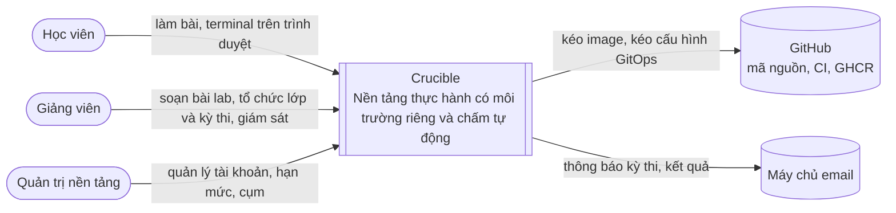
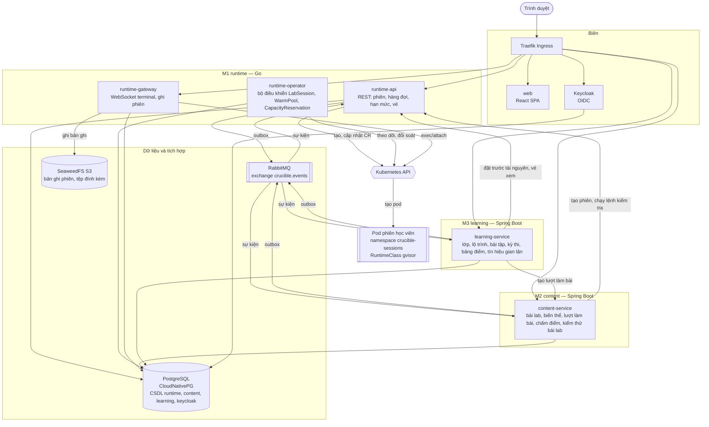
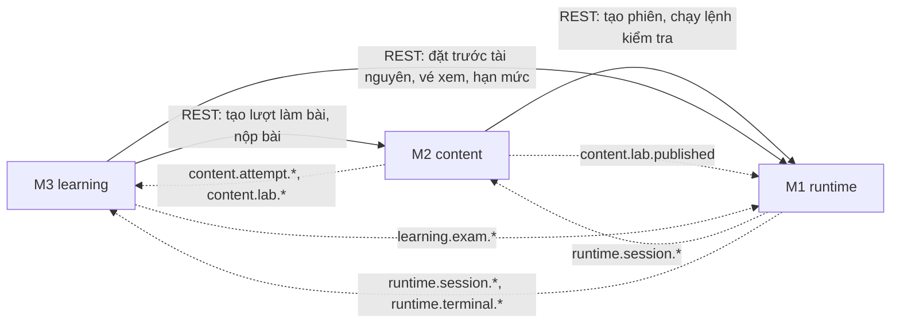
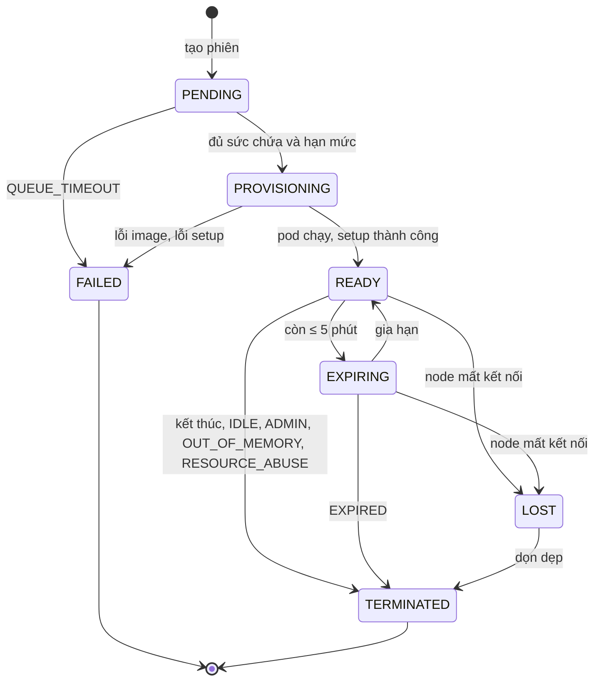
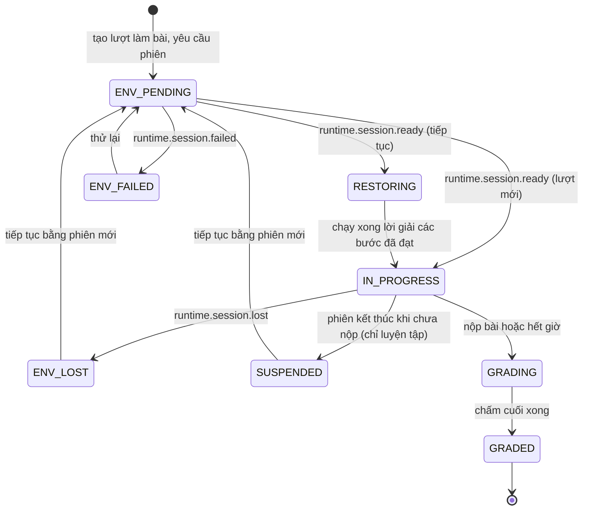
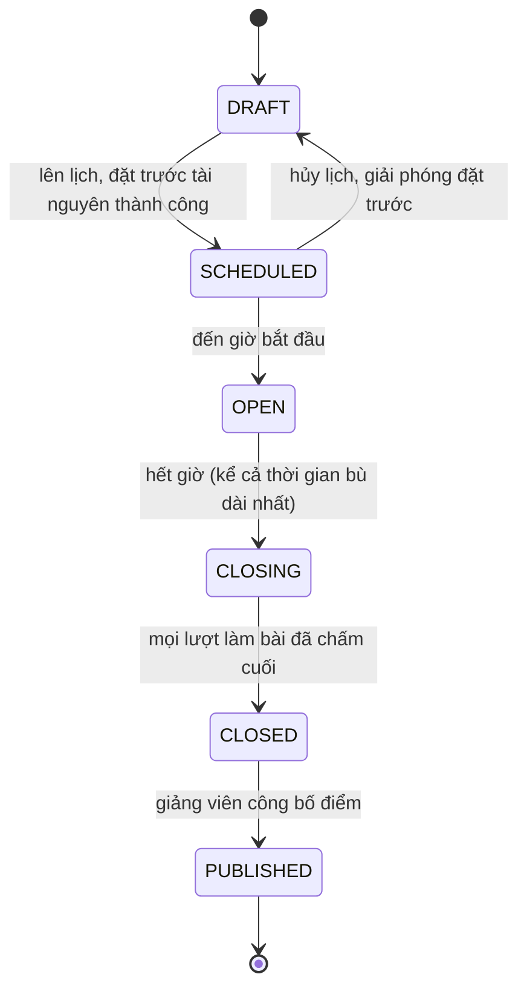
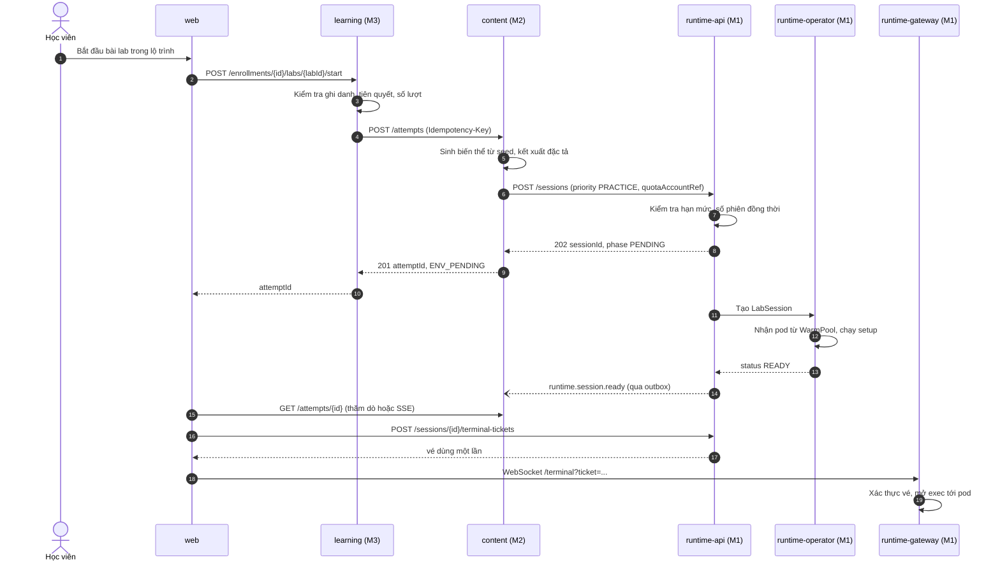
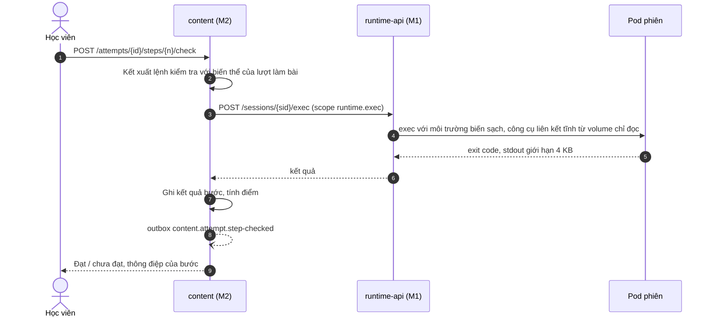
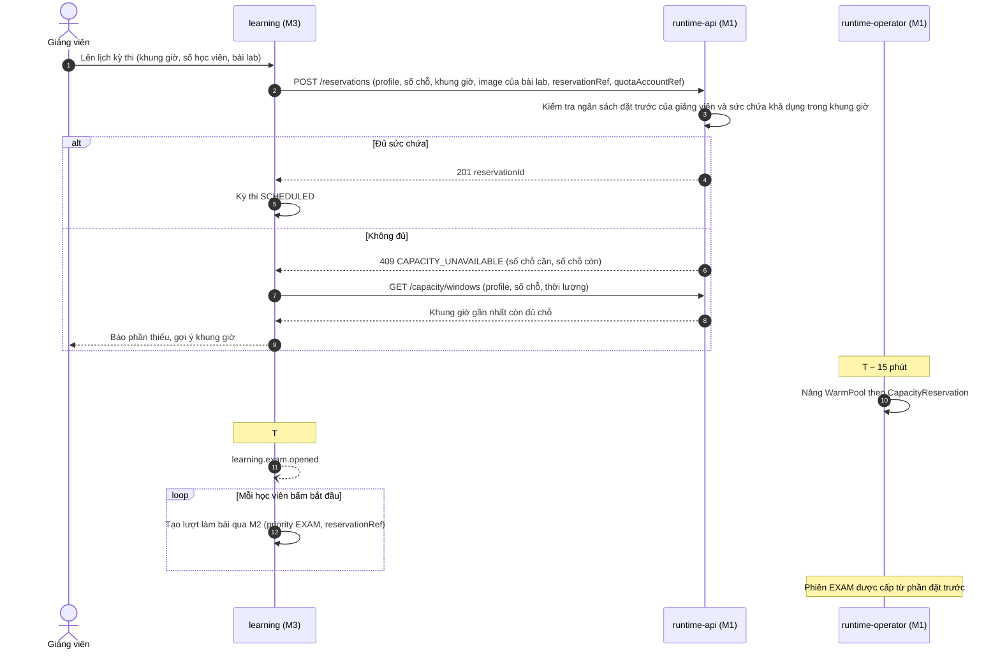
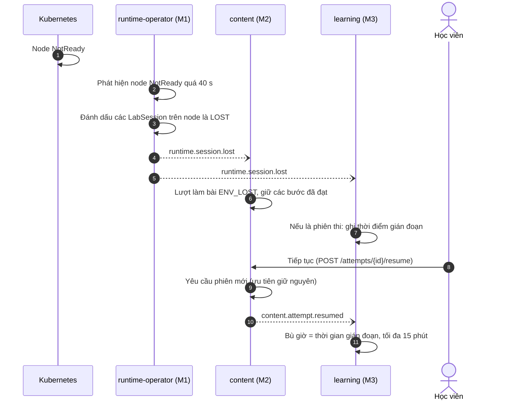

# Kiến trúc hệ thống

| Thuộc tính | Giá trị |
|---|---|
| Mã tài liệu | CR-DOC-02 |
| Phiên bản | 1.1 |
| Ngày ban hành | 17/10/2026 |
| Tài liệu liên quan | CR-DOC-01 Bài toán và phạm vi, CR-DOC-03 Hợp đồng giữa các module, CR-DOC-04 Vận hành, CR-DOC-05 Cách ly và bảo mật, ADR-0001 đến ADR-0015 |

## 1. Phạm vi

Tài liệu mô tả kiến trúc của Crucible theo mô hình C4 (ngữ cảnh, container, triển khai), ranh giới và quyền sở hữu
dữ liệu của các module, cơ chế giao tiếp, các luồng nghiệp vụ chính và các quyết định đáp ứng yêu cầu chất lượng
tại CR-DOC-01 mục 8. Thiết kế bên trong từng module được mô tả trong tài liệu của module tại `docs/modules/`.

## 2. Nguyên tắc kiến trúc

1. **Ranh giới module trùng ranh giới nghiệp vụ.** Mỗi module sở hữu dữ liệu, giao diện và quy trình triển khai của mình.
   Module khác chỉ truy cập qua hợp đồng công bố tại CR-DOC-03 (ADR-0001).
2. **Trạng thái hạ tầng được quản lý theo kiểu khai báo.** Phiên được biểu diễn bằng tài nguyên Kubernetes; bộ điều khiển
   liên tục đưa trạng thái thực tế về trạng thái mong muốn. Khởi động lại bất kỳ thành phần nào không làm mất phiên (ADR-0002).
3. **Môi trường học viên là vùng không tin cậy.** Mọi thứ chạy trong môi trường học viên được coi là có thể bị điều khiển bởi
   học viên; ranh giới cách ly được bảo đảm bởi hạ tầng, không bởi mã ứng dụng (ADR-0003, CR-DOC-05).
4. **Đồng bộ khi cần câu trả lời, bất đồng bộ khi thông báo sự việc đã xảy ra.** Sự kiện được phát qua outbox nên không mất
   khi broker gián đoạn (ADR-0005).
5. **Mọi cấu hình nằm trong kho mã.** Hạ tầng, cụm và ứng dụng được dựng lại từ kho mã bằng Terraform và GitOps (ADR-0008, ADR-0009).

## 3. Ngữ cảnh hệ thống (C4 cấp 1)

Cụm Crucible chủ động kéo image và cấu hình từ GitHub; GitHub không cần kết nối vào cụm. Điều này cho phép cụm chạy
sau NAT trên máy cá nhân (ADR-0008).

## 4. Container (C4 cấp 2)

### 4.1. Danh mục container

| Container | Module | Công nghệ | Trách nhiệm | Mở rộng |
|---|---|---|---|---|
| `web` | Dùng chung | React, Vite, nginx | Giao diện; mỗi module sở hữu thư mục tính năng riêng trong `web/src/modules/` | Nhiều bản sao, không trạng thái |
| `runtime-api` | M1 | Go | Tiếp nhận yêu cầu phiên, kiểm tra hạn mức và sức chứa, xếp hàng, cấp vé terminal, chạy lệnh kiểm tra, phát sự kiện | Nhiều bản sao, không trạng thái |
| `runtime-gateway` | M1 | Go | Cầu nối WebSocket giữa trình duyệt và pod phiên; ghi bản ghi; trích dòng lệnh cho phiên thi | Nhiều bản sao; kết nối được phân bổ lại khi khởi động lại |
| `runtime-operator` | M1 | Go, controller-runtime | Đối soát `LabSession`, `WarmPool`, `CapacityReservation` với pod thực tế; phát hiện node mất kết nối; thu hồi tài nguyên mồ côi | Một bản chạy chính nhờ bầu chọn leader, một bản dự phòng |
| `content-service` | M2 | Spring Boot 4, Java 25 | Bài lab, phiên bản, biến thể, lượt làm bài, chấm điểm, kiểm thử bài lab | Nhiều bản sao |
| `learning-service` | M3 | Spring Boot 4, Java 25 | Lớp, lộ trình, bài tập, kỳ thi, bù giờ, giám sát, tín hiệu gian lận, bảng điểm | Nhiều bản sao; tác vụ định kỳ dùng khóa phân tán (ShedLock) |
| Keycloak | Nền tảng | Keycloak | Đăng nhập, vai trò, tài khoản dịch vụ cho giao tiếp giữa module (ADR-0004) | Một bản sao |
| PostgreSQL | Nền tảng | CloudNativePG | Mỗi module một CSDL và một tài khoản riêng (ADR-0001) | Một bản chính, sao lưu WAL liên tục |
| RabbitMQ | Nền tảng | RabbitMQ, quorum queue | Phân phối sự kiện giữa các module (ADR-0005) | Một node |
| Lưu trữ đối tượng | Nền tảng | SeaweedFS (giao diện S3) | Bản ghi phiên, tệp đính kèm bài lab | Một node (ADR-0014) |

### 4.2. Tài nguyên Kubernetes do M1 định nghĩa

| Tài nguyên | Phạm vi | Ý nghĩa |
|---|---|---|
| `LabSession` | Namespace `crucible-sessions` | Một phiên: đặc tả môi trường đã kết xuất, ưu tiên, thời hạn, chủ phiên; trạng thái gồm pha, node, thời điểm sẵn sàng, thời điểm hết hạn |
| `WarmPool` | Namespace `crucible-sessions` | Nhóm môi trường ấm cho một cấu hình môi trường (image và mức tài nguyên): số lượng tối thiểu, tối đa |
| `CapacityReservation` | Namespace `crucible-sessions` | Phần sức chứa giữ cho một kỳ thi trong một khung giờ |

Trạng thái sống của phiên nằm trong tài nguyên Kubernetes; CSDL `runtime` lưu lịch sử, hàng đợi, sổ hạn mức và vé.
Chi tiết tại ADR-0002 và `docs/modules/m1-runtime.md`.

## 5. Ranh giới module và quyền sở hữu dữ liệu

| Dữ liệu | Chủ sở hữu | Module khác truy cập bằng |
|---|---|---|
| Phiên, hàng đợi, hạn mức giờ máy, vé terminal, bản ghi phiên | M1 | `runtime-api`; sự kiện `runtime.*` |
| Bài lab, phiên bản, đặc tả, biến thể, lượt làm bài, kết quả chấm | M2 | `content-api`; sự kiện `content.*` |
| Lớp, ghi danh, lộ trình, bài tập, kỳ thi, bù giờ, tín hiệu gian lận, bảng điểm | M3 | Sự kiện `learning.*` |
| Tài khoản, vai trò | Keycloak | Token OIDC; mã người dùng là `sub` của token |

Quy tắc:
- Không module nào đọc hoặc ghi CSDL của module khác. Mỗi module dùng một tài khoản CSDL chỉ có quyền trên CSDL của mình.
- Module cần dữ liệu của module khác để hiển thị thì giữ bản sao chỉ đọc được cập nhật qua sự kiện (ví dụ M3 giữ tên và
  điểm tối đa của bài lab để hiển thị lộ trình).
- M1 không biết khái niệm lớp, bài lab hay kỳ thi. M1 chỉ nhận mã tham chiếu mờ (`ownerRef`, `quotaAccountRef`,
  `reservationRef`) do module gọi cung cấp.

### 5.1. Phụ thuộc giữa các module

Phụ thuộc đồng bộ chỉ đi một chiều M3 → M2 → M1, không có vòng. M1 không gọi đồng bộ module nào nên phát triển và
kiểm thử được độc lập từ đầu.

## 6. Giao tiếp

### 6.1. Đồng bộ

| Khía cạnh | Quy định |
|---|---|
| Giao thức | REST/JSON qua HTTP; đặc tả OpenAPI 3.1 tại `contracts/` |
| Xác thực từ trình duyệt | Access token OIDC của người dùng (Authorization Code + PKCE); mỗi dịch vụ kiểm tra chữ ký bằng JWKS của Keycloak |
| Xác thực giữa dịch vụ | Token client credentials của tài khoản dịch vụ; quyền được biểu diễn bằng scope (ví dụ `runtime.exec` chỉ cấp cho M2) |
| Lặp lại an toàn | Các lệnh tạo (`POST /sessions`, `POST /attempts`) nhận header `Idempotency-Key`; gửi lại cùng khóa trả về cùng kết quả |
| Thời gian chờ và thử lại | Thời gian chờ mặc định 5 s (chạy lệnh kiểm tra 15 s); chỉ thử lại lệnh có `Idempotency-Key` hoặc lệnh đọc; ngắt mạch khi tỉ lệ lỗi cao |
| Lỗi | `application/problem+json` (RFC 9457) với trường `code` ổn định, liệt kê tại CR-DOC-03 |
| Truy vết | Header `traceparent` (W3C Trace Context) được truyền qua mọi lời gọi |

### 6.2. Bất đồng bộ

| Khía cạnh | Quy định |
|---|---|
| Broker | RabbitMQ, một topic exchange `crucible.events`; routing key là kiểu sự kiện (ví dụ `runtime.session.ready`) |
| Định dạng | CloudEvents 1.0 dạng JSON (`id`, `source`, `type`, `time`, `subject`, `data`); danh mục tại `contracts/events.asyncapi.yaml` |
| Phát | Transactional outbox: sự kiện được ghi vào bảng `outbox` trong cùng transaction với thay đổi nghiệp vụ, tiến trình chuyển tiếp đẩy lên broker |
| Nhận | Mỗi module một quorum queue cho mỗi nhóm sự kiện; xử lý idempotent bằng bảng `inbox` theo `id` sự kiện |
| Thứ tự | Không bảo đảm thứ tự toàn cục. Sự kiện về cùng một đối tượng mang `sequence` tăng dần; bên nhận bỏ qua sự kiện có `sequence` cũ hơn bản đã xử lý |
| Lỗi xử lý | Thử lại tối đa 5 lần với khoảng chờ tăng dần, sau đó chuyển vào dead-letter queue và phát cảnh báo |

### 6.3. Luồng terminal

Trình duyệt kết nối WebSocket tới `runtime-gateway` bằng vé dùng một lần do `runtime-api` cấp. Gateway mở luồng exec
tới container của phiên qua Kubernetes API, chuyển tiếp dữ liệu hai chiều, đồng thời ghi luồng ra định dạng asciicast v2
vào SeaweedFS theo từng đoạn. Kết nối xem trực tiếp dùng vé loại `VIEW`, gateway chỉ chuyển dữ liệu từ pod ra trình duyệt.
Chi tiết tại ADR-0006.

## 7. Vòng đời đối tượng

### 7.1. Phiên (M1)

### 7.2. Lượt làm bài (M2)

### 7.3. Kỳ thi (M3)

## 8. Luồng nghiệp vụ chính

### 8.1. Bắt đầu bài luyện tập

### 8.2. Kiểm tra một bước

### 8.3. Lên lịch và bắt đầu kỳ thi

### 8.4. Mất node chạy phiên

### 8.5. Kết thúc kỳ thi

| Bước | Thành phần | Hành động |
|---|---|---|
| 1 | M3 | Tác vụ định kỳ phát hiện lượt làm bài hết giờ (đã tính bù giờ), gọi `POST /attempts/{id}/submit` |
| 2 | M2 | Chạy lại toàn bộ lệnh kiểm tra trên phiên, ghi điểm cuối, phát `content.attempt.graded`, yêu cầu M1 kết thúc phiên |
| 3 | M1 | Kết thúc phiên, hoàn tất bản ghi, phát `runtime.session.terminated` và `runtime.recording.available` |
| 4 | M3 | Cập nhật bảng điểm; khi mọi lượt làm bài đã chấm, kỳ thi chuyển `CLOSED`; chạy phân tích tín hiệu gian lận |

## 9. Các vấn đề xuyên suốt

| Vấn đề | Cách giải quyết | Tham chiếu |
|---|---|---|
| Xác thực, phân quyền | Keycloak OIDC; vai trò trong token; phân quyền theo đối tượng (giảng viên của lớp nào) do module sở hữu đối tượng quyết định | ADR-0004 |
| Cách ly môi trường | gVisor, NetworkPolicy chặn mặc định, không token tài khoản dịch vụ, giới hạn tài nguyên, chính sách kiểm soát khi tạo pod | ADR-0003, CR-DOC-05 |
| Toàn vẹn chấm điểm | Lệnh kiểm tra chạy bằng `exec` từ ngoài, dùng công cụ từ volume chỉ đọc, môi trường biến sạch | ADR-0011 |
| Nhất quán dữ liệu | Outbox và inbox; mỗi thay đổi nghiệp vụ và sự kiện của nó nằm trong một transaction | ADR-0005 |
| Quan sát | OpenTelemetry cho trace và metric; log JSON có `trace_id`; Prometheus, Loki, Tempo, Grafana | ADR-0012, CR-DOC-04 |
| Cấu hình, bí mật | Cấu hình qua ConfigMap trong kho mã; bí mật mã hóa bằng Sealed Secrets trong kho mã | CR-DOC-04 |
| Thời gian | Lưu UTC (`timestamptz`), hiển thị theo `Asia/Ho_Chi_Minh`; đồng hồ các node đồng bộ NTP | |

## 10. Đáp ứng yêu cầu chất lượng

| Kịch bản | Quyết định kiến trúc |
|---|---|
| Q1, Q2 Cấp phiên nhanh, chịu tải đột biến | Nhóm môi trường ấm; đặt trước tài nguyên nâng nhóm ấm trước giờ thi; image bài lab được kéo sẵn lên node phiên (ADR-0007) |
| Q3 Sức chứa | Node phiên tách khỏi node nền tảng bằng taint; giới hạn tài nguyên theo mức cấu hình; số đo sức chứa được xác định bằng kiểm thử tải |
| Q4 Mất node | Bộ điều khiển theo dõi trạng thái node; trạng thái `LOST` và luồng tiếp tục lượt làm bài; bù giờ ở M3 |
| Q5 Không có tài nguyên mồ côi | Pod gắn `ownerReference` tới `LabSession`; bộ điều khiển đối soát định kỳ; sổ hạn mức tính theo thời điểm trong trạng thái phiên |
| Q6 Cách ly | gVisor, NetworkPolicy, chính sách kiểm soát khi tạo pod (ADR-0003) |
| Q7 Toàn vẹn chấm điểm | Lệnh kiểm tra chạy bằng công cụ từ volume chỉ đọc (ADR-0011) |
| Q8 Không mất sự kiện | Outbox, inbox, quorum queue, dead-letter queue (ADR-0005) |
| Q9 Triển khai không gián đoạn | Trạng thái phiên nằm ngoài tiến trình; gateway rút kết nối có kiểm soát, trình duyệt kết nối lại bằng vé mới; GitOps với Argo CD (ADR-0006, ADR-0008) |
| Q10 Truy vết | OpenTelemetry xuyên suốt, `traceparent` qua REST và qua thuộc tính sự kiện (ADR-0012) |
| Q11 Khôi phục dữ liệu | Sao lưu WAL liên tục của CloudNativePG tới kho lưu trữ nằm ngoài cụm (CR-DOC-04) |
| Q12 Tái lập | Terraform dựng máy ảo, cloud-init cài k3s, Argo CD dựng toàn bộ ứng dụng từ kho mã (ADR-0009) |

## 11. Giới hạn đã chấp nhận

| Giới hạn | Lý do chấp nhận |
|---|---|
| Toàn bộ cụm chạy trên một máy vật lý; hỏng máy vật lý làm dừng hệ thống | Phù hợp phạm vi học phần; kịch bản mất node được kiểm chứng bằng tắt máy ảo |
| PostgreSQL, RabbitMQ, SeaweedFS chạy một bản | Sức chứa của cụm không đủ cho bản sao; dữ liệu được bảo vệ bằng sao lưu liên tục |
| Môi trường học viên là container, không phải máy ảo | gVisor cung cấp lớp nhân riêng ở mức đủ cho bài thực hành Linux cơ bản; một số lệnh nhân hệ điều hành không khả dụng |
| Dòng lệnh dùng cho phân tích gian lận được tái dựng từ luồng nhập, không chính xác tuyệt đối | Chỉ dùng làm tín hiệu cho giảng viên xem xét, không tự động trừ điểm |

## Lịch sử thay đổi

| Phiên bản | Ngày | Nội dung |
|---|---|---|
| 1.0 | 17/10/2026 | Ban hành lần đầu |
| 1.1 | 17/10/2026 | Trình tự lên lịch kỳ thi có ngân sách đặt trước và gợi ý khung giờ; lý do kết thúc phiên mới |
