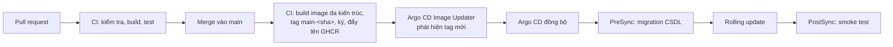

# Hạ tầng, triển khai và vận hành

| Thuộc tính | Giá trị |
|---|---|
| Mã tài liệu | CR-DOC-04 |
| Phiên bản | 1.0 |
| Ngày ban hành | 17/10/2026 |
| Tài liệu liên quan | CR-DOC-01 mục 8 (yêu cầu chất lượng), CR-DOC-02 Kiến trúc, CR-DOC-05 Cách ly và bảo mật, ADR-0007, ADR-0008, ADR-0009, ADR-0012 |

## 1. Phạm vi

Tài liệu mô tả hạ tầng chạy Crucible, cách dựng cụm, quy trình triển khai, giám sát, sao lưu, kế hoạch sức chứa,
kiểm thử tải và thí nghiệm chaos. Thao tác chi tiết cho từng tình huống vận hành được viết thành runbook tại
`docs/runbooks/` trong quá trình triển khai.

## 2. Các môi trường

| Môi trường | Mục đích | Nơi chạy | Thành phần |
|---|---|---|---|
| Phát triển | Mỗi thành viên phát triển module của mình | Máy cá nhân (Linux, macOS, Windows) | Docker Compose: PostgreSQL, RabbitMQ, SeaweedFS, Keycloak; dịch vụ của module chạy trực tiếp từ IDE; module khác chạy bằng image đã phát hành hoặc mock |
| CI | Kiểm tra mỗi pull request | GitHub Actions | Kiểm tra hợp đồng, build, kiểm thử đơn vị, kiểm thử tích hợp với Testcontainers, kiểm thử cụm trên k3d |
| Cụm chuẩn | Chạy tích hợp, demo, kiểm thử tải, chaos, đo yêu cầu chất lượng | Máy ảo KVM trên máy của trưởng nhóm | k3s, toàn bộ thành phần tại CR-DOC-02 mục 4 |

Cụm chuẩn là môi trường duy nhất có gVisor và đo được yêu cầu chất lượng. Môi trường phát triển chạy phiên bằng chế độ
`docker` của `runtime-api` (CR-DOC-03 mục 2.3).

## 3. Hạ tầng cụm chuẩn

### 3.1. Máy chủ vật lý

| Thông số | Giá trị |
|---|---|
| CPU | Intel Core i5-12500H, 16 luồng, hỗ trợ VT-x |
| Bộ nhớ | 38 GB |
| Lưu trữ máy ảo | Phân vùng `/home` (phân vùng `/` không đủ chỗ cho image máy ảo) |
| Ảo hóa | KVM, libvirt, QEMU |

### 3.2. Máy ảo

| Máy ảo | vCPU | Bộ nhớ | Đĩa | Vai trò k3s | Nhãn, taint | Thành phần |
|---|---|---|---|---|---|---|
| `cr-server` | 4 | 10 GB | 60 GB | server | `crucible.dev/role=platform` | Control plane, PostgreSQL, RabbitMQ, SeaweedFS, Keycloak, Argo CD, giám sát, dịch vụ M1–M3, giao diện |
| `cr-lab-1` | 4 | 6 GB | 40 GB | agent | `crucible.dev/role=lab`, taint `crucible.dev/role=lab:NoSchedule`, `crucible.dev/gvisor=true` | Pod phiên, máy chủ gói nội bộ |
| `cr-lab-2` | 4 | 6 GB | 40 GB | agent | Như `cr-lab-1` | Pod phiên |
| `cr-lab-3` | 4 | 6 GB | 40 GB | agent | Như `cr-lab-1` | Pod phiên |

Ngân sách bộ nhớ ước tính của `cr-server`: k3s 1,0 GB; PostgreSQL 1,0 GB; Keycloak 0,8 GB; giám sát 2,3 GB;
Argo CD 0,7 GB; RabbitMQ, SeaweedFS 0,7 GB; dịch vụ M1–M3 và giao diện 1,6 GB; thành phần nền 0,3 GB; tổng khoảng 8,4 GB.
Trên node phiên, hệ điều hành, k3s agent, thu thập log và metric chiếm khoảng 1 GB.

Tổng 28 GB bộ nhớ cho máy ảo, máy vật lý giữ khoảng 10 GB. Ba node phiên là số tối thiểu để khi mất một node, hai node
còn lại vẫn đủ chỗ cấp lại phiên bị ảnh hưởng (Q4). Khi cần giải phóng bộ nhớ cho máy vật lý, có thể tắt `cr-lab-3`;
sức chứa giảm theo mục 10.

### 3.3. Mạng

| Mục | Giá trị |
|---|---|
| Mạng libvirt | `crucible-net`, NAT, dải `10.77.0.0/24`; địa chỉ tĩnh `cr-server` = `10.77.0.10`, `cr-lab-n` = `10.77.0.1n` |
| Tên miền | `crucible.local` và `*.crucible.local` trỏ tới `10.77.0.10` (khai báo trong `/etc/hosts` của máy vật lý) |
| Lối vào | Traefik của k3s tại `cr-server`, cổng 443 |
| Chứng chỉ | cert-manager với CA nội bộ; chứng chỉ CA được nhập vào trình duyệt của người dùng cụm |
| Truy cập từ xa | Tailscale trên `cr-server`; thành viên trong tailnet truy cập giao diện, Grafana, Argo CD qua tên MagicDNS |
| Mạng pod | Flannel (mặc định của k3s); NetworkPolicy do bộ điều khiển chính sách mạng tích hợp của k3s thực thi |

### 3.4. Dựng cụm

Hạ tầng được mô tả bằng mã trong `infra/`:

| Thư mục | Công cụ | Nội dung |
|---|---|---|
| `infra/terraform/` | Terraform, provider `dmacvicar/libvirt` | Pool lưu trữ trên `/home`, mạng `crucible-net`, 4 máy ảo từ image Ubuntu Server 24.04 cloud |
| `infra/cloud-init/` | cloud-init | Người dùng quản trị, khóa SSH, cài k3s (server hoặc agent với token), cài gVisor và cấu hình containerd trên node phiên |
| `deploy/bootstrap/` | Argo CD | Cài Argo CD và ứng dụng gốc; Argo CD dựng toàn bộ phần còn lại từ kho mã |

Trình tự dựng lại toàn bộ cụm (Q12):

```bash
cd infra/terraform && terraform apply          # dựng máy ảo; cloud-init cài k3s, gVisor
./infra/scripts/fetch-kubeconfig.sh            # lấy kubeconfig từ cr-server
./deploy/bootstrap/install.sh                  # cài Argo CD, khôi phục khóa Sealed Secrets, tạo ứng dụng gốc
```

### 3.5. Namespace

| Namespace | Nội dung | Node |
|---|---|---|
| `crucible-platform` | PostgreSQL (CloudNativePG), RabbitMQ, SeaweedFS, Keycloak | platform |
| `crucible-runtime` | `runtime-api`, `runtime-gateway`, `runtime-operator` | platform |
| `crucible-content` | `content-service` | platform |
| `crucible-learning` | `learning-service` | platform |
| `crucible-web` | `web` | platform |
| `crucible-sessions` | Pod phiên, `WarmPool`, `CapacityReservation` | lab |
| `crucible-mirror` | Máy chủ gói nội bộ (apt-cacher-ng chỉ phục vụ kho gói đã khai báo, không chuyển tiếp `CONNECT`; CR-DOC-05 T3), DaemonSet kéo sẵn image bài lab | lab |
| `observability` | Prometheus, Alertmanager, Grafana, Loki, Tempo, OpenTelemetry Collector | platform |
| `argocd`, `cert-manager`, `sealed-secrets`, `cnpg-system` | Thành phần nền | platform |

## 4. Máy của thành viên

Máy của thành viên dùng hệ điều hành bất kỳ. Có ba mức tham gia:

| Mức | Bắt buộc | Linux | macOS | Windows |
|---|---|---|---|---|
| 1. Phát triển cục bộ | Có | Docker Engine | Docker Desktop hoặc OrbStack | Docker Desktop với WSL2; mã nguồn đặt trong hệ thống tệp của WSL2 |
| 2. Truy cập cụm chuẩn | Có | Tailscale | Tailscale | Tailscale |
| 3. Tham gia cụm làm node phiên | Không | k3s agent trực tiếp hoặc trong máy ảo | Máy ảo Linux (UTM, Lima hoặc OrbStack) chạy k3s agent | Máy ảo Linux (Hyper-V hoặc VirtualBox) chạy k3s agent |

**Mức 2.** Thành viên có quyền đọc toàn cụm và quyền ghi trong namespace của module mình (RoleBinding theo nhóm trong
Keycloak qua OIDC của Kubernetes API); xem Grafana, Argo CD; không có quyền trên `crucible-sessions` và `crucible-platform`.

**Mức 3.** Node từ máy thành viên tham gia cụm qua Tailscale và có các đặc điểm sau:
- Nhãn `crucible.dev/node-class=volatile`. `runtime-operator` chỉ xếp phiên `PRACTICE` và `LAB_CI` lên node loại này,
  không xếp phiên `EXAM`, vì máy cá nhân có thể tắt bất cứ lúc nào.
- Máy Apple Silicon có kiến trúc `arm64`. Image bài lab được build đa kiến trúc (`linux/amd64`, `linux/arm64`);
  image chỉ có một kiến trúc thì bộ điều khiển chỉ xếp phiên lên node cùng kiến trúc.
- Luồng terminal từ node này đi qua Tailscale nên độ trễ cao hơn node trên máy chủ chính; số đo yêu cầu chất lượng
  không tính các node này.

Mức 3 dùng cho demo nhiều máy và thí nghiệm mất node thật (tắt máy, ngắt mạng).

## 5. Triển khai

### 5.1. Luồng từ mã nguồn tới cụm



| Giai đoạn | Nội dung |
|---|---|
| Build | Mỗi dịch vụ một image; tag `main-<sha 7 ký tự>`; quét lỗ hổng bằng Trivy, chặn mức CRITICAL có bản sửa; ký bằng cosign (keyless, OIDC của GitHub Actions) |
| Cấu hình | `deploy/charts/<dịch vụ>` (Helm chart của mỗi dịch vụ), `deploy/envs/standard/` (giá trị cho cụm chuẩn), `deploy/apps/` (Argo CD Application theo mẫu app-of-apps) |
| Cập nhật image | Argo CD Image Updater theo dõi tag khớp `^main-[0-9a-f]{7}$` và cập nhật tham số của Application (ADR-0008) |
| Migration | Job PreSync chạy migration bằng tài khoản sở hữu lược đồ: Flyway cho M2, M3; golang-migrate cho M1. Migration theo nguyên tắc mở rộng rồi thu hẹp: phiên bản mới và phiên bản cũ của dịch vụ cùng chạy được trên lược đồ mới |
| Cập nhật | Rolling update, `maxUnavailable: 0`; readiness probe; PodDisruptionBudget; `runtime-gateway` có `preStop` gửi khung `closing` mã 4010 và chờ tối đa 20 giây |
| Kiểm tra sau triển khai | Job PostSync gọi endpoint kiểm tra sức khỏe và chạy một kịch bản tạo phiên, kiểm tra bước, kết thúc phiên |
| Quay lui | Quay lui từ lịch sử của Argo CD về bản đồng bộ trước; migration không bị quay lui (nguyên tắc mở rộng rồi thu hẹp bảo đảm tương thích) |

### 5.2. Cấu hình và bí mật

- Cấu hình không bí mật nằm trong `deploy/envs/standard/` dưới dạng values của Helm.
- Bí mật được mã hóa bằng Sealed Secrets và lưu trong kho mã. Khóa riêng của Sealed Secrets được sao lưu ra ngoài cụm
  (thư mục sao lưu ở mục 8) để dựng lại cụm vẫn giải mã được.
- Cấu hình realm Keycloak (client, scope, vai trò) được quản lý dạng mã bằng keycloak-config-cli; cấu hình RabbitMQ
  (exchange, policy) được nạp từ tệp definitions trong kho mã.

## 6. Phát hành và cài đặt

| Mục | Quy định |
|---|---|
| Phiên bản | Đánh số theo SemVer `MAJOR.MINOR.PATCH`; tag `vX.Y.Z` trên `main` kích hoạt phát hành |
| Sản phẩm phát hành | Image của mọi dịch vụ với tag `X.Y.Z`; Helm chart tổng `crucible` (gồm chart các dịch vụ và tùy chọn cài kèm PostgreSQL, RabbitMQ, SeaweedFS, Keycloak) đẩy lên GHCR dạng OCI; mã dựng hạ tầng tham chiếu (`infra/`); ghi chú phát hành |
| Yêu cầu của nơi cài đặt | Kubernetes từ 1.30; ít nhất một node chạy phiên có gVisor; StorageClass; Ingress controller; tùy chọn dùng PostgreSQL, RabbitMQ, S3, OIDC sẵn có của đơn vị thay cho bản cài kèm |
| Hướng dẫn | `docs/install/cai-dat.md` (cài mới trên cụm có sẵn và trên máy ảo theo `infra/`), `docs/install/nang-cap.md`, `docs/install/cau-hinh.md` (bảng tham số của chart) |
| Nâng cấp | Hỗ trợ nâng cấp tuần tự giữa các phiên bản MINOR liên tiếp; migration theo nguyên tắc mở rộng rồi thu hẹp; CRD được nâng cấp trước dịch vụ |
| Kiểm thử nâng cấp | Job CI trên k3d: cài bản phát hành trước, tạo dữ liệu mẫu và một phiên đang chạy, nâng cấp lên mã hiện tại, kiểm tra dữ liệu và phiên (Q14) |
| Cụm chuẩn | Theo dõi `main` qua GitOps (mục 5); mỗi bản phát hành được cài thử trên một namespace sạch trước khi gắn tag |

## 7. Giám sát

### 7.1. Thành phần

| Thành phần | Vai trò | Lưu giữ |
|---|---|---|
| OpenTelemetry Collector | Nhận trace và metric OTLP từ dịch vụ, chuyển tới Tempo và Prometheus | |
| Prometheus | Metric của cụm và dịch vụ; đánh giá luật cảnh báo | 7 ngày |
| Loki, Grafana Alloy | Log JSON của mọi pod | 7 ngày |
| Tempo | Trace | 3 ngày |
| Grafana | Dashboard; đăng nhập qua Keycloak | |
| Alertmanager | Gửi cảnh báo tới kênh chat của nhóm | |

### 7.2. Chỉ số nghiệp vụ

| Chỉ số | Loại | Nhãn | Dùng cho |
|---|---|---|---|
| `crucible_session_ready_seconds` | Histogram | `priority`, `source` (`warm`, `cold`) | Q1, Q2 |
| `crucible_sessions` | Gauge | `phase`, `priority`, `node` | Sức chứa |
| `crucible_session_queue_length` | Gauge | `priority` | Q2, AC-R2.1 |
| `crucible_warm_pool_available` | Gauge | `profile`, `image` | Q1 |
| `crucible_reservation_slots` | Gauge | `reservation`, `state` (`reserved`, `in_use`) | AC-R2.2 |
| `crucible_orphan_resources` | Gauge | `kind` | Q5 |
| `crucible_exec_duration_seconds` | Histogram | `result` | AC-C2.3 |
| `crucible_terminal_connections` | Gauge | `mode` | Q3 |
| `crucible_session_cpu_ratio` | Histogram | `priority` | CPU dùng của phiên so với giới hạn, phục vụ chỉnh ngưỡng BR-M1.22 |
| `crucible_resource_violations_total` | Counter | `priority`, `action` | AC-R5.1–AC-R5.3 |
| `crucible_terminal_rtt_seconds` | Histogram | | Q3 |
| `crucible_outbox_lag_seconds` | Gauge | `service` | Q8 |
| `crucible_events_dead_lettered_total` | Counter | `queue` | Q8 |

### 7.3. Mục tiêu mức dịch vụ và cảnh báo

| SLO | Mục tiêu | Cửa sổ |
|---|---|---|
| Phiên luyện tập sẵn sàng trong 5 giây | 95% | 7 ngày |
| Lệnh kiểm tra hoàn tất trong 3 giây | 95% | 7 ngày |
| Yêu cầu API của mỗi module thành công (không tính lỗi 4xx) | 99% | 7 ngày |

| Cảnh báo | Điều kiện |
|---|---|
| Tiêu hao ngân sách lỗi nhanh | Tốc độ tiêu hao SLO gấp 14 lần trong 1 giờ và 5 phút |
| Tài nguyên mồ côi | `crucible_orphan_resources > 0` trong 5 phút |
| Sự kiện vào dead-letter | `increase(crucible_events_dead_lettered_total[5m]) > 0` |
| Outbox chậm | `crucible_outbox_lag_seconds > 60` |
| Hết nhóm ấm khi có hàng đợi | `crucible_warm_pool_available == 0` và `crucible_session_queue_length > 0` trong 2 phút |
| Thiếu sức chứa trước kỳ thi | 15 phút trước giờ bắt đầu, nhóm ấm nhỏ hơn số chỗ đặt trước |
| Node không sẵn sàng | Node `NotReady` quá 1 phút |
| CPU node phiên bão hòa | CPU dùng của một node phiên trên 90% trong 10 phút (dấu hiệu nhiều phiên nặng hoặc ngưỡng giám sát chưa phù hợp) |
| Sao lưu thất bại | Lần sao lưu gần nhất quá 26 giờ hoặc WAL không được lưu quá 15 phút |

### 7.4. Dashboard

| Dashboard | Nội dung |
|---|---|
| Tổng quan SLO | Các SLO, ngân sách lỗi còn lại |
| Phiên và sức chứa | Phiên theo pha, theo node; hàng đợi; nhóm ấm; đặt trước; thời gian sẵn sàng theo nguồn; phiên dùng CPU cao nhất; số lần phát hiện dùng CPU bất thường |
| Kỳ thi | Theo thời gian thực trong kỳ thi: học viên đã bắt đầu, phiên đang chạy, lỗi, bù giờ |
| Dịch vụ | Tốc độ yêu cầu, tỉ lệ lỗi, độ trễ của mỗi dịch vụ; outbox; hàng đợi RabbitMQ |
| Cụm | Tài nguyên theo node, theo namespace |

## 8. Sao lưu và khôi phục

| Dữ liệu | Cách sao lưu | Nơi lưu | Mục tiêu |
|---|---|---|---|
| PostgreSQL | CloudNativePG: lưu WAL liên tục (`archive_timeout` 5 phút) và sao lưu nền hằng ngày, giữ 7 ngày | SeaweedFS ngoài cụm (giao diện S3), chạy bằng Docker trên máy vật lý | RPO ≤ 15 phút, RTO ≤ 30 phút (Q11) |
| Bản ghi phiên | Đồng bộ hằng ngày sang kho ngoài cụm; giữ 30 ngày | SeaweedFS ngoài cụm | Mất tối đa 1 ngày bản ghi |
| Khóa Sealed Secrets | Xuất thủ công sau mỗi lần xoay vòng | Thư mục mã hóa ngoài cụm | Bắt buộc để dựng lại cụm |
| Cấu hình hạ tầng, cụm, ứng dụng | Kho mã | GitHub | Dựng lại từ kho mã (Q12) |

Diễn tập khôi phục PostgreSQL về một thời điểm (point-in-time recovery) vào một cluster mới được thực hiện ít nhất một
lần trước khi bảo vệ, có biên bản ghi thời gian thực tế.

## 9. Kiểm thử tải

Kiểm thử tải chạy bằng k6 từ máy vật lý (ngoài cụm), giả lập học viên qua HTTP và WebSocket.

| Kịch bản | Mô tả | Yêu cầu kiểm chứng |
|---|---|---|
| `practice-steady` | 20 học viên giả lập liên tục bắt đầu bài, gõ lệnh mỗi 2–5 giây, kiểm tra bước, kết thúc | Q1, AC-C2.3 |
| `exam-burst` | Đặt trước 30 chỗ; 30 học viên bắt đầu trong 60 giây; làm bài 10 phút; tất cả nộp khi hết giờ | Q2, AC-L2.2, AC-L2.3 |
| `capacity-search` | Tăng dần số phiên đồng thời có thao tác tới khi vi phạm Q1 hoặc độ trễ terminal | Q3 |
| `cold-start` | Nhóm ấm bằng 0; đo thời gian sẵn sàng khi image đã được kéo sẵn và chưa được kéo sẵn | AC-R1.2 |

Kết quả mỗi lần chạy (phiên bản dịch vụ, cấu hình cụm, số đo) được lưu tại `tests/load/results/`.

## 10. Kế hoạch sức chứa

| Mức tài nguyên | Bộ nhớ (request = limit) | CPU request / limit | Chi phí gVisor (RuntimeClass overhead) | Tổng bộ nhớ một phiên |
|---|---|---|---|---|
| `small` | 256 MiB | 100m / 1000m | 64 MiB, 50m | 320 MiB |
| `medium` | 512 MiB | 200m / 2000m | 64 MiB, 50m | 576 MiB |

Bộ nhớ dùng request bằng limit để tránh node hết bộ nhớ khi nhiều phiên cùng hoạt động; CPU cho phép vượt request vì
phiên thực hành phần lớn thời gian chờ thao tác.

| Cấu hình cụm | Bộ nhớ khả dụng cho phiên | Số phiên `small` ước tính |
|---|---|---|
| 3 node phiên (cụm chuẩn) | Khoảng 3 × 5,0 GB | Khoảng 45 |
| 2 node phiên | Khoảng 2 × 5,0 GB | Khoảng 30 |

Số ước tính dùng để lập kế hoạch. Số phiên cam kết được xác định bằng kịch bản `capacity-search` (mục 9) và ghi vào
báo cáo sức chứa. `runtime-api` tính sức chứa khả dụng theo số liệu thực tế của node, không theo bảng trên.

## 11. Thí nghiệm chaos

Mỗi thí nghiệm có giả thuyết, cách thực hiện và tiêu chí đạt; kết quả được ghi thành biên bản tại `tests/chaos/reports/`.
Chaos Mesh chỉ được cài trong thời gian thí nghiệm. Sự cố mức máy ảo được tạo bằng `virsh`.

| Mã | Giả thuyết | Cách thực hiện | Tiêu chí đạt |
|---|---|---|---|
| CH1 | Mất một node phiên không làm mất điểm và học viên được cấp lại môi trường | `virsh destroy cr-lab-2` khi có 20 phiên đang làm bài | Q4 |
| CH2 | Bộ điều khiển khởi động lại không làm mất hoặc nhân đôi phiên | Xóa pod `runtime-operator` liên tục 5 lần trong lúc chạy `exam-burst` | Q5; mọi học viên có đúng một phiên |
| CH3 | Pod phiên bị xóa ngoài ý muốn được phát hiện | Xóa ngẫu nhiên 5 pod phiên | Phiên chuyển `LOST` ≤ 60 s; không tài nguyên mồ côi |
| CH4 | Broker gián đoạn không làm mất sự kiện | Dừng RabbitMQ 2 phút trong lúc có phiên kết thúc và bài được chấm | Q8 |
| CH5 | Mạng chậm tới node phiên làm giảm trải nghiệm nhưng không gây lỗi | Thêm độ trễ 200 ms tới `cr-lab-1` bằng NetworkChaos | Không phiên nào bị kết thúc; terminal hoạt động |
| CH6 | PostgreSQL khởi động lại không gây lỗi dữ liệu | Xóa pod PostgreSQL chính | Dịch vụ phục hồi ≤ 2 phút; không mất dữ liệu đã xác nhận |
| CH7 | Cập nhật dịch vụ trong lúc tải không làm gián đoạn phiên | Triển khai phiên bản mới của `runtime-gateway` và `content-service` khi đang chạy `practice-steady` | Q9 |

## 12. Runbook

| Runbook | Tình huống |
|---|---|
| `dung-lai-cum.md` | Dựng lại toàn bộ cụm từ kho mã |
| `khoi-phuc-csdl.md` | Khôi phục PostgreSQL về một thời điểm |
| `xu-ly-dead-letter.md` | Xem, sửa, phát lại sự kiện trong dead-letter queue |
| `node-mat-ket-noi.md` | Xử lý node phiên mất kết nối, đưa node trở lại |
| `chuan-bi-ky-thi.md` | Kiểm tra sức chứa, nhóm ấm, image đã kéo sẵn trước kỳ thi |
| `them-node.md` | Thêm node phiên (máy ảo hoặc máy thành viên) |
| `xoay-vong-bi-mat.md` | Xoay vòng mật khẩu CSDL, khóa ký biến thể, khóa Sealed Secrets |

## Lịch sử thay đổi

| Phiên bản | Ngày | Nội dung |
|---|---|---|
| 1.0 | 17/10/2026 | Ban hành lần đầu |
