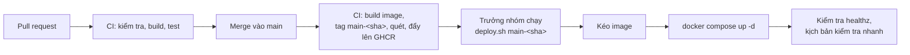

# Hạ tầng, triển khai và vận hành

| Thuộc tính | Giá trị |
|---|---|
| Mã tài liệu | CR-DOC-04 |
| Phiên bản | 1.2 |
| Ngày ban hành | 27/10/2026 |
| Tài liệu liên quan | CR-DOC-01 mục 8 (yêu cầu chất lượng), CR-DOC-02 Kiến trúc, CR-DOC-05 Cách ly và bảo mật, ADR-0003, ADR-0007, ADR-0008, ADR-0009, ADR-0012 |

## 1. Phạm vi

Tài liệu mô tả hạ tầng chạy Crucible, cách dựng môi trường chuẩn, quy trình triển khai, giám sát, sao lưu, kế hoạch
sức chứa, đo yêu cầu chất lượng và thí nghiệm sự cố. Thao tác chi tiết cho từng tình huống vận hành được viết thành
runbook tại `docs/runbooks/` trong quá trình triển khai.

## 2. Các môi trường

| Môi trường | Mục đích | Nơi chạy | Thành phần |
|---|---|---|---|
| Phát triển | Mỗi thành viên phát triển module của mình | Máy cá nhân (Linux, macOS, Windows) | Docker Compose (`dev/compose.yaml`): PostgreSQL, RabbitMQ, SeaweedFS, Keycloak, Mailpit; dịch vụ của module chạy trực tiếp từ IDE; module khác chạy bằng image hoặc mock |
| CI | Kiểm tra mỗi pull request | GitHub Actions | Kiểm tra hợp đồng, build, kiểm thử đơn vị, kiểm thử tích hợp với Testcontainers và Docker của runner |
| Môi trường chuẩn | Chạy tích hợp, demo, đo yêu cầu chất lượng, thí nghiệm sự cố | Hai máy ảo KVM trên máy của trưởng nhóm | Toàn bộ thành phần tại CR-DOC-02 mục 4 |

Môi trường chuẩn là môi trường duy nhất chạy phiên bằng gVisor và đo được yêu cầu chất lượng. Môi trường phát triển chạy
phiên bằng Docker với runtime `runc` (CR-DOC-03 mục 2.3).

## 3. Hạ tầng môi trường chuẩn

### 3.1. Máy chủ vật lý

| Thông số | Giá trị |
|---|---|
| CPU | Intel Core i5-12500H, 16 luồng, hỗ trợ VT-x |
| Bộ nhớ | 38 GB |
| Lưu trữ máy ảo | Phân vùng `/home` (phân vùng `/` không đủ chỗ cho image máy ảo) |
| Ảo hóa | KVM, libvirt, QEMU |

### 3.2. Máy ảo

| Máy ảo | vCPU | Bộ nhớ | Đĩa | Thành phần |
|---|---|---|---|---|
| `cr-server` | 4 | 10 GB | 60 GB | Caddy, PostgreSQL, RabbitMQ, SeaweedFS, Keycloak, Prometheus, Grafana, Dozzle, dịch vụ M1–M3, giao diện, tác vụ sao lưu |
| `cr-lab` | 8 | 16 GB | 30 GB hệ điều hành + 60 GB riêng cho `/var/lib/containerd` | Docker Engine, gVisor, container phiên, máy chủ gói nội bộ `crucible-mirror` |

Ngân sách bộ nhớ ước tính của `cr-server`: hệ điều hành và Docker 0,5 GB; PostgreSQL 1,0 GB; Keycloak 0,8 GB;
RabbitMQ, SeaweedFS 0,7 GB; Prometheus, Grafana 0,6 GB; dịch vụ M1–M3 và giao diện 1,6 GB; Caddy, Dozzle 0,1 GB; tổng
khoảng 5,3 GB. Số đo thực tế được xác định ở thử nghiệm S5.

Trên `cr-lab`, hệ điều hành, Docker Engine và máy chủ gói nội bộ chiếm khoảng 1,5 GB; `LAB_RESERVED_MEMORY` đặt 2 GiB.
Tổng 26 GB bộ nhớ cho máy ảo, máy vật lý giữ khoảng 12 GB.

### 3.3. Mạng

| Mục | Giá trị |
|---|---|
| Mạng libvirt | `crucible-net`, NAT, dải `10.77.0.0/24`; địa chỉ tĩnh `cr-server` = `10.77.0.10`, `cr-lab` = `10.77.0.11` |
| Tên miền | `crucible.local` và `*.crucible.local` trỏ tới `10.77.0.10` (khai báo trong `/etc/hosts` của máy vật lý) |
| Lối vào | Caddy tại `cr-server`, cổng 443; định tuyến `/api/<module>`, `/auth`, terminal WebSocket, giao diện |
| Chứng chỉ | CA nội bộ của Caddy (`tls internal`); chứng chỉ CA được nhập vào trình duyệt của người dùng |
| Truy cập từ xa | Tailscale trên `cr-server`; thành viên trong tailnet truy cập giao diện, Grafana, Dozzle qua tên MagicDNS |
| `cr-lab` | Tường lửa (`ufw`) chỉ nhận SSH từ `cr-server` và máy vật lý; Docker Engine không mở cổng TCP |
| Mạng của phiên | Mạng Docker trên `cr-lab`; `default-address-pools` dải `172.30.0.0/16`, mỗi mạng một khối `/28` (CR-MOD-M1 mục 3.2) |

### 3.4. Dựng môi trường chuẩn

Hạ tầng được mô tả bằng mã trong `infra/`:

| Đường dẫn | Công cụ | Nội dung |
|---|---|---|
| `infra/create-vms.sh` | `virsh`, `virt-install` | Pool lưu trữ trên `/home`, mạng `crucible-net`, hai máy ảo từ image Ubuntu Server 24.04 cloud; khóa SSH của `runtime-api` sinh trên máy quản trị, ngoài kho mã; ghi khóa máy của `cr-lab` vào `known_hosts` của `cr-server` |
| `infra/destroy-vms.sh` | `virsh` | Xóa hai máy ảo cùng đĩa, giữ mạng, pool và image gốc |
| `infra/libvirt/crucible-net.xml` | libvirt | Mạng NAT `10.77.0.0/24`, địa chỉ tĩnh theo địa chỉ MAC |
| `infra/cloud-init/cr-server.yaml` | cloud-init | Người dùng quản trị, khóa SSH, Docker Engine, Tailscale, khóa SSH của `runtime-api` để vào `cr-lab` |
| `infra/cloud-init/cr-lab.yaml` | cloud-init | Người dùng quản trị, tài khoản `crucible` (nhóm `docker`) nhận khóa của `runtime-api`, Docker Engine, gVisor, cấu hình Docker, `ufw` |
| `deploy/` | Docker Compose | Cấu hình ứng dụng trên `cr-server` (mục 5) |

Trình tự dựng lại toàn bộ môi trường (Q12):

```bash
./infra/create-vms.sh                       # dựng hai máy ảo; cloud-init cài Docker, gVisor, Tailscale
scp deploy/.env cr-server:/opt/crucible/    # bí mật lấy từ bản sao lưu (mục 8)
ssh cr-server /opt/crucible/deploy.sh <tag> # kéo image, khởi động toàn bộ dịch vụ
```

Cấu hình Docker của `cr-lab` (`/etc/docker/daemon.json`) do cloud-init ghi:

| Khóa | Giá trị | Lý do |
|---|---|---|
| `runtimes.runsc` | `path: /usr/bin/runsc`, `runtimeArgs: ["--platform=systrap", "--overlay2=root:self,size=1g"]` | Khai báo gVisor; lớp ghi của hệ thống tệp gốc là tệp trên đĩa, mỗi container tối đa 1 GiB (S1) |
| `default-runtime` | `runsc` | Mọi container trên máy phiên chạy trong gVisor (ADR-0003) |
| `no-new-privileges` | `true` | Mặc định cho mọi container |
| `icc` | `false` | Container trên mạng `bridge` mặc định không liên lạc với nhau |
| `live-restore` | `true` | Khởi động lại Docker Engine không dừng container phiên |
| `default-address-pools` | `[{"base": "172.30.0.0/16", "size": 28}]` | Đủ khối địa chỉ cho mạng riêng của từng phiên |
| `log-driver`, `log-opts` | `local`, `max-size: 1m` | Đầu ra của container phiên không làm đầy đĩa |

Docker Engine 29 lưu image và lớp ghi của container qua containerd tại `/var/lib/containerd`; đĩa riêng 60 GB của
`cr-lab` được gắn tại đường dẫn này nên dữ liệu của phiên không làm đầy đĩa hệ điều hành. Lớp ghi của gVisor mặc định
không giới hạn dung lượng và không thu hồi phần đã xóa bên trong môi trường; giới hạn `size=1g` của runtime `runsc` áp
dụng chung cho mọi container phiên, 44 phiên ghi đầy chiếm khoảng 44 GiB.

Container phiên bị giới hạn 512 tiến trình (`PidsLimit`). Với gVisor, giới hạn áp dụng cho cả sandbox: mỗi tiến trình
trong sandbox tốn khoảng hai tiến trình trên máy cộng phần cố định khoảng 45, nên số tiến trình học viên dùng được thấp
hơn 512. Giới hạn đếm tác vụ nên mỗi luồng của một tiến trình chiếm một suất, và tiến trình đã kết thúc chưa được
thu dọn cũng vậy; PID 1 của container phiên là tiến trình khởi tạo của Docker (BR-M1.31) nên các suất này được
trả lại. Đỉnh thực tế của từng bài mẫu được đọc từ `pids.peak` ở thử nghiệm S4. Lệnh cài gói trong cloud-init chạy với
`DEBIAN_FRONTEND=noninteractive`.

### 3.5. Dịch vụ trên `cr-server`

Mọi dịch vụ chạy trong một dự án Docker Compose `crucible` (`deploy/compose.yaml`):

| Nhóm | Dịch vụ |
|---|---|
| Lối vào | `caddy` |
| Nền tảng | `postgres`, `rabbitmq`, `seaweedfs`, `keycloak` |
| Ứng dụng | `runtime-api`, `content-service`, `learning-service`, `web` |
| Quan sát | `prometheus`, `grafana`, `node-exporter`, `dozzle` |
| Tác vụ | `backup` (sao lưu theo lịch, mục 8) |

Trên `cr-lab`, ngoài container phiên chỉ có `crucible-mirror` (apt-cacher-ng chỉ phục vụ kho gói đã khai báo, không
chuyển tiếp `CONNECT`; CR-DOC-05 T3) và `node-exporter`.

## 4. Máy của thành viên

Máy của thành viên dùng hệ điều hành bất kỳ:

| Mức | Bắt buộc | Linux | macOS | Windows |
|---|---|---|---|---|
| 1. Phát triển cục bộ | Có | Docker Engine | Docker Desktop hoặc OrbStack | Docker Desktop với WSL2; mã nguồn đặt trong hệ thống tệp của WSL2 |
| 2. Truy cập môi trường chuẩn | Có | Tailscale | Tailscale | Tailscale |

Ở mức 2, thành viên dùng giao diện như người dùng cuối, xem Grafana và xem log của mọi dịch vụ qua Dozzle (chỉ đọc).
Thành viên không có tài khoản SSH trên hai máy ảo; mọi thay đổi trên môi trường chuẩn đi qua kho mã và script triển khai.

## 5. Triển khai

### 5.1. Luồng từ mã nguồn tới môi trường chuẩn



| Giai đoạn | Nội dung |
|---|---|
| Build | Mỗi dịch vụ một image; tag `main-<sha 7 ký tự>`; quét lỗ hổng bằng Trivy, chặn mức CRITICAL có bản sửa |
| Cấu hình | `deploy/compose.yaml`, `deploy/caddy/Caddyfile`, `deploy/prometheus/`, `deploy/grafana/` (dashboard, luật cảnh báo), `deploy/rabbitmq/definitions.json`, `deploy/keycloak/realm-crucible.json`, `deploy/.env.example` |
| Triển khai | `deploy.sh <tag>` ghi tag vào `IMAGE_TAG` của `.env`, `docker compose pull`, `docker compose up -d`; chỉ dịch vụ có image hoặc cấu hình thay đổi bị khởi động lại; ghi tag và thời điểm vào `/opt/crucible/deploy.log` |
| Migration | Mỗi dịch vụ chạy migration khi khởi động bằng tài khoản sở hữu lược đồ: Flyway cho M2, M3; golang-migrate cho M1. Migration theo nguyên tắc mở rộng rồi thu hẹp: phiên bản mới và phiên bản cũ của dịch vụ cùng chạy được trên lược đồ mới |
| Dừng có kiểm soát | `stop_grace_period` 25 giây; `runtime-api` gửi khung `closing` mã 4010 cho mọi terminal và đẩy phần bản ghi còn đệm trước khi thoát |
| Kiểm tra sau triển khai | Script gọi `healthz` của từng dịch vụ và chạy một kịch bản tạo phiên, kiểm tra bước, kết thúc phiên |
| Quay lui | Chạy lại `deploy.sh` với tag trước đó (lấy từ `deploy.log`); migration không bị quay lui (nguyên tắc mở rộng rồi thu hẹp bảo đảm tương thích) |

### 5.2. Cấu hình và bí mật

- Cấu hình không bí mật nằm trong `deploy/`.
- Bí mật (mật khẩu CSDL, secret của client Keycloak, khóa ký biến thể, khóa S3, khóa SSH của `runtime-api`) nằm trong
  `/opt/crucible/.env` và `/opt/crucible/secrets/` trên `cr-server`, quyền 600, chủ sở hữu là tài khoản quản trị. Kho mã
  chỉ chứa `deploy/.env.example`. Bản sao mã hóa của bí mật được giữ ngoài máy ảo (mục 8).
- Realm Keycloak được nạp từ `deploy/keycloak/realm-crucible.json` khi khởi tạo; thay đổi về sau (client, scope, vai trò)
  được áp dụng bằng keycloak-config-cli chạy một lần trong `deploy.sh`. Cấu hình RabbitMQ (exchange, policy) được nạp từ
  `deploy/rabbitmq/definitions.json`.

## 6. Phát hành và cài đặt

| Mục | Quy định |
|---|---|
| Phiên bản | Đánh số theo SemVer `MAJOR.MINOR.PATCH`; tag `vX.Y.Z` trên `main` kích hoạt phát hành |
| Sản phẩm phát hành | Image của mọi dịch vụ với tag `X.Y.Z` trên GHCR; gói `deploy/` (Compose, cấu hình mẫu); mã dựng hạ tầng tham chiếu (`infra/`); ghi chú phát hành |
| Yêu cầu của nơi cài đặt | Máy Linux có Docker Engine cho nền tảng; máy Linux có Docker Engine và gVisor cho phiên (có thể là cùng máy, không khuyến nghị); tùy chọn dùng PostgreSQL, RabbitMQ, S3, OIDC sẵn có của đơn vị thay cho bản cài kèm |
| Hướng dẫn | `docs/install/cai-dat.md` (cài mới trên máy có sẵn và trên máy ảo theo `infra/`), `docs/install/nang-cap.md`, `docs/install/cau-hinh.md` (bảng biến của `.env`) |
| Nâng cấp | Hỗ trợ nâng cấp tuần tự giữa các phiên bản MINOR liên tiếp; migration theo nguyên tắc mở rộng rồi thu hẹp |
| Kiểm thử nâng cấp | Job CI: chạy bản phát hành trước bằng Compose, tạo dữ liệu mẫu và một phiên đang chạy, nâng cấp lên mã hiện tại, kiểm tra dữ liệu và phiên (Q14) |

## 7. Giám sát

### 7.1. Thành phần

| Thành phần | Vai trò | Lưu giữ |
|---|---|---|
| Prometheus | Metric của dịch vụ và hai máy ảo (`node-exporter`); đánh giá luật cảnh báo | 7 ngày |
| Grafana | Dashboard; đăng nhập qua Keycloak; gửi cảnh báo tới kênh chat của nhóm | |
| Dozzle | Xem log của container trên `cr-server` (chỉ đọc) | Theo `log-opts` của Docker |

### 7.2. Chỉ số nghiệp vụ

| Chỉ số | Loại | Nhãn | Dùng cho |
|---|---|---|---|
| `crucible_session_ready_seconds` | Histogram | `priority` | Q1, Q2 |
| `crucible_sessions` | Gauge | `phase`, `priority`, `profile` | Sức chứa |
| `crucible_session_queue_length` | Gauge | `priority` | Q2, AC-R2.1 |
| `crucible_capacity_slots` | Gauge | `profile`, `state` (`total`, `used`, `reserved`) | Q3, AC-R2.2 |
| `crucible_lab_up` | Gauge | | Q4 |
| `crucible_prepull_pending` | Gauge | | Image cần kéo sẵn chưa có trên máy phiên |
| `crucible_orphan_resources` | Gauge | `kind` (`container`, `network`) | Q5 |
| `crucible_exec_duration_seconds` | Histogram | `result` | AC-C2.3 |
| `crucible_terminal_connections` | Gauge | `mode` | Q3 |
| `crucible_terminal_rtt_seconds` | Histogram | | Q3 |
| `crucible_session_cpu_ratio` | Histogram | `priority` | CPU dùng của phiên so với giới hạn, phục vụ chỉnh ngưỡng BR-M1.22 |
| `crucible_resource_violations_total` | Counter | `priority`, `action` | AC-R5.1–AC-R5.3 |
| `crucible_outbox_lag_seconds` | Gauge | `service` | Q8 |
| `crucible_events_dead_lettered_total` | Counter | `queue` | Q8 |
| `crucible_backup_last_success_timestamp` | Gauge | `target` | Q11 |

### 7.3. Mục tiêu mức dịch vụ và cảnh báo

| SLO | Mục tiêu | Cửa sổ |
|---|---|---|
| Phiên luyện tập sẵn sàng trong 5 giây | 95% | 7 ngày |
| Lệnh kiểm tra hoàn tất trong 3 giây | 95% | 7 ngày |
| Yêu cầu API của mỗi module thành công (không tính lỗi 4xx) | 99% | 7 ngày |

| Cảnh báo | Điều kiện |
|---|---|
| Tiêu hao ngân sách lỗi nhanh | Tốc độ tiêu hao SLO gấp 14 lần trong 1 giờ và 5 phút |
| Máy phiên mất kết nối | `crucible_lab_up == 0` trong 1 phút |
| Tài nguyên mồ côi | `crucible_orphan_resources > 0` trong 5 phút |
| Sự kiện vào dead-letter | `increase(crucible_events_dead_lettered_total[5m]) > 0` |
| Outbox chậm | `crucible_outbox_lag_seconds > 60` |
| Hàng đợi kéo dài | `crucible_session_queue_length > 0` trong 5 phút |
| Image kỳ thi chưa kéo sẵn | `crucible_prepull_pending > 0` trong 15 phút |
| CPU máy phiên bão hòa | CPU dùng của `cr-lab` trên 90% trong 10 phút (dấu hiệu nhiều phiên nặng hoặc ngưỡng giám sát chưa phù hợp) |
| Đĩa gần đầy | Một phân vùng của hai máy ảo dùng trên 85% |
| Sao lưu thất bại | Lần sao lưu CSDL thành công gần nhất quá 2 giờ |

### 7.4. Dashboard

| Dashboard | Nội dung |
|---|---|
| Tổng quan SLO | Các SLO, ngân sách lỗi còn lại |
| Phiên và sức chứa | Phiên theo pha, theo mức tài nguyên; hàng đợi; chỗ đã dùng, chỗ đặt trước; thời gian sẵn sàng; phiên dùng CPU cao nhất; số lần phát hiện dùng CPU bất thường |
| Kỳ thi | Theo thời gian thực trong kỳ thi: học viên đã bắt đầu, phiên đang chạy, lỗi, bù giờ |
| Dịch vụ | Tốc độ yêu cầu, tỉ lệ lỗi, độ trễ của mỗi dịch vụ; outbox; hàng đợi RabbitMQ |
| Máy ảo | CPU, bộ nhớ, đĩa, mạng của `cr-server` và `cr-lab` |

## 8. Sao lưu và khôi phục

| Dữ liệu | Cách sao lưu | Nơi lưu | Mục tiêu |
|---|---|---|---|
| PostgreSQL | Dịch vụ `backup` chạy `pg_dump -Fc` cho từng CSDL mỗi giờ; giữ 48 bản theo giờ và 14 bản theo ngày | SeaweedFS (bucket `backups`); bản theo ngày chép ra máy vật lý | RPO ≤ 1 giờ, RTO ≤ 30 phút (Q11) |
| Bản ghi phiên | Chép hằng ngày ra máy vật lý; giữ 30 ngày | Thư mục sao lưu trên máy vật lý | Mất tối đa 1 ngày bản ghi |
| Bí mật (`.env`, `secrets/`) | Chép thủ công sau mỗi lần thay đổi, mã hóa bằng `age` | Thư mục sao lưu trên máy vật lý | Bắt buộc để dựng lại môi trường |
| Cấu hình hạ tầng và ứng dụng | Kho mã | GitHub | Dựng lại từ kho mã (Q12) |

Diễn tập khôi phục PostgreSQL từ bản `pg_dump` gần nhất vào một máy chủ PostgreSQL mới được thực hiện ít nhất một lần
trước khi bảo vệ, có biên bản ghi thời gian thực tế.

## 9. Đo yêu cầu chất lượng

Chương trình đo tại `tests/load/` (Go) chạy từ máy vật lý, giả lập học viên qua HTTP và WebSocket bằng token của tài
khoản thử nghiệm.

| Kịch bản | Mô tả | Yêu cầu kiểm chứng |
|---|---|---|
| `practice-steady` | 20 học viên giả lập liên tục bắt đầu bài, gõ lệnh mỗi 2–5 giây, kiểm tra bước, kết thúc | Q1, AC-C2.3 |
| `exam-burst` | Đặt trước 30 chỗ; 30 học viên bắt đầu trong 60 giây; làm bài 10 phút; tất cả nộp khi hết giờ | Q2, AC-L2.2, AC-L2.3 |
| `capacity-search` | Tăng dần số phiên đồng thời có thao tác tới khi vi phạm Q1 hoặc độ trễ terminal | Q3 |
| `cold-start` | Đo thời gian sẵn sàng khi image đã được kéo sẵn và chưa được kéo sẵn | AC-R1.2 |

Kết quả mỗi lần chạy (phiên bản dịch vụ, cấu hình máy ảo, số đo) được lưu tại `tests/load/results/`.

## 10. Kế hoạch sức chứa

| Mức tài nguyên | Bộ nhớ của học viên | CPU tối đa | Chi phí gVisor | Giới hạn bộ nhớ của container |
|---|---|---|---|---|
| `small` | 256 MiB | 1 CPU | 64 MiB | 320 MiB |
| `medium` | 512 MiB | 2 CPU | 64 MiB | 576 MiB |

Với gVisor, giới hạn bộ nhớ của container áp dụng cho cả sandbox, nên `runtime-api` đặt giới hạn bằng bộ nhớ của mức
tài nguyên cộng chi phí gVisor (`SANDBOX_OVERHEAD_MEMORY`, đo ở S5). Bộ nhớ đặt `MemorySwap` bằng `Memory` để không dùng
swap; CPU chỉ đặt giới hạn trên vì phiên thực hành phần lớn thời gian chờ thao tác.

| Cấu hình máy phiên | Bộ nhớ dành cho phiên | Số phiên `small` ước tính | Số phiên `medium` ước tính |
|---|---|---|---|
| `cr-lab` 16 GB | Khoảng 14 GB | Khoảng 44 | Khoảng 24 |
| `cr-lab` 12 GB (khi máy vật lý cần thêm bộ nhớ) | Khoảng 10 GB | Khoảng 31 | Khoảng 17 |

Số ước tính dùng để lập kế hoạch. Số phiên cam kết được xác định bằng kịch bản `capacity-search` (mục 9) và ghi vào
báo cáo sức chứa. `runtime-api` tính sức chứa theo bộ nhớ thực tế của máy phiên (CR-MOD-M1 mục 5.1), không theo bảng trên.

## 11. Thí nghiệm sự cố

Mỗi thí nghiệm có giả thuyết, cách thực hiện và tiêu chí đạt; kết quả được ghi thành biên bản tại `tests/incidents/reports/`.
Sự cố được tạo bằng `virsh`, `docker` và `tc`.

| Mã | Giả thuyết | Cách thực hiện | Tiêu chí đạt |
|---|---|---|---|
| CH1 | Mất máy phiên không làm mất điểm; học viên tiếp tục được khi máy phiên trở lại | `virsh destroy cr-lab` khi có 20 phiên đang làm bài, khởi động lại sau 3 phút | Q4 |
| CH2 | `runtime-api` khởi động lại không làm mất hoặc nhân đôi phiên | Khởi động lại container `runtime-api` 5 lần trong lúc chạy `exam-burst` | Q5; mọi học viên có đúng một phiên |
| CH3 | Container phiên bị xóa ngoài ý muốn được phát hiện | `docker rm -f` ngẫu nhiên 5 container phiên trên `cr-lab` | Phiên chuyển `TERMINATED` ≤ 60 s; không tài nguyên mồ côi |
| CH4 | Broker gián đoạn không làm mất sự kiện | Dừng RabbitMQ 2 phút trong lúc có phiên kết thúc và bài được chấm | Q8 |
| CH5 | Mạng chậm tới máy phiên làm giảm trải nghiệm nhưng không gây lỗi | Thêm độ trễ 200 ms trên giao diện mạng của `cr-lab` bằng `tc netem` | Không phiên nào bị kết thúc; terminal hoạt động |
| CH6 | PostgreSQL khởi động lại không gây lỗi dữ liệu | Khởi động lại container PostgreSQL | Dịch vụ phục hồi ≤ 2 phút; không mất dữ liệu đã xác nhận |
| CH7 | Cập nhật dịch vụ trong lúc tải không làm mất môi trường | Triển khai phiên bản mới của `runtime-api` và `content-service` khi đang chạy `practice-steady` | Q9 |

## 12. Runbook

| Runbook | Tình huống |
|---|---|
| `dung-lai-moi-truong.md` | Dựng lại hai máy ảo và toàn bộ dịch vụ từ kho mã và bản sao lưu |
| `khoi-phuc-csdl.md` | Khôi phục PostgreSQL từ bản `pg_dump` |
| `xu-ly-dead-letter.md` | Xem, sửa, phát lại sự kiện trong dead-letter queue |
| `may-phien-mat-ket-noi.md` | Xử lý `cr-lab` mất kết nối, đưa máy phiên trở lại |
| `chuan-bi-ky-thi.md` | Kiểm tra sức chứa, đặt trước, image đã kéo sẵn trước kỳ thi |
| `xoay-vong-bi-mat.md` | Xoay vòng mật khẩu CSDL, khóa ký biến thể, khóa SSH của `runtime-api` |

## Lịch sử thay đổi

| Phiên bản | Ngày | Nội dung |
|---|---|---|
| 1.0 | 26/10/2026 | Ban hành lần đầu |
| 1.1 | 27/10/2026 | Kết quả thử nghiệm S1: đĩa riêng của `cr-lab` gắn tại `/var/lib/containerd` (60 GB), giới hạn lớp ghi 1 GiB mỗi phiên, đường dẫn `runsc`, script `destroy-vms.sh`, khóa máy của `cr-lab` |
| 1.2 | 28/10/2026 | Cách đếm tác vụ của `PidsLimit` và tiến trình khởi tạo của container phiên |
