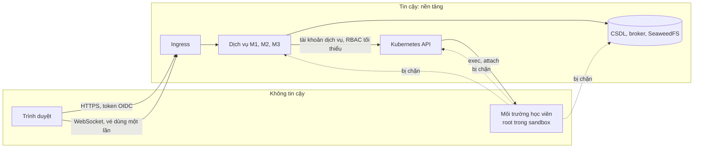

# Cách ly và bảo mật

| Thuộc tính | Giá trị |
|---|---|
| Mã tài liệu | CR-DOC-05 |
| Phiên bản | 1.1 |
| Ngày ban hành | 17/10/2026 |
| Tài liệu liên quan | CR-DOC-02 Kiến trúc, CR-DOC-03 Hợp đồng, CR-DOC-04 Vận hành, ADR-0003, ADR-0004, ADR-0011 |

## 1. Phạm vi

Tài liệu xác định tài sản cần bảo vệ, ranh giới tin cậy, các mối đe dọa chính và biện pháp tương ứng, cùng bộ kiểm
thử chứng minh biện pháp có hiệu lực. Mức độ bảo mật hướng tới chuẩn thực hành thông thường cho một nền tảng cho phép
người dùng chạy lệnh tùy ý: cách ly bằng hạ tầng, quyền tối thiểu, kiểm thử tự động. Kiểm thử xâm nhập chuyên sâu
không thuộc phạm vi.

## 2. Tài sản

| Tài sản | Lý do cần bảo vệ |
|---|---|
| Cụm Kubernetes và máy chủ vật lý | Chiếm được cụm là chiếm được toàn bộ hệ thống và dữ liệu |
| Dữ liệu điểm, bài thi, bản ghi phiên | Tính công bằng của kỳ thi |
| Biến thể và lời giải mẫu của bài lab | Lộ ra làm mất giá trị của bài thi |
| Khóa ký biến thể của M2 | Lộ ra cho phép suy ra biến thể của mọi học viên |
| Tài khoản và token người dùng | Mạo danh học viên hoặc giảng viên |
| Sức chứa của cụm | Lạm dụng tài nguyên làm gián đoạn kỳ thi của người khác |

## 3. Ranh giới tin cậy

| Ranh giới | Đặc điểm |
|---|---|
| Trình duyệt → nền tảng | Mọi yêu cầu xác thực bằng token; quyền được kiểm tra ở dịch vụ sở hữu đối tượng |
| Môi trường học viên → nền tảng | Môi trường không chủ động kết nối được tới bất kỳ thành phần nào của nền tảng; nền tảng chỉ tương tác với môi trường qua Kubernetes API (exec, attach) |
| Dịch vụ → dịch vụ | Token client credentials với scope; NetworkPolicy chỉ cho phép các cặp gọi tại CR-DOC-02 mục 5.1 |

## 4. Mối đe dọa và biện pháp

### 4.1. Từ môi trường học viên

| Mã | Mối đe dọa | Biện pháp |
|---|---|---|
| T1 | Thoát container, chiếm node | gVisor (`RuntimeClass gvisor`): lời gọi hệ thống được xử lý bởi nhân riêng trong không gian người dùng; không cấp `privileged`, không thêm capability ngoài mặc định, `allowPrivilegeEscalation: false`, seccomp mặc định của runtime; không gắn `hostPath`, không dùng `hostNetwork`, `hostPID` |
| T2 | Gọi Kubernetes API bằng token của pod | `automountServiceAccountToken: false`; tài khoản dịch vụ của pod phiên không có Role nào; NetworkPolicy chặn địa chỉ API server |
| T3 | Truy cập dịch vụ nền tảng, pod khác, dịch vụ metadata | NetworkPolicy mặc định chặn mọi chiều vào và ra trong `crucible-sessions`; bài lab `network: mirror` chỉ được ra tới máy chủ gói nội bộ cổng 3142; không có DNS nội bộ cụm cho pod phiên ngoại trừ tên máy chủ gói. Máy chủ gói không được dùng làm proxy ra Internet: chỉ phục vụ các kho gói đã khai báo (`ForceManaged: 1`), không chuyển tiếp yêu cầu `CONNECT` (`PassThroughPattern` không khớp địa chỉ nào) |
| T4 | Chiếm tài nguyên (fork bomb, đầy bộ nhớ, đầy đĩa) | Giới hạn bộ nhớ, CPU, `pids` theo mức tài nguyên; ephemeral storage giới hạn 2 GiB; vượt giới hạn chỉ ảnh hưởng phiên đó |
| T4a | Dùng CPU kéo dài (đào tiền ảo, vòng lặp vô hạn) làm chậm phiên khác trên cùng node | Không có đường ra Internet nên không gửi được kết quả đào tới bên ngoài (T3, T5); giám sát CPU theo phiên: phiên luyện tập bị cảnh báo rồi kết thúc, phiên thi được báo giám thị, mọi lần phát hiện được ghi nhận (CR-MOD-M1 BR-M1.22–BR-M1.25) |
| T5 | Tấn công từ chối dịch vụ ra ngoài Internet | Mặc định không có đường ra Internet |
| T6 | Làm sai lệch kết quả chấm | Lệnh kiểm tra chạy bằng công cụ liên kết tĩnh từ volume chỉ đọc, môi trường biến sạch (ADR-0011); học viên không có `CAP_SYS_ADMIN` nên không gắn đè được volume |
| T7 | Đọc được lời giải, biến thể của người khác | Lời giải và lệnh kiểm tra không được ghi vào môi trường; lệnh kiểm tra được truyền qua exec và không lưu lại trong môi trường; biến thể sinh bằng HMAC với khóa chỉ M2 giữ |

### 4.2. Từ người dùng qua giao diện và API

| Mã | Mối đe dọa | Biện pháp |
|---|---|---|
| T8 | Truy cập phiên, lượt làm bài, bản ghi của người khác | Kiểm tra chủ sở hữu ở mọi operation; trả 404 cho đối tượng không có quyền; vé terminal gắn với chủ phiên và dùng một lần |
| T9 | Chiếm terminal bằng vé bị lộ | Vé hết hạn sau 30 giây, dùng một lần, chỉ truyền qua WebSocket TLS; không xuất hiện trong log (gateway che tham số `ticket`) |
| T10 | Học viên giả mạo vai trò giảng viên | Vai trò lấy từ token do Keycloak ký; vai trò `INSTRUCTOR`, `ADMIN` chỉ được cấp bởi quản trị trong Keycloak |
| T11 | Giảng viên xem bài của lớp không phụ trách | M3 kiểm tra quan hệ giảng viên – lớp trước khi xin vé xem và trước khi trả bản ghi; M1 ghi nhật ký mọi vé xem |
| T12 | Lạm dụng tạo phiên hoặc đặt trước để chiếm sức chứa | Giới hạn phiên đồng thời theo học viên; hạn mức giờ máy; giới hạn tần suất tạo phiên 10 lần mỗi phút mỗi người dùng; trần hạn mức theo giảng viên cho giờ máy, phiên đồng thời và chỗ × giờ đặt trước, chỉ quản trị đặt được |
| T13 | Giảng viên đưa script độc hại vào bài lab | Script chỉ chạy trong môi trường đã cách ly như lệnh của học viên; image chỉ từ registry được phép (mục 5) |
| T14 | Lỗ hổng web phổ biến (XSS từ mô tả bài lab, CSRF) | Markdown được làm sạch khi hiển thị; Content-Security-Policy chặn script nội tuyến; token trong header, không dùng cookie cho API |

### 4.3. Chuỗi cung ứng và vận hành

| Mã | Mối đe dọa | Biện pháp |
|---|---|---|
| T15 | Image dịch vụ hoặc thư viện có lỗ hổng | Trivy trong CI; Dependabot; image nền tối thiểu (distroless cho Go, JRE tối thiểu cho Java) |
| T16 | Image bị thay thế trên đường triển khai | Image được ký bằng cosign trong CI; chính sách kiểm soát khi tạo pod từ chối image dịch vụ chưa ký |
| T17 | Lộ bí mật trong kho mã | Sealed Secrets; quét bí mật bằng gitleaks trong CI |
| T18 | Thành viên vô tình sửa tài nguyên ngoài module của mình | RBAC theo namespace (CR-DOC-04 mục 4); mọi thay đổi cụm đi qua GitOps |

## 5. Chính sách bắt buộc khi tạo pod

Các chính sách được thực thi bằng ValidatingAdmissionPolicy (biểu thức CEL, có sẵn trong Kubernetes) nên vẫn có hiệu
lực khi bộ điều khiển phiên có lỗi.

| Chính sách | Áp dụng | Nội dung |
|---|---|---|
| `session-pod-hardening` | Namespace `crucible-sessions` | Bắt buộc `runtimeClassName: gvisor`, `automountServiceAccountToken: false`, không `privileged`, không `hostPath`, không `hostNetwork`/`hostPID`/`hostIPC`, có giới hạn bộ nhớ và CPU |
| `session-image-allowlist` | Namespace `crucible-sessions` | Image bắt đầu bằng `ghcr.io/<tổ chức>/crucible-labs/` hoặc image công cụ của M1 |
| `platform-image-signed` | Namespace `crucible-*` trừ `crucible-sessions` | Image dịch vụ thuộc `ghcr.io/<tổ chức>/crucible/` (xác minh chữ ký bằng policy-controller của Sigstore là mục mở rộng) |
| Pod Security Admission | Mọi namespace dịch vụ | Mức `restricted` |

## 6. Kiểm thử bảo mật

### 6.1. Bộ kiểm thử cách ly

Bộ kiểm thử cách ly (`tests/isolation/`) là một bài lab đặc biệt có các bước thử vượt ranh giới; mỗi bước đạt khi
hành vi bị chặn. Bộ kiểm thử chạy trên cụm chuẩn sau mỗi lần thay đổi cấu hình cụm hoặc M1, và là tiêu chí kiểm
chứng Q6.

| Mã | Thử nghiệm | Kết quả mong đợi |
|---|---|---|
| I1 | Kết nối tới Kubernetes API (`kubernetes.default`, địa chỉ ClusterIP, địa chỉ node cổng 6443) | Thất bại |
| I2 | Đọc token tài khoản dịch vụ tại `/var/run/secrets/kubernetes.io/serviceaccount/` | Không tồn tại |
| I3 | Kết nối tới PostgreSQL, RabbitMQ, SeaweedFS, Keycloak, các dịch vụ M1–M3 | Thất bại |
| I4 | Kết nối tới pod phiên khác | Thất bại |
| I5 | Kết nối tới địa chỉ Internet | Thất bại (bài lab `network: none`) |
| I6 | Kiểm tra môi trường đang chạy trong gVisor (`dmesg`, `/proc/version`) | Nhận diện nhân của gVisor |
| I7 | Gắn hệ thống tệp, nạp mô-đun nhân, thay đổi `/opt/crucible/bin` | Thất bại |
| I8 | Fork bomb, cấp phát vượt bộ nhớ | Chỉ phiên đó bị ảnh hưởng; phiên khác trên cùng node vẫn đạt Q1 |
| I9 | Tạo pod thiếu `runtimeClassName` hoặc có `hostPath` trong `crucible-sessions` bằng tài khoản có quyền tạo pod | Bị chính sách từ chối |
| I10 | Chạy tiến trình dùng hết CPU trong phiên luyện tập 16 phút | Cảnh báo sau 10 phút, phiên kết thúc với `RESOURCE_ABUSE` sau 15 phút; phiên khác trên cùng node giữ độ trễ terminal p95 ≤ 150 ms |
| I11 | Qua máy chủ gói nội bộ, tải một địa chỉ ngoài danh sách kho gói (`http_proxy=http://mirror:3142 curl http://example.com`) và mở đường hầm `CONNECT` tới cổng 443 | Bị từ chối (bài lab `network: mirror`) |

### 6.2. Kiểm thử ứng dụng

| Hạng mục | Phương pháp |
|---|---|
| Phân quyền theo đối tượng | Ma trận kiểm thử API: mỗi vai trò × mỗi operation × chủ sở hữu và không phải chủ sở hữu |
| Vé terminal | Dùng lại vé, dùng vé hết hạn, dùng vé của phiên khác, kết nối xem gửi dữ liệu vào |
| Toàn vẹn chấm điểm | Thay `curl`, `grep`, `id` trong môi trường bằng script luôn thành công; đặt `/etc/ld.so.preload`; chạy lệnh kiểm tra (AC-C2.4) |
| Quét tự động | OWASP ZAP baseline trên cụm chuẩn sau mỗi lần triển khai; Trivy cho image và cấu hình Kubernetes; gitleaks |

## 7. Rủi ro còn lại

| Rủi ro | Lý do chấp nhận |
|---|---|
| Lỗ hổng của chính gVisor | gVisor là lớp cách ly được dùng trong sản phẩm thương mại; cập nhật phiên bản định kỳ |
| Học viên làm giả trạng thái mà lệnh kiểm tra quan sát (ví dụ chạy một tiến trình tự viết trả về đúng nội dung) | Trạng thái quan sát được là trạng thái thực của môi trường; bản ghi phiên cho phép giảng viên phát hiện khi cần |
| Dòng lệnh tái dựng từ luồng nhập có thể sai lệch (phím mũi tên, tự hoàn thành) | Chỉ dùng làm tín hiệu cho giảng viên |
| Toàn bộ cụm trên một máy vật lý | CR-DOC-02 mục 11 |

## Lịch sử thay đổi

| Phiên bản | Ngày | Nội dung |
|---|---|---|
| 1.0 | 17/10/2026 | Ban hành lần đầu |
| 1.1 | 17/10/2026 | T4a dùng CPU kéo dài, T12 trần theo giảng viên, máy chủ gói không làm proxy, kiểm thử I10, I11 |
