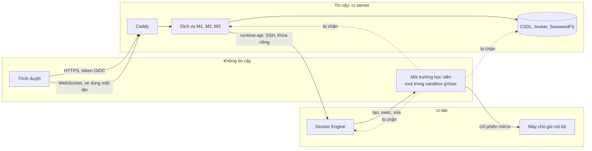

# Cách ly và bảo mật

| Thuộc tính | Giá trị |
|---|---|
| Mã tài liệu | CR-DOC-05 |
| Phiên bản | 1.0 |
| Ngày ban hành | 26/10/2026 |
| Tài liệu liên quan | CR-DOC-02 Kiến trúc, CR-DOC-03 Hợp đồng, CR-DOC-04 Vận hành, ADR-0003, ADR-0004, ADR-0011, ADR-0016 |

## 1. Phạm vi

Tài liệu xác định tài sản cần bảo vệ, ranh giới tin cậy, các mối đe dọa chính và biện pháp tương ứng, cùng bộ kiểm
thử chứng minh biện pháp có hiệu lực. Mức độ bảo mật hướng tới chuẩn thực hành thông thường cho một nền tảng cho phép
người dùng chạy lệnh tùy ý: cách ly bằng hạ tầng, quyền tối thiểu, kiểm thử tự động. Kiểm thử xâm nhập chuyên sâu
không thuộc phạm vi.

## 2. Tài sản

| Tài sản | Lý do cần bảo vệ |
|---|---|
| Máy ảo `cr-server`, `cr-lab` và máy chủ vật lý | Chiếm được `cr-server` là chiếm được toàn bộ dữ liệu; chiếm được `cr-lab` là kiểm soát mọi môi trường đang chạy |
| Dữ liệu điểm, bài thi, bản ghi phiên | Tính công bằng của kỳ thi |
| Biến thể và lời giải mẫu của bài lab | Lộ ra làm mất giá trị của bài thi |
| Khóa ký biến thể của M2 | Lộ ra cho phép suy ra biến thể của mọi học viên |
| Khóa SSH của `runtime-api` | Cho phép điều khiển Docker Engine của máy phiên |
| Tài khoản và token người dùng | Mạo danh học viên hoặc giảng viên |
| Sức chứa của máy phiên | Lạm dụng tài nguyên làm gián đoạn kỳ thi của người khác |

## 3. Ranh giới tin cậy

| Ranh giới | Đặc điểm |
|---|---|
| Trình duyệt → nền tảng | Mọi yêu cầu xác thực bằng token; quyền được kiểm tra ở dịch vụ sở hữu đối tượng |
| Môi trường học viên → nền tảng | Môi trường không chủ động kết nối được tới bất kỳ thành phần nào của nền tảng hay tới chính `cr-lab`; nền tảng chỉ tương tác với môi trường qua Docker Engine API (exec) |
| `runtime-api` → máy phiên | Khóa SSH riêng chỉ dùng được để chuyển tiếp tới Docker Engine; quyền điều khiển Docker tương đương root trên `cr-lab` nhưng không chạm tới `cr-server` |
| Dịch vụ → dịch vụ | Token client credentials với scope; CSDL, broker, SeaweedFS chỉ nằm trên mạng nội bộ của Docker Compose, không mở cổng ra ngoài `cr-server` |

## 4. Mối đe dọa và biện pháp

### 4.1. Từ môi trường học viên

| Mã | Mối đe dọa | Biện pháp |
|---|---|---|
| T1 | Thoát container, chiếm máy phiên | gVisor: lời gọi hệ thống được xử lý bởi nhân riêng trong không gian người dùng; `runsc` là runtime mặc định của Docker trên `cr-lab` (ADR-0003); không `privileged`, không thêm capability ngoài mặc định trừ `NET_ADMIN` cho bài lab khai báo (ADR-0016; capability chỉ có hiệu lực với nhân của sandbox), `no-new-privileges`, seccomp mặc định; không gắn thư mục của máy, không dùng mạng hay không gian tiến trình của máy. Thoát được khỏi gVisor chỉ chạm tới `cr-lab`, máy không chứa dữ liệu của nền tảng |
| T2 | Điều khiển Docker Engine từ trong môi trường | Không gắn socket Docker vào container; Docker Engine trên `cr-lab` không mở cổng TCP; khóa SSH của `runtime-api` chỉ nằm trên `cr-server`, khai báo trong `authorized_keys` của `cr-lab` với `restrict` và `command="docker system dial-stdio"` |
| T3 | Truy cập dịch vụ nền tảng, phiên khác, chính máy phiên | Phiên `network: none` không có mạng; phiên `network: mirror` dùng mạng Docker `internal` riêng chỉ có thêm máy chủ gói nội bộ (cổng 3142); `ufw` trên `cr-lab` chặn mọi kết nối vào máy, kể cả từ mạng của phiên. Máy chủ gói không được dùng làm proxy ra Internet: chỉ phục vụ các kho gói đã khai báo (`ForceManaged: 1`), không chuyển tiếp yêu cầu `CONNECT` (`PassThroughPattern` không khớp địa chỉ nào) |
| T4 | Chiếm tài nguyên (fork bomb, đầy bộ nhớ, đầy đĩa) | Giới hạn bộ nhớ, CPU theo mức tài nguyên và 512 tiến trình cho mỗi container (CR-DOC-04 mục 3.4); vượt giới hạn bộ nhớ hoặc số tiến trình làm dừng cả sandbox của phiên đó, không ảnh hưởng phiên khác; dữ liệu của container nằm trên đĩa riêng của Docker (`data-root`), cảnh báo khi đĩa dùng trên 85%; cách gVisor lưu lớp ghi của hệ thống tệp và giới hạn dung lượng được xác định ở S1 |
| T4a | Dùng CPU kéo dài (đào tiền ảo, vòng lặp vô hạn) làm chậm phiên khác trên cùng máy phiên | Không có đường ra Internet nên không gửi được kết quả đào tới bên ngoài (T3, T5); giám sát CPU theo phiên: phiên luyện tập bị cảnh báo rồi kết thúc, phiên thi được báo giám thị, mọi lần phát hiện được ghi nhận (CR-MOD-M1 BR-M1.22–BR-M1.25) |
| T5 | Tấn công từ chối dịch vụ ra ngoài Internet | Mặc định không có đường ra Internet |
| T6 | Làm sai lệch kết quả chấm | Lệnh kiểm tra chạy bằng công cụ liên kết tĩnh từ volume chỉ đọc, môi trường biến sạch (ADR-0011); học viên không có `CAP_SYS_ADMIN` nên không gắn đè được volume |
| T7 | Đọc được lời giải, biến thể của người khác | Lời giải và lệnh kiểm tra không được ghi vào môi trường; lệnh kiểm tra được truyền qua exec và không lưu lại trong môi trường; biến thể sinh bằng HMAC với khóa chỉ M2 giữ |

### 4.2. Từ người dùng qua giao diện và API

| Mã | Mối đe dọa | Biện pháp |
|---|---|---|
| T8 | Truy cập phiên, lượt làm bài, bản ghi của người khác | Kiểm tra chủ sở hữu ở mọi operation; trả 404 cho đối tượng không có quyền; vé terminal gắn với chủ phiên và dùng một lần |
| T9 | Chiếm terminal bằng vé bị lộ | Vé hết hạn sau 30 giây, dùng một lần, chỉ truyền qua WebSocket TLS; không xuất hiện trong log (`runtime-api` và Caddy che tham số `ticket`) |
| T10 | Học viên giả mạo vai trò giảng viên | Vai trò lấy từ token do Keycloak ký; vai trò `INSTRUCTOR`, `ADMIN` chỉ được cấp bởi quản trị trong Keycloak |
| T11 | Giảng viên xem bài của lớp không phụ trách | M3 kiểm tra quan hệ giảng viên – lớp trước khi xin vé xem và trước khi trả bản ghi; M1 ghi nhật ký mọi vé xem |
| T12 | Lạm dụng tạo phiên hoặc đặt trước để chiếm sức chứa | Giới hạn phiên đồng thời theo học viên; hạn mức giờ máy; giới hạn tần suất tạo phiên 10 lần mỗi phút mỗi người dùng; trần hạn mức theo giảng viên cho giờ máy, phiên đồng thời và chỗ × giờ đặt trước, chỉ quản trị đặt được |
| T13 | Giảng viên đưa script độc hại vào bài lab | Script chỉ chạy trong môi trường đã cách ly như lệnh của học viên; image chỉ từ registry được phép (mục 5) |
| T14 | Lỗ hổng web phổ biến (XSS từ mô tả bài lab, CSRF) | Markdown được làm sạch khi hiển thị; Content-Security-Policy chặn script nội tuyến; token trong header, không dùng cookie cho API |

### 4.3. Chuỗi cung ứng và vận hành

| Mã | Mối đe dọa | Biện pháp |
|---|---|---|
| T15 | Image dịch vụ hoặc thư viện có lỗ hổng | Trivy trong CI; Dependabot; image nền tối thiểu (distroless cho Go, JRE tối thiểu cho Java) |
| T16 | Image bị thay thế trên đường triển khai | Chỉ CI có quyền đẩy image lên GHCR; `deploy.sh` ghi digest của image đã kéo vào nhật ký triển khai; image bài lab chỉ từ tiền tố được phép (`SESSION_IMAGE_PREFIXES`) |
| T17 | Lộ bí mật trong kho mã | Bí mật nằm ngoài kho mã (CR-DOC-04 mục 5.2); quét bí mật bằng gitleaks trong CI |
| T18 | Thành viên vô tình sửa môi trường chuẩn | Thành viên không có tài khoản SSH trên hai máy ảo; mọi thay đổi đi qua kho mã và script triển khai (CR-DOC-04 mục 4) |
| T19 | Chiếm `runtime-api` rồi dùng quyền điều khiển Docker của nó | `runtime-api` chỉ nhận yêu cầu qua Caddy với token; tham số tạo container chỉ lấy từ cấu hình và danh sách cho phép (mức tài nguyên, capability, tiền tố image), không nhận cấu hình Docker từ yêu cầu; container `runtime-api` chạy bằng tài khoản không phải root, không gắn socket Docker của `cr-server` |

## 5. Cấu hình bắt buộc của máy phiên và container phiên

Các cấu hình ở tầng Docker Engine của `cr-lab` do cloud-init ghi, độc lập với mã của `runtime-api`, nên vẫn có hiệu lực
khi `runtime-api` có lỗi. Các cấu hình ở tầng `runtime-api` được kiểm thử tự động (CR-MOD-M1 mục 11).

| Tầng | Cấu hình |
|---|---|
| Docker Engine của `cr-lab` | `default-runtime: runsc`, `no-new-privileges: true`, `icc: false`, không mở cổng TCP (CR-DOC-04 mục 3.4) |
| Hệ điều hành của `cr-lab` | `ufw` chặn mọi kết nối vào trừ SSH từ `cr-server` và máy vật lý; khóa của `runtime-api` bị giới hạn ở `docker system dial-stdio` |
| `runtime-api` | Kiểm tra runtime `runsc` khi khởi động (BR-M1.15); container phiên luôn có giới hạn bộ nhớ, CPU, số tiến trình, `CapAdd` chỉ gồm giá trị trong `SESSION_ALLOWED_CAPABILITIES`, không gắn thư mục của máy; image phải bắt đầu bằng tiền tố trong `SESSION_IMAGE_PREFIXES` |

## 6. Kiểm thử bảo mật

### 6.1. Bộ kiểm thử cách ly

Bộ kiểm thử cách ly (`tests/isolation/`) là một bài lab đặc biệt có các bước thử vượt ranh giới; mỗi bước đạt khi
hành vi bị chặn. Bộ kiểm thử chạy trên môi trường chuẩn sau mỗi lần thay đổi cấu hình máy phiên hoặc M1, và là tiêu chí
kiểm chứng Q6.

| Mã | Thử nghiệm | Kết quả mong đợi |
|---|---|---|
| I1 | Kết nối tới Docker Engine: tìm `/var/run/docker.sock`, kết nối cổng 2375, 2376 trên địa chỉ gateway của mạng phiên | Không tồn tại, thất bại |
| I2 | Tìm khóa SSH, tệp `.env`, bí mật của nền tảng trong hệ thống tệp của môi trường | Không tồn tại |
| I3 | Kết nối tới `cr-server` (`10.77.0.10`): PostgreSQL, RabbitMQ, SeaweedFS, Keycloak, các dịch vụ M1–M3, cổng 443 | Thất bại |
| I4 | Kết nối tới container phiên khác | Thất bại |
| I5 | Kết nối tới địa chỉ Internet | Thất bại (bài lab `network: none` và `mirror`) |
| I6 | Kiểm tra môi trường đang chạy trong gVisor (`dmesg`, `/proc/version`) | Nhận diện nhân của gVisor |
| I7 | Gắn hệ thống tệp, nạp mô-đun nhân, thay đổi `/opt/crucible/bin` | Thất bại |
| I8 | Fork bomb, cấp phát vượt bộ nhớ | Chỉ phiên đó bị ảnh hưởng (môi trường của phiên bị dừng); phiên khác trên cùng máy phiên vẫn đạt Q1 |
| I9 | Trên `cr-lab`, tạo container không khai báo runtime; khởi động `runtime-api` với `SESSION_RUNTIME=runsc` khi Docker không có runtime `runsc` | Container chạy bằng `runsc`; `runtime-api` không khởi động |
| I10 | Chạy tiến trình dùng hết CPU trong phiên luyện tập 16 phút | Cảnh báo sau 10 phút, phiên kết thúc với `RESOURCE_ABUSE` sau 15 phút; phiên khác trên cùng máy phiên giữ độ trễ terminal p95 ≤ 150 ms |
| I11 | Qua máy chủ gói nội bộ, tải một địa chỉ ngoài danh sách kho gói (`http_proxy=http://mirror:3142 curl http://example.com`) và mở đường hầm `CONNECT` tới cổng 443 | Bị từ chối (bài lab `network: mirror`) |
| I12 | Trong phiên có `NET_ADMIN`: xóa toàn bộ quy tắc tường lửa, gán thêm địa chỉ IP của một phiên khác, của máy chủ gói và của `cr-server` cho giao diện mạng, rồi lặp lại I1, I3, I4, I5; yêu cầu tạo phiên có capability khác `NET_ADMIN` | Các kết nối vẫn thất bại; yêu cầu bị từ chối với 422 `ENVIRONMENT_NOT_ALLOWED` |
| I13 | Từ phiên `network: mirror`, kết nối tới các cổng của chính `cr-lab` (SSH 22, `node-exporter` 9100) qua địa chỉ gateway của mạng phiên | Thất bại |

### 6.2. Kiểm thử ứng dụng

| Hạng mục | Phương pháp |
|---|---|
| Phân quyền theo đối tượng | Ma trận kiểm thử API: mỗi vai trò × mỗi operation × chủ sở hữu và không phải chủ sở hữu |
| Vé terminal | Dùng lại vé, dùng vé hết hạn, dùng vé của phiên khác, kết nối xem gửi dữ liệu vào |
| Toàn vẹn chấm điểm | Thay `curl`, `grep`, `id` trong môi trường bằng script luôn thành công; đặt `/etc/ld.so.preload`; chạy lệnh kiểm tra (AC-C2.4) |
| Quét tự động | OWASP ZAP baseline trên môi trường chuẩn sau mỗi lần triển khai; Trivy cho image và tệp Compose; gitleaks |

## 7. Rủi ro còn lại

| Rủi ro | Lý do chấp nhận |
|---|---|
| Lỗ hổng của chính gVisor | gVisor là lớp cách ly được dùng trong sản phẩm thương mại; cập nhật phiên bản định kỳ |
| Học viên làm giả trạng thái mà lệnh kiểm tra quan sát (ví dụ chạy một tiến trình tự viết trả về đúng nội dung) | Trạng thái quan sát được là trạng thái thực của môi trường; bản ghi phiên cho phép giảng viên phát hiện khi cần |
| Dòng lệnh tái dựng từ luồng nhập có thể sai lệch (phím mũi tên, tự hoàn thành) | Chỉ dùng làm tín hiệu cho giảng viên |
| Toàn bộ hệ thống trên một máy vật lý | CR-DOC-02 mục 11 |
| Máy chủ gói nội bộ nối vào mạng của mọi phiên `mirror` | Máy chủ gói chạy trong gVisor, chỉ phục vụ kho gói đã khai báo, không chuyển tiếp gói giữa các mạng; chiếm được nó vẫn cần thoát khỏi gVisor để vượt ra ngoài |
| Quyền điều khiển Docker của `runtime-api` tương đương root trên `cr-lab` | Không có lớp chính sách độc lập như admission của Kubernetes; giảm thiểu bằng T19 và cấu hình ở tầng Docker Engine (mục 5) |

## Lịch sử thay đổi

| Phiên bản | Ngày | Nội dung |
|---|---|---|
| 1.0 | 26/10/2026 | Ban hành lần đầu |
