# Rủi ro, thử nghiệm sớm và lộ trình

| Thuộc tính | Giá trị |
|---|---|
| Mã tài liệu | CR-DOC-06 |
| Phiên bản | 1.0 |
| Ngày ban hành | 17/10/2026 |
| Tài liệu liên quan | CR-DOC-01 đến CR-DOC-05, CR-DOC-07 Quy trình phát triển |

## 1. Phạm vi

Tài liệu liệt kê các rủi ro kỹ thuật và tổ chức, các thử nghiệm sớm để xác nhận những giả định kỹ thuật chưa được kiểm
chứng, lộ trình theo mốc, phân công và tiêu chí hoàn thành của từng module.

## 2. Rủi ro

| Mã | Rủi ro | Khả năng | Ảnh hưởng | Biện pháp | Phương án dự phòng |
|---|---|---|---|---|---|
| RK1 | gVisor không chạy ổn định trên k3s trong máy ảo KVM, hoặc exec và attach không hoạt động | Thấp | Cao | Thử nghiệm S1 trong tuần đầu | Dùng runc kèm user namespace (`hostUsers: false`), seccomp và bỏ capability; ghi nhận mức cách ly thấp hơn tại CR-DOC-05 |
| RK2 | Thời gian cấp phiên từ nhóm ấm vượt 5 giây | Trung bình | Trung bình | Thử nghiệm S2 | Rút gọn script setup của bài lab; nới mục tiêu Q1 có căn cứ đo |
| RK3 | Terminal qua Kubernetes exec có độ trễ cao hoặc mất kết nối | Thấp | Cao | Thử nghiệm S3 | Chạy agent nhỏ trong pod phiên, gateway kết nối trực tiếp qua mạng pod (cần mở NetworkPolicy một chiều) |
| RK4 | Phần mềm trong bài lab (dịch vụ không có systemd, công cụ mạng) hoạt động khác thường trong gVisor | Trung bình | Trung bình | Thử nghiệm S4 với image nền và hai bài mẫu | Điều chỉnh image nền, loại bỏ dạng bài không tương thích khỏi phạm vi |
| RK5 | Máy chủ vật lý không đủ bộ nhớ cho toàn bộ thành phần | Trung bình | Trung bình | Thử nghiệm S5 | Giảm thời gian lưu giữ giám sát, bỏ Tempo, giảm node phiên xuống 5 GB |
| RK6 | Thành viên chậm tiến độ làm module khác bị chặn | Trung bình | Cao | Hợp đồng chốt trước khi code; mock và chế độ `docker` của M1; mốc có tiêu chí cụ thể (mục 4) | Module bị chậm được rút gọn về chức năng MVP; module khác tiếp tục làm việc với mock |
| RK7 | Thời gian học công nghệ mới (Go, controller-runtime, Kubernetes) của người phụ trách M1 | Trung bình | Trung bình | Thử nghiệm sớm S1–S3 do chính người phụ trách thực hiện | Giảm phạm vi M1 về chức năng MVP, chuyển `WarmPool` theo lịch sang cấu hình tĩnh |
| RK8 | Mã do công cụ AI sinh ra sai nghiệp vụ mà không bị phát hiện | Cao | Cao | Tiêu chí chấp nhận có mã và được kiểm thử; review bắt buộc; kiểm thử hợp đồng trong CI | |
| RK9 | Chạy Docker bên trong môi trường học viên không khả thi trong gVisor | Trung bình | Thấp | Đưa bài lab Docker ra ngoài MVP; thử nghiệm S6 khi còn thời gian | Không hỗ trợ bài lab Docker |

## 3. Thử nghiệm sớm

Mỗi thử nghiệm có thời hạn cố định và tiêu chí kết thúc. Kết quả được ghi tại `docs/spikes/<mã>.md` gồm cách làm,
số đo, kết luận và quyết định tiếp theo. Mã thử nghiệm được bỏ đi sau khi có kết luận; phần dùng lại được viết lại
theo quy trình bình thường.

| Mã | Câu hỏi cần trả lời | Thời hạn | Tiêu chí kết thúc |
|---|---|---|---|
| S1 | gVisor chạy được trên node k3s trong máy ảo KVM; exec, attach, NetworkPolicy, giới hạn tài nguyên hoạt động với pod gVisor | 2 ngày | Pod `runtimeClassName: gvisor` chạy bash, exec và attach thành công; các kiểm thử I1–I7 tại CR-DOC-05 cho kết quả mong đợi |
| S2 | Thời gian từ khi nhận pod ấm tới khi sẵn sàng (gắn nhãn, ghi tệp, chạy setup) | 2 ngày | Số đo p50, p95 trên 50 lần với bài `linux-user-nginx` |
| S3 | Gateway Go chuyển tiếp WebSocket ↔ exec và ghi asciicast | 3 ngày | Gõ lệnh tương tác qua trình duyệt với xterm.js; độ trễ khứ hồi p95 đo được; bản ghi phát lại được |
| S4 | Image nền và hai bài mẫu chạy đúng trong gVisor | 2 ngày | Lời giải mẫu đạt và môi trường mới dựng không đạt với 5 seed, chạy thủ công |
| S5 | Toàn bộ thành phần nền tảng vừa bộ nhớ của `cr-server` | 1 ngày | Số đo bộ nhớ thực tế của từng thành phần sau khi cài |
| S6 | Docker Engine chạy bên trong pod gVisor | 1 ngày | Kết luận khả thi hay không |

S1–S5 do người phụ trách M1 thực hiện trong tuần 1–2, song song với việc hai module còn lại bắt đầu trên mock.

## 4. Lộ trình

Tuần 1 là tuần đề tài được duyệt.

```mermaid
gantt
    dateFormat  X
    axisFormat  %s
    section Chung
    Hợp đồng v1, kho mã, CI              :c1, 0, 1
    section M1 và nền tảng
    Thử nghiệm S1–S5                     :m1a, 0, 2
    Chế độ docker của runtime-api        :m1b, 1, 3
    Cụm chuẩn, GitOps, giám sát          :m1c, 2, 5
    Operator, nhóm ấm, gateway, ghi phiên :m1d, 3, 6
    Đặt trước, mất node, xem trực tiếp   :m1e, 6, 9
    Tải, chaos, bảo mật, khôi phục       :m1f, 9, 11
    section M2
    Bài lab, phiên bản, biến thể          :m2a, 0, 3
    Lượt làm bài, chấm bước, gợi ý        :m2b, 2, 6
    Kiểm thử bài lab, chấm cuối, tiếp tục :m2c, 6, 9
    Hoàn thiện, kiểm thử                  :m2d, 9, 11
    section M3
    Lớp, ghi danh, lộ trình               :m3a, 0, 3
    Bài tập, bắt đầu bài, bảng điểm       :m3b, 2, 6
    Kỳ thi, bù giờ, giám sát, gian lận    :m3c, 6, 9
    Hoàn thiện, kiểm thử                  :m3d, 9, 11
```

| Mốc | Cuối tuần | Tiêu chí |
|---|---|---|
| MA | 3 | Trên môi trường phát triển: học viên bắt đầu bài lab từ lộ trình, có terminal (chế độ `docker` của M1), kiểm tra bước và thấy điểm. Ba module gọi nhau bằng API thật |
| MB | 6 | Trên cụm chuẩn qua GitOps: cùng luồng như MA với gVisor, nhóm ấm, ghi phiên; dashboard phiên và sức chứa hoạt động; bộ kiểm thử cách ly đạt; phát hành `v0.1.0` |
| MC | 9 | Kỳ thi đầy đủ trên cụm chuẩn: lên lịch có đặt trước, bắt đầu đồng loạt, mất node và bù giờ, nộp tự động, tín hiệu gian lận, phúc khảo |
| MD | 11 | Báo cáo đo toàn bộ Q1–Q14; biên bản chaos CH1–CH7; biên bản diễn tập khôi phục; biên bản cài đặt thử do người ngoài nhóm thực hiện; phát hành `v1.0.0` kèm hướng dẫn cài đặt và nâng cấp |

## 5. Phân công

| Thành viên | Phụ trách | Sản phẩm chính |
|---|---|---|
| Trưởng nhóm | M1; nền tảng; hợp đồng | Mã M1 (`services/runtime/`, `web/src/modules/runtime/`); hạ tầng (`infra/`, `deploy/`); giám sát; bộ kiểm thử cách ly, tải, chaos; tài liệu CR-DOC-01 đến CR-DOC-07 |
| Thành viên phụ trách M2 | M2 | Mã M2 (`services/content/`, `web/src/modules/content/`); bài lab mẫu (`labs/`, tối thiểu 10 bài thuộc đủ các dạng); tài liệu `docs/modules/m2-content.md` |
| Thành viên phụ trách M3 | M3 | Mã M3 (`services/learning/`, `web/src/modules/learning/`); tài liệu `docs/modules/m3-learning.md` |

Khung giao diện chung (`web/src/shell/`: điều hướng, đăng nhập, thông báo) do trưởng nhóm dựng trong tuần 1.

Mỗi thành viên viết tài liệu thiết kế module của mình theo mẫu `docs/modules/_mau.md` trước khi bắt đầu viết mã
(hạn cuối tuần 1). Tài liệu module mô tả mô hình dữ liệu, máy trạng thái, API nội bộ cho giao diện, quy tắc nghiệp vụ
và cách kiểm thử các tiêu chí chấp nhận của module.

## 6. Tiêu chí hoàn thành

Một chức năng được coi là hoàn thành khi:

1. Mọi tiêu chí chấp nhận liên quan có kiểm thử tự động mang mã tiêu chí trong tên hoặc chú thích.
2. Kiểm thử hợp đồng của bên cung cấp đạt; sự kiện phát ra hợp lệ theo lược đồ.
3. Chức năng chạy trên cụm chuẩn qua GitOps, không chỉ trên máy phát triển.
4. Có metric và log đủ để chẩn đoán lỗi; chỉ số nghiệp vụ liên quan tại CR-DOC-04 mục 7.2 đã được phát.
5. Tài liệu module được cập nhật nếu thiết kế thay đổi.

## Lịch sử thay đổi

| Phiên bản | Ngày | Nội dung |
|---|---|---|
| 1.0 | 17/10/2026 | Ban hành lần đầu |
