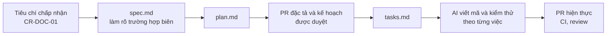

# Quy trình phát triển và CI/CD

| Thuộc tính | Giá trị |
|---|---|
| Mã tài liệu | CR-DOC-07 |
| Phiên bản | 1.2 |
| Ngày ban hành | 17/10/2026 |
| Tài liệu liên quan | CR-DOC-03 mục 2 (quản lý hợp đồng), CR-DOC-04 mục 5 (triển khai), `CONTRIBUTING.md`, `.github/` |

## 1. Phạm vi

Tài liệu quy định cấu trúc kho mã, quản lý công việc, quyền sở hữu mã theo module, quy trình pull request, cấu hình bảo vệ nhánh và
pipeline CI. Phần triển khai lên cụm được quy định tại CR-DOC-04 mục 5.

## 2. Kho mã

Toàn bộ hệ thống nằm trong một kho mã `github.com/NhatMinh0311/crucible`.

| Đường dẫn | Nội dung | Chủ sở hữu |
|---|---|---|
| `docs/` | Tài liệu dự án, ADR, tài liệu module, runbook, kết quả thử nghiệm sớm | Trưởng nhóm; `docs/modules/<module>` thuộc chủ module |
| `contracts/` | Hợp đồng giữa các module | Cả ba thành viên |
| `services/runtime/` | M1: `runtime-api`, `runtime-operator`, `runtime-gateway` (Go) | Phụ trách M1 |
| `services/content/` | M2: `content-service` (Spring Boot) | Phụ trách M2 |
| `services/learning/` | M3: `learning-service` (Spring Boot) | Phụ trách M3 |
| `web/src/shell/` | Khung giao diện chung | Trưởng nhóm |
| `web/src/modules/<module>/` | Giao diện của từng module | Chủ module |
| `labs/` | Bài lab mẫu và image bài lab | Phụ trách M2 |
| `infra/`, `deploy/` | Máy ảo, cụm, GitOps | Trưởng nhóm |
| `tests/` | Kiểm thử cách ly, tải, chaos, đầu cuối | Trưởng nhóm |

Nhánh làm việc tạo từ `main`, đặt tên `<loại>/<module>-<mô tả ngắn>`; loại là `feat`, `fix`, `docs`, `test`, `chore`.
Ví dụ: `feat/m2-variant-generator`, `chore/infra-terraform-vms`. Pull request được merge bằng squash.

## 3. Quản lý công việc và quy trình pull request

Công việc được quản lý bằng GitHub Issues và Project board `Crucible`:

| Thành phần | Quy ước |
|---|---|
| Issue | Một chức năng hoặc một thử nghiệm sớm; người được giao là chủ module; nội dung ghi mã chức năng, tiêu chí chấp nhận, tài liệu liên quan. Chủ module tự chia issue con khi cần |
| Nhãn | Module `m1`, `m2`, `m3`, `platform`; loại `feature`, `spike`, `infra`, `security`, `test`, `docs`, `content`, `web`, `chore` |
| Milestone | Mốc `MA`–`MD` của lộ trình (CR-DOC-06 mục 4) |
| Board | Cột `Todo`, `In Progress`, `Done`; issue đóng thì tự chuyển sang `Done` |
| Backlog khởi đầu | `.github/backlog.yaml`, tạo trên GitHub bằng `scripts/create-issues.py`; issue phát sinh sau đó tạo trực tiếp trên GitHub |

Issue có đặc tả theo Spec Kit (mục 7) ghi đường dẫn `specs/<số>-<tên>/`.

1. Tạo nhánh, thực hiện thay đổi, mở pull request vào `main` theo mẫu; ghi mã yêu cầu liên quan (`US-C2`, `AC-C2.4`, `BR-M1.3`) và
   issue được giải quyết (`Closes #<số>`) để issue tự đóng khi merge.
2. CI chạy tự động; pull request chỉ merge được khi mọi kiểm tra bắt buộc thành công.
3. Người review theo CODEOWNERS (mục 4) duyệt. Mọi trao đổi phải được giải quyết trước khi merge.
4. Commit mới sau khi được duyệt làm mất lượt duyệt cũ.
5. Thay đổi hợp đồng được thực hiện trong pull request riêng, merge trước pull request hiện thực (CR-DOC-03 mục 2.1).

Lệnh và thao tác chi tiết tại `CONTRIBUTING.md`.

## 4. Quyền sở hữu và review

Mỗi đường dẫn có hai chủ sở hữu trong `.github/CODEOWNERS`: chủ module và một người review chéo. Lượt duyệt của một
trong hai người thỏa điều kiện "Require review from Code Owners"; vì GitHub không cho tự duyệt, pull request của chủ
module luôn được người còn lại duyệt.

| Đường dẫn | Chủ sở hữu | Người review chéo |
|---|---|---|
| `services/runtime/`, `web/src/modules/runtime/`, `infra/`, `deploy/`, `tests/` | Phụ trách M1 | Phụ trách M2 |
| `services/content/`, `web/src/modules/content/`, `labs/`, `docs/modules/m2-*` | Phụ trách M2 | Phụ trách M3 |
| `services/learning/`, `web/src/modules/learning/`, `docs/modules/m3-*` | Phụ trách M3 | Phụ trách M1 |
| `contracts/` | Cả ba | Theo quy ước: pull request sửa hợp đồng cần lượt duyệt của chủ mọi module sử dụng hợp đồng đó, ghi trong mô tả pull request |
| Còn lại (`docs/`, `.github/`, `web/src/shell/`) | Trưởng nhóm | Phụ trách M2 |

So với cách để trưởng nhóm duyệt mọi pull request, cách phân công này giảm điểm nghẽn tại trưởng nhóm
và buộc mỗi thành viên đọc mã của một module khác.

## 5. Cấu hình bảo vệ nhánh `main`

Ruleset "main branch protection" có cấu hình sau:

| Mục | Giá trị |
|---|---|
| Restrict deletions, Require linear history, Block force pushes | Bật |
| Require a pull request before merging | Bật; 1 lượt duyệt; bỏ lượt duyệt cũ khi có commit mới; yêu cầu Code Owners; yêu cầu duyệt lần push cuối; yêu cầu giải quyết trao đổi; chỉ squash |
| Require status checks to pass | `contracts`; bổ sung `runtime`, `content`, `learning`, `web`, `e2e`, `security` khi mã tương ứng có mặt |
| Bypass list | Repository admin, chỉ qua pull request |

Cấu hình được xuất ra `.github/rulesets/main-branch-protection.json` mỗi khi thay đổi.

## 6. Pipeline CI

Workflow `.github/workflows/ci.yml` chạy khi có pull request vào `main` và khi có commit trên `main`. Job của module chỉ
chạy khi pull request thay đổi đường dẫn của module hoặc `contracts/`.

| Job | Nội dung | Trạng thái |
|---|---|---|
| `changes` | Xác định đường dẫn thay đổi để chỉ chạy job liên quan | Đang chạy |
| `contracts` | Lint OpenAPI (`redocly lint`), kiểm tra AsyncAPI (`asyncapi validate`), kiểm tra lược đồ và quy tắc ngữ nghĩa của đặc tả bài lab trong `contracts/lab-spec/examples/` và `labs/` | Đang chạy |
| `dev-env` | Khởi động dịch vụ phụ thuộc của `dev/compose.yaml`, chạy `dev/check.sh` | Đang chạy |
| `runtime` | Mã sinh khớp hợp đồng, `gofmt`, `go vet`, `staticcheck`; build image bộ công cụ và image nền bài lab; `go test -race` gồm kiểm thử tích hợp với PostgreSQL, RabbitMQ (Testcontainers) và Docker Engine của runner; envtest bổ sung cùng chế độ `kubernetes` | Đang chạy |
| `content`, `learning` | Gradle build: sinh mã từ hợp đồng, biên dịch, kiểm thử đơn vị và tích hợp với Testcontainers | Đang chạy |
| `web` | Sinh kiểu từ hợp đồng, kiểm tra kiểu, lint (oxlint), kiểm thử (Vitest), build | Đang chạy |
| `e2e` | Dựng k3d, triển khai bằng Helm chart, chạy luồng đầu cuối bằng Playwright | Bổ sung từ mốc MA |
| `security` | gitleaks, Trivy cho phụ thuộc và cấu hình Kubernetes | Bổ sung khi có mã |
| `images` | Chỉ trên `main`: build image đa kiến trúc, Trivy, ký cosign, đẩy lên GHCR | Bổ sung từ mốc MB |
| `upgrade` | Cài bản phát hành trước trên k3d, tạo dữ liệu, nâng cấp lên mã hiện tại, kiểm tra (Q14) | Bổ sung sau `v0.1.0` |

Workflow `.github/workflows/release.yml` chạy khi có tag `vX.Y.Z`: build và ký image với tag phiên bản, đóng gói và đẩy
Helm chart `crucible` lên GHCR, tạo GitHub Release với ghi chú phát hành (CR-DOC-04 mục 6).

Workflow chỉ có quyền đọc nội dung kho mã, trừ job `images` có thêm quyền ghi package và `id-token` để ký.

## 7. Phát triển với trợ lý AI

Các thành viên dùng trợ lý AI để viết mã; quy trình dưới đây bảo đảm thành viên duyệt giải pháp trước khi mã được viết
và mã do AI viết tuân theo cùng một chuẩn.

| Thành phần | Nội dung |
|---|---|
| `AGENTS.md` | Quy tắc bắt buộc cho mọi trợ lý AI: phạm vi sửa mã, không tự quyết định nghiệp vụ, kiểm thử mang mã tiêu chí, quy ước mã nguồn. `CLAUDE.md` nạp lại nội dung này cho Claude Code |
| GitHub Spec Kit | Mỗi tính năng có `specs/<số>-<tên>/spec.md`, `plan.md`, `tasks.md`. Pull request đặc tả và kế hoạch được duyệt trước; pull request hiện thực dẫn tới thư mục `specs/` tương ứng. Phiên bản Spec Kit được cố định khi khởi tạo |
| Skill `frontend-design` (Anthropic) | Dùng khi tạo màn hình mới để có định hướng thẩm mỹ thống nhất; kết hợp shadcn/ui và theme chung |
| Review | Pull request do AI viết được người review theo CODEOWNERS đọc như mã do người viết; người mở pull request chịu trách nhiệm về nội dung |

Luồng một tính năng:

## 8. Truy vết

| Đối tượng | Truy vết qua |
|---|---|
| Thay đổi mã nguồn | Commit trên `main`, mỗi commit tương ứng một pull request |
| Lý do thay đổi | Issue, mô tả pull request, mã yêu cầu và mã quy tắc |
| Tiến độ | Project board và milestone `MA`–`MD` |
| Người duyệt | Lịch sử review |
| Kết quả kiểm thử | Lịch sử chạy GitHub Actions |
| Phiên bản đang chạy trên cụm | Lịch sử đồng bộ của Argo CD |
| Cấu hình ngoài kho mã | Ruleset (tệp xuất), tài khoản collaborator, cấu hình Tailscale, ghi tại tài liệu này và CR-DOC-04 |

## Lịch sử thay đổi

| Phiên bản | Ngày | Nội dung |
|---|---|---|
| 1.0 | 17/10/2026 | Ban hành lần đầu |
| 1.1 | 18/10/2026 | Job CI `runtime` |
| 1.2 | 19/10/2026 | Quản lý công việc bằng GitHub Issues, milestone và Project board |
