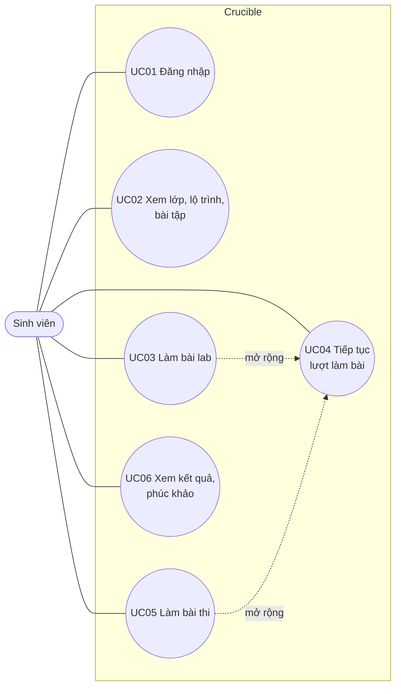
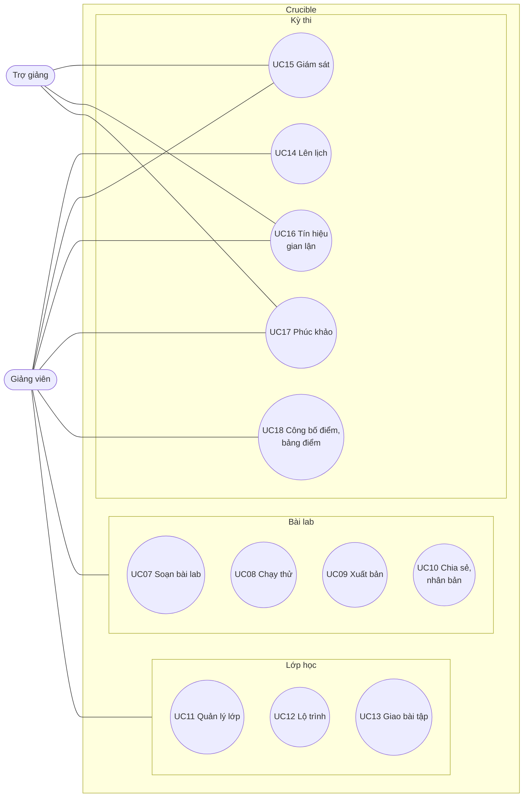
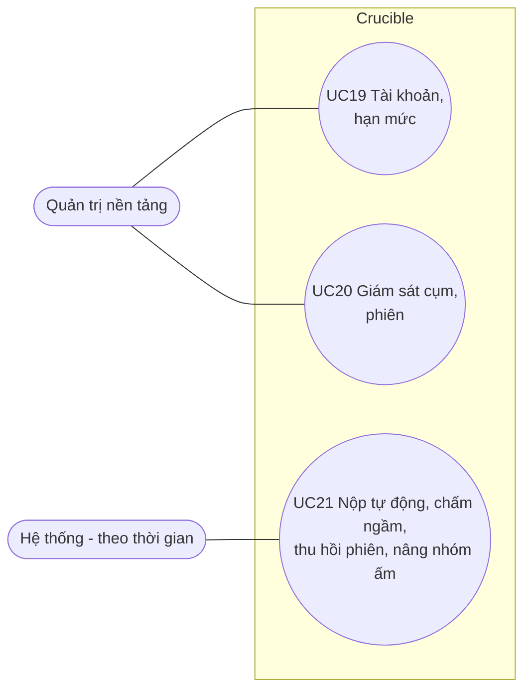
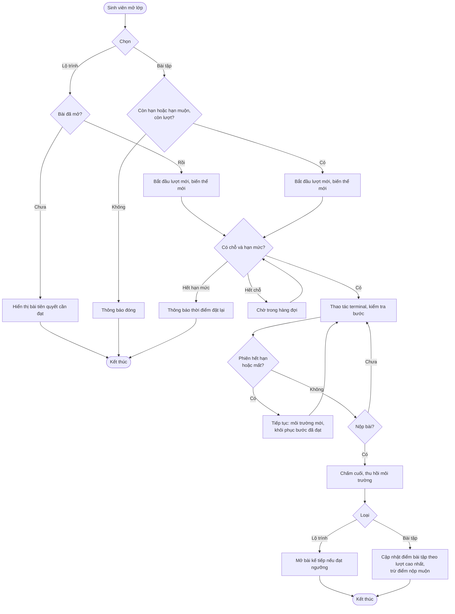
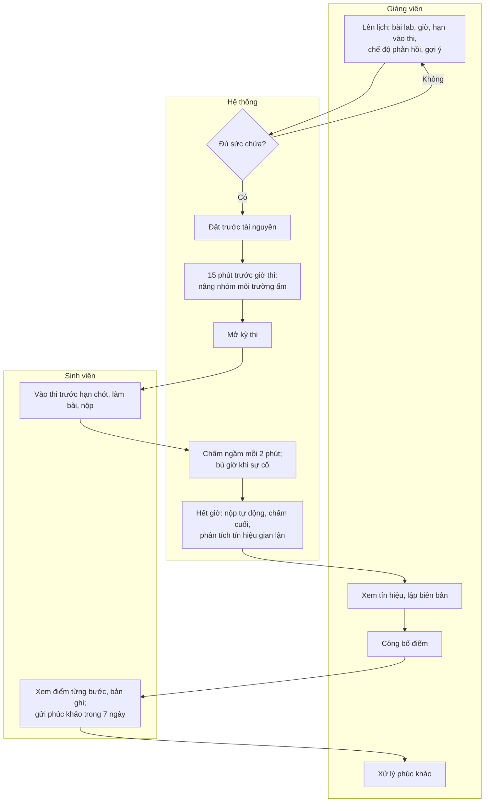
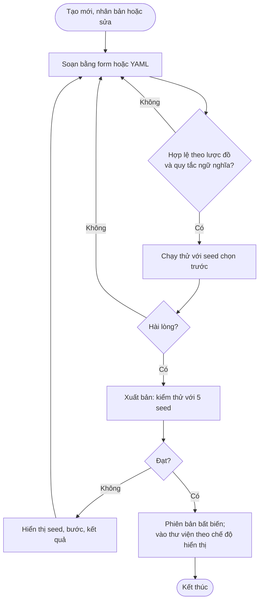
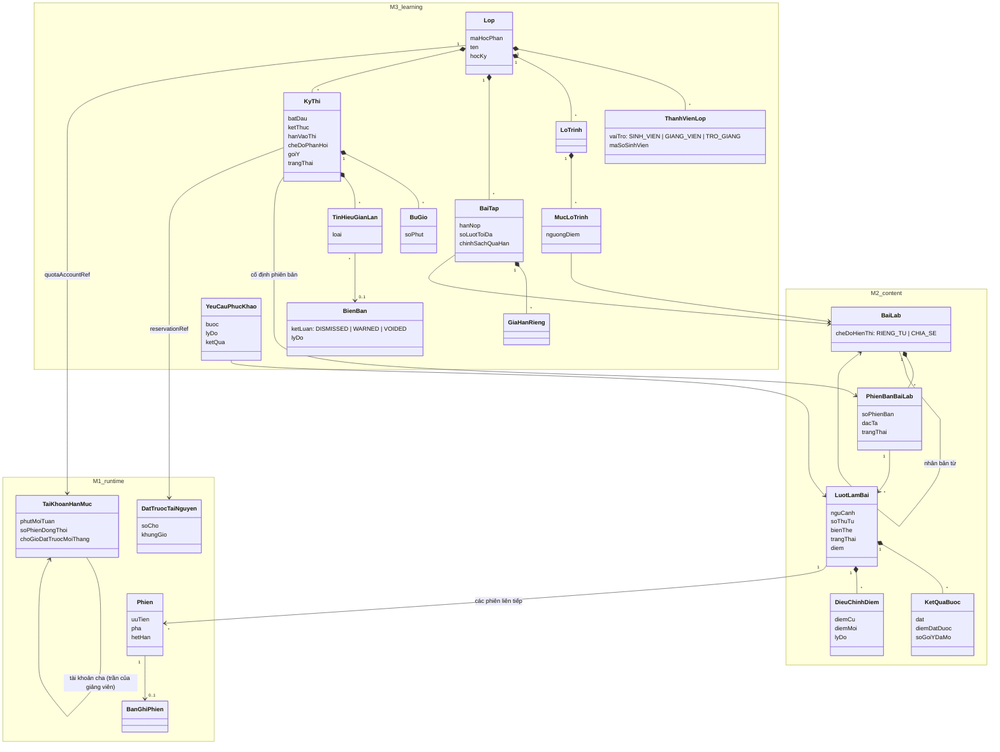

# Phân tích nghiệp vụ: use case, hoạt động và mô hình miền

| Thuộc tính | Giá trị |
|---|---|
| Mã tài liệu | CR-DOC-10 |
| Phiên bản | 1.2 |
| Ngày ban hành | 17/10/2026 |
| Tài liệu liên quan | CR-DOC-01 (chức năng, tiêu chí chấp nhận), CR-DOC-02 (vòng đời đối tượng, luồng kỹ thuật) |

## 1. Phạm vi

Tài liệu mô tả nghiệp vụ của Crucible dưới góc nhìn người dùng: các use case theo tác nhân, đặc tả các use case chính,
biểu đồ hoạt động của các quy trình nhiều bước và mô hình miền liên kết khái niệm của ba module. Luồng kỹ thuật giữa các
thành phần được mô tả tại CR-DOC-02 mục 8.

## 2. Tổng quan use case

Biểu đồ use case được tách theo nhóm tác nhân để dễ đọc.

| Mã | Use case | Tác nhân | Chức năng (CR-DOC-01) | Module chính |
|---|---|---|---|---|
| UC01 | Đăng nhập bằng tài khoản trường hoặc tài khoản cục bộ | Mọi người dùng | P01 | Nền tảng |
| UC02 | Xem lớp, lộ trình, bài tập, kỳ thi sắp tới | Sinh viên | L01–L04 | M3 |
| UC03 | Làm bài lab: bắt đầu, thao tác terminal, kiểm tra bước, trả lời câu hỏi, xem gợi ý, nộp | Sinh viên | R01, R08, C07–C10, C16, C17 | M2, M1 |
| UC04 | Tiếp tục lượt làm bài có khôi phục tiến độ | Sinh viên | C07, C14 | M2 |
| UC05 | Làm bài thi | Sinh viên | L04, L06, C15, C16 | M3, M2 |
| UC06 | Xem kết quả, bản ghi sau công bố, gửi phúc khảo | Sinh viên | L08, L11, L14 | M3 |
| UC07 | Soạn bài lab bằng form và YAML | Giảng viên | C01–C03 | M2 |
| UC08 | Chạy thử bài lab nháp với seed chọn trước | Giảng viên | C13 | M2, M1 |
| UC09 | Xuất bản phiên bản bài lab qua kiểm thử bài lab | Giảng viên | C04, C05 | M2 |
| UC10 | Chia sẻ, nhân bản bài lab | Giảng viên | C11 | M2 |
| UC11 | Tạo lớp, nhập danh sách, thêm giảng viên và trợ giảng, hạn mức giờ máy của lớp | Giảng viên | L01, L12 | M3 |
| UC12 | Quản lý lộ trình luyện tập, xem tiến độ lớp | Giảng viên | L02 | M3 |
| UC13 | Giao bài tập, đặt chính sách quá hạn, gia hạn riêng | Giảng viên | L03 | M3 |
| UC14 | Lên lịch kỳ thi có đặt trước tài nguyên | Giảng viên | L04, L05, R07 | M3, M1 |
| UC15 | Giám sát kỳ thi: tiến độ, xem trực tiếp terminal | Giảng viên, trợ giảng | L07, R09 | M3, M1 |
| UC16 | Xem tín hiệu gian lận, đề xuất và lập biên bản | Giảng viên, trợ giảng | L09, L13 | M3 |
| UC17 | Xử lý phúc khảo | Giảng viên (quyết định), trợ giảng (góp ý) | L11 | M3, M2 |
| UC18 | Công bố điểm kỳ thi, xem và xuất bảng điểm | Giảng viên | L10, L14 | M3 |
| UC19 | Quản lý tài khoản, vai trò, trần hạn mức của giảng viên | Quản trị | R05, P01 | Nền tảng, M1 |
| UC20 | Giám sát sức chứa, hàng đợi, phiên, lần phát hiện dùng CPU bất thường; kết thúc phiên | Quản trị | R13, R16 | M1 |
| UC21 | Nộp tự động khi hết giờ, chấm ngầm mỗi 2 phút, thu hồi phiên hết hạn hoặc không hoạt động, nâng nhóm ấm trước kỳ thi | Hệ thống | R03, R07, C15, L04 | M1, M2, M3 |

## 3. Đặc tả use case chính

### 3.1. UC03 — Làm bài lab

| Mục | Nội dung |
|---|---|
| Tác nhân | Sinh viên |
| Mục tiêu | Hoàn thành các bước của một bài lab trong lộ trình hoặc bài tập và nhận điểm |
| Tiền điều kiện | Sinh viên thuộc lớp; bài lab đã mở (đạt tiên quyết với lộ trình; trong hạn hoặc hạn muộn với bài tập; còn lượt) |
| Kích hoạt | Sinh viên bấm "Bắt đầu" trên bài lab |

Luồng chính:
1. Hệ thống tạo lượt làm bài với biến thể mới và yêu cầu môi trường.
2. Hệ thống hiển thị trạng thái chuẩn bị (vị trí hàng đợi nếu có), sau đó mở trang làm bài: mô tả các bước ở một bên,
   terminal ở bên còn lại, thời gian còn lại của phiên.
3. Sinh viên thao tác trong terminal.
4. Sinh viên bấm "Kiểm tra" ở một bước; hệ thống chạy lệnh kiểm tra và hiển thị đạt hoặc chưa đạt kèm thông điệp.
   Với bước trả lời, sinh viên nhập câu trả lời và bấm "Trả lời"; hệ thống so với đáp án.
5. Lặp lại bước 3–4 cho các bước còn lại.
6. Sinh viên bấm "Nộp bài"; hệ thống chấm cuối, thu hồi môi trường, hiển thị điểm.

Luồng thay thế và ngoại lệ:

| Mã | Điều kiện | Xử lý |
|---|---|---|
| 1a | Sinh viên đã có phiên luyện tập khác đang chạy | Hệ thống thông báo và đề nghị mở phiên đang chạy hoặc kết thúc phiên đó (AC-R1.3) |
| 1b | Tài khoản hạn mức của lớp hết giờ máy trong tuần | Hệ thống thông báo thời điểm hạn mức được đặt lại (AC-R2.4) |
| 2a | Chờ cấp môi trường quá 10 phút | Lượt làm bài chuyển lỗi môi trường; sinh viên thử lại được (AC-R2.3) |
| 3a | Sinh viên không thao tác trong thời gian `idleMinutes` | Cảnh báo trước 2 phút; hết hạn thì phiên bị thu hồi, lượt làm bài tạm dừng, giữ điểm các bước đã đạt (UC04) |
| 3b | Phiên còn 5 phút | Cảnh báo; sinh viên gia hạn được trong giới hạn |
| 3c | Kết nối terminal bị ngắt | Giao diện tự kết nối lại; môi trường giữ nguyên |
| 3d | Phiên dùng CPU bất thường kéo dài | Cảnh báo trong terminal; tiếp diễn 5 phút thì phiên bị kết thúc, lượt làm bài tạm dừng, giữ điểm các bước đã đạt; lần phát hiện được ghi nhận cho quản trị (AC-R5.1) |
| 4a | Sinh viên mở gợi ý | Hệ thống hỏi xác nhận, hiển thị tỉ lệ trừ điểm của gợi ý trước khi mở |
| 4b | Bước trả lời đã dùng hết số lần mà chưa đúng | Bước khóa ở trạng thái không đạt; các bước khác vẫn làm được (AC-C2.10) |
| 6a | Bài tập hết hạn khi đang làm | Hệ thống nộp tự động tại thời điểm hết hạn cuối cùng |

| Mục | Nội dung |
|---|---|
| Hậu điều kiện | Lượt làm bài có điểm; với bài tập, điểm bài tập cập nhật theo lượt cao nhất; với lộ trình, bài kế tiếp được mở khi đạt ngưỡng |
| Tiêu chí liên quan | AC-R1.1–AC-R1.5, AC-C2.1–AC-C2.6, AC-L1.1–AC-L1.4 |

### 3.2. UC04 — Tiếp tục lượt làm bài

| Mục | Nội dung |
|---|---|
| Tác nhân | Sinh viên |
| Tiền điều kiện | Lượt làm bài đang tạm dừng (phiên hết hạn, không hoạt động) hoặc mất môi trường do sự cố |
| Kích hoạt | Sinh viên bấm "Tiếp tục" |

Luồng chính:
1. Hệ thống yêu cầu môi trường mới với cùng biến thể.
2. Hệ thống hiển thị "Đang khôi phục tiến độ" và chạy lời giải mẫu của các bước đã đạt theo thứ tự bước.
3. Hệ thống kiểm tra lại các bước đã khôi phục và mở trang làm bài; sinh viên làm tiếp từ bước chưa đạt.

| Mã | Điều kiện | Xử lý |
|---|---|---|
| 2a | Lời giải của một bước chạy lỗi | Dừng khôi phục các bước sau; thông báo bước khôi phục không thành công; giữ điểm đã đạt (AC-C2.8) |

| Mục | Nội dung |
|---|---|
| Hậu điều kiện | Lượt làm bài ở trạng thái đang làm trên môi trường mới; điểm các bước đã đạt không đổi |
| Tiêu chí liên quan | AC-C2.7, AC-C2.8 |

### 3.3. UC05 — Làm bài thi

| Mục | Nội dung |
|---|---|
| Tác nhân | Sinh viên |
| Tiền điều kiện | Sinh viên thuộc lớp; kỳ thi đã mở; chưa qua hạn chót được vào thi; sinh viên chưa nộp bài thi này |
| Kích hoạt | Sinh viên bấm "Vào thi" |

Luồng chính:
1. Hệ thống tạo lượt làm bài thi với biến thể riêng, cấp môi trường từ phần đặt trước của kỳ thi.
2. Trang làm bài hiển thị đồng hồ đếm ngược tới giờ kết thúc chung (cộng bù giờ của sinh viên nếu có); nút "Kiểm tra"
   và gợi ý hiển thị theo cấu hình kỳ thi.
3. Sinh viên làm bài; hệ thống chấm ngầm mỗi 2 phút.
4. Sinh viên bấm "Nộp bài", xác nhận hai lần; hệ thống chấm cuối trên trạng thái môi trường lúc nộp và thu hồi môi trường.

| Mã | Điều kiện | Xử lý |
|---|---|---|
| 1a | Qua hạn chót được vào thi | Từ chối, thông báo `EXAM_ENTRY_CLOSED` (AC-L2.7) |
| 2a | Chế độ `RECORDED_ONLY` | "Kiểm tra" chỉ báo đã ghi nhận |
| 2b | Chế độ `DISABLED` | Không có nút "Kiểm tra" |
| 3a | Node chạy phiên gặp sự cố | Giao diện báo sự cố hạ tầng, đồng hồ tạm dừng; sinh viên bấm "Tiếp tục"; môi trường mới được khôi phục tới các bước đã đạt theo lần chấm ngầm gần nhất; hệ thống bù đúng thời gian gián đoạn, tổng tối đa 15 phút (AC-L2.4) |
| 4a | Hết giờ khi sinh viên chưa nộp | Hệ thống nộp tự động và chấm cuối (AC-L2.3) |

| Mục | Nội dung |
|---|---|
| Hậu điều kiện | Lượt làm bài có điểm cuối, chưa hiển thị cho sinh viên tới khi công bố |
| Tiêu chí liên quan | AC-L2.2–AC-L2.9, AC-C2.5, AC-C2.9 |

### 3.4. UC07, UC08, UC09 — Soạn, chạy thử và xuất bản bài lab

| Mục | Nội dung |
|---|---|
| Tác nhân | Giảng viên |
| Kích hoạt | Giảng viên tạo bài lab mới, nhân bản một bài chia sẻ, hoặc sửa bài của mình |

Luồng chính:
1. Giảng viên nhập thông tin theo từng phần của form; có thể chuyển sang tab YAML và ngược lại. Mỗi bước chọn loại kiểm tra
   trạng thái (lệnh kiểm tra) hoặc trả lời câu hỏi (đáp án, biểu thức chính quy hoặc lệnh lấy đáp án, số lần tối đa).
2. Hệ thống kiểm tra lược đồ và quy tắc ngữ nghĩa khi nhập, hiển thị lỗi tại trường tương ứng.
3. Giảng viên xem trước mô tả các bước với một biến thể.
4. Giảng viên chạy thử: chọn seed, nhận một phiên có terminal, chạy từng lệnh kiểm tra, chạy lời giải mẫu.
5. Giảng viên bấm "Xuất bản"; hệ thống chạy kiểm thử bài lab với 5 seed.
6. Kiểm thử đạt: phiên bản được xuất bản, bất biến; bài lab xuất hiện trong thư viện theo chế độ hiển thị.

| Mã | Điều kiện | Xử lý |
|---|---|---|
| 5a | Kiểm thử không đạt | Hiển thị seed, bước, kết quả mong đợi và kết quả thực tế; phiên bản vẫn là nháp |
| 5b | Một seed bị dừng vì vượt giới hạn bộ nhớ | Kiểm thử không đạt; đề xuất mức tài nguyên lớn hơn (AC-C1.8) |
| 6b | Bộ nhớ cao nhất vượt 80% giới hạn | Phiên bản được xuất bản; kết quả kiểm thử kèm cảnh báo và đề xuất mức tài nguyên lớn hơn (AC-C1.8) |
| 6a | Sửa bài đã xuất bản | Tạo phiên bản nháp mới; lượt làm bài và kỳ thi đã lên lịch giữ phiên bản cũ |

| Mục | Nội dung |
|---|---|
| Tiêu chí liên quan | AC-C1.1–AC-C1.7 |

### 3.5. UC11 — Quản lý lớp

Luồng chính:
1. Giảng viên tạo lớp (mã học phần, tên lớp, học kỳ).
2. Giảng viên tải lên tệp CSV danh sách sinh viên; hệ thống kiểm tra từng dòng và hiển thị bản xem trước gồm dòng hợp lệ
   và dòng lỗi.
3. Giảng viên xác nhận; sinh viên trong danh sách được gắn vào lớp ngay nếu đã có tài khoản, hoặc khi đăng nhập lần đầu
   bằng email trùng.
4. Giảng viên thêm giảng viên phụ trách khác và trợ giảng bằng email.
5. Giảng viên đặt hạn mức giờ máy mỗi tuần cho lớp; màn hình hiển thị trần của giảng viên và phần đã chia cho các lớp khác.

| Mã | Điều kiện | Xử lý |
|---|---|---|
| 2a | Tệp có dòng lỗi | Chỉ nhập khi giảng viên chọn bỏ qua các dòng lỗi hoặc sửa tệp; báo lỗi theo dòng (AC-L1.5) |
| 3a | Nhập lại danh sách đã có sinh viên | Dòng trùng mã số sinh viên được cập nhật họ tên, email; sinh viên không có trong tệp mới không bị xóa khỏi lớp |
| 5a | Hạn mức vượt phần trần còn lại | Từ chối, hiển thị phần còn lại; giảng viên giảm hạn mức của lớp này hoặc lớp khác, hoặc đề nghị quản trị nâng trần (AC-R2.6) |

### 3.6. UC14 — Lên lịch kỳ thi

Luồng chính:
1. Giảng viên chọn lớp, bài lab (phiên bản đã xuất bản), giờ bắt đầu, giờ kết thúc, hạn chót được vào thi, chế độ phản hồi,
   bật hoặc tắt gợi ý.
2. Hệ thống kiểm tra ngân sách đặt trước trong tháng của giảng viên và sức chứa khả dụng trong khung giờ cho số sinh viên
   của lớp, rồi đặt trước tài nguyên.
3. Kỳ thi ở trạng thái đã lên lịch; sinh viên thấy kỳ thi sắp tới.

| Mã | Điều kiện | Xử lý |
|---|---|---|
| 2a | Không đủ sức chứa | Từ chối; hiển thị số chỗ cần, số chỗ còn và tối đa 3 khung giờ gần nhất cùng độ dài còn đủ chỗ; giảng viên chọn một khung giờ gợi ý hoặc nhập giờ khác (AC-L2.1) |
| 2b | Vượt ngân sách chỗ × giờ đặt trước trong tháng của giảng viên | Từ chối, hiển thị ngân sách đã dùng và còn lại (AC-R2.7) |
| 3a | Giảng viên hủy hoặc đổi giờ trước khi mở | Giải phóng đặt trước cũ, đặt trước theo giờ mới |

### 3.7. UC15, UC16 — Giám sát kỳ thi và xử lý tín hiệu gian lận

Luồng chính:
1. Giảng viên hoặc trợ giảng mở màn hình giám sát: danh sách sinh viên với trạng thái (chưa vào, đang làm, gián đoạn,
   đã nộp), tiến độ theo lần chấm ngầm gần nhất, thời gian bù, số tín hiệu gian lận, cảnh báo dùng CPU bất thường.
2. Chọn một sinh viên để xem trực tiếp terminal (chỉ đọc).
3. Sau kỳ thi, hệ thống phân tích và tạo tín hiệu gian lận: lộ giá trị biến thể, chuỗi lệnh tương đồng, kết nối từ hai
   địa chỉ, dán khối lớn.
4. Trợ giảng xem tín hiệu, xem bản ghi, đề xuất kết luận.
5. Giảng viên phụ trách lập biên bản với kết luận bác bỏ, nhắc nhở hoặc hủy kết quả, kèm lý do; sinh viên được thông báo.

| Mục | Nội dung |
|---|---|
| Tiêu chí liên quan | AC-L2.5, AC-L2.6, AC-L3.1, AC-L3.2, AC-L3.4 |

### 3.8. UC06, UC17 — Phúc khảo

Luồng chính:
1. Sau khi điểm được công bố, sinh viên xem điểm từng bước và bản ghi phiên của mình.
2. Trong thời hạn phúc khảo, sinh viên gửi yêu cầu nêu bước và lý do.
3. Trợ giảng có thể ghi góp ý; giảng viên phụ trách xem bản ghi, quyết định giữ hoặc sửa điểm, ghi câu trả lời.
4. Sinh viên nhận kết quả; điểm sửa được ghi lại với điểm cũ, người sửa, lý do.

| Mã | Điều kiện | Xử lý |
|---|---|---|
| 2a | Quá thời hạn hoặc đã gửi cho bài này | Từ chối (AC-L3.5) |

### 3.9. UC13 — Giao bài tập

Luồng chính:
1. Giảng viên chọn lớp, bài lab, hạn nộp, số lượt tối đa, chính sách quá hạn.
2. Hệ thống ước tính tải cao nhất gần hạn nộp và so với sức chứa (bảng dưới).
3. Tải trong giới hạn: bài tập được lưu; sinh viên nhận thông báo.

| Đại lượng | Cách tính |
|---|---|
| Khung giờ cao điểm | 3 giờ trước hạn nộp |
| Số phiên ước tính chạy cùng lúc | `ceil(0,5 × số sinh viên × thời hạn phiên của bài lab / 180 phút)`, giả định một nửa lớp làm bài trong khung giờ cao điểm |
| Số chỗ còn trống | Số chỗ còn của mức tài nguyên trong khung giờ cao điểm (`GET /v1/capacity`) trừ số phiên ước tính của các bài tập khác có khung giờ cao điểm chồng lấn |
| Giới hạn của lớp | Số phiên đồng thời trong hạn mức của lớp |

Tỉ lệ 0,5 và độ dài 3 giờ là tham số cấu hình của M3.

| Mã | Điều kiện | Xử lý |
|---|---|---|
| 2a | Số phiên ước tính vượt số chỗ còn trống hoặc vượt giới hạn của lớp | Cảnh báo kèm số liệu và gợi ý (dời hạn nộp sang khung giờ ít bài tập khác, mở bài sớm hơn, nâng hạn mức của lớp); giảng viên xác nhận để lưu hoặc sửa (AC-L1.6) |
| 2b | Đổi hạn nộp của bài tập đã giao | Ước tính lại như bước 2 |

## 4. Biểu đồ hoạt động

### 4.1. Học theo lộ trình và làm bài tập

### 4.2. Vòng đời kỳ thi

### 4.3. Soạn và xuất bản bài lab

## 5. Mô hình miền

Liên kết giữa các module (mũi tên đi qua ranh giới namespace) chỉ là mã tham chiếu; mỗi module lưu dữ liệu của mình
(CR-DOC-02 mục 5).

## Lịch sử thay đổi

| Phiên bản | Ngày | Nội dung |
|---|---|---|
| 1.0 | 17/10/2026 | Ban hành lần đầu |
| 1.1 | 17/10/2026 | UC03 3d, UC09 5b và 6b, UC11 5a, UC13 (mục 3.9), UC14 2a và 2b; tài khoản hạn mức phân cấp trong mô hình miền |
| 1.2 | 18/10/2026 | Bước trả lời trong UC03 và soạn bài lab |
