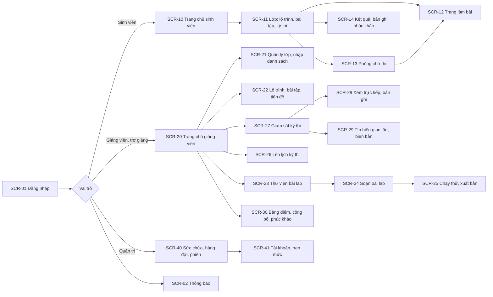

# Thiết kế giao diện và trải nghiệm người dùng

| Thuộc tính | Giá trị |
|---|---|
| Mã tài liệu | CR-DOC-11 |
| Phiên bản | 1.0 |
| Ngày ban hành | 17/10/2026 |
| Tài liệu liên quan | CR-DOC-01, CR-DOC-10 (use case), CR-DOC-03 mục 6 (giao thức terminal), AGENTS.md mục 4 |

## 1. Phạm vi

Tài liệu quy định nguyên tắc trải nghiệm, hệ thống thiết kế, sơ đồ màn hình, danh mục màn hình, bố cục các màn hình
chính và cách hiển thị trạng thái. Chi tiết từng màn hình thuộc tài liệu module sở hữu màn hình đó.

## 2. Nguyên tắc trải nghiệm

| Mã | Nguyên tắc | Áp dụng |
|---|---|---|
| UX1 | Người dùng luôn biết hệ thống đang làm gì | Mọi thao tác chờ quá 1 giây có trạng thái cụ thể: "Đang chuẩn bị môi trường", "Vị trí trong hàng đợi: 3", "Đang khôi phục tiến độ (2/4 bước)" |
| UX2 | Không làm mất công sức của sinh viên | Mất kết nối tự kết nối lại; sự cố hạ tầng có nút "Tiếp tục" và khôi phục tiến độ; cảnh báo trước khi phiên hết hạn hoặc bị thu hồi do không hoạt động |
| UX3 | Thao tác không đảo ngược được phải xác nhận | Nộp bài thi (xác nhận hai lần), mở gợi ý có trừ điểm (hiển thị mức trừ), kết luận hủy kết quả, công bố điểm |
| UX4 | Thời gian rõ ràng | Đồng hồ còn lại luôn hiển thị trên trang làm bài; giờ hiển thị theo giờ Việt Nam; thời gian bù giờ hiển thị riêng |
| UX5 | Lỗi nói được cách khắc phục | Thông điệp lỗi theo mã lỗi (CR-DOC-03 mục 3.4) bằng tiếng Việt, kèm việc người dùng có thể làm tiếp |
| UX6 | Bàn phím là chính trên trang làm bài | Terminal nhận mọi phím; phím tắt của trang không xung đột với phím của shell; có phím tắt chuyển tiêu điểm giữa hướng dẫn và terminal |
| UX7 | Khả năng tiếp cận | Độ tương phản đạt WCAG 2.1 mức AA; trạng thái không chỉ biểu đạt bằng màu (kèm biểu tượng và chữ); điều hướng được bằng bàn phím |

## 3. Thiết bị

| Nhóm màn hình | Thiết bị |
|---|---|
| Trang làm bài, phòng chờ thi, soạn bài lab, chạy thử | Máy tính, chiều rộng từ 1024 px; màn hình nhỏ hơn hiển thị thông báo yêu cầu dùng máy tính |
| Các màn hình còn lại (lớp, lộ trình, lịch thi, điểm, thông báo, giám sát kỳ thi, phúc khảo) | Máy tính và điện thoại, chiều rộng từ 360 px |

## 4. Hệ thống thiết kế

| Thành phần | Lựa chọn |
|---|---|
| Thư viện thành phần | shadcn/ui (Radix UI, Tailwind CSS); mã thành phần nằm trong `web/src/shell/ui` |
| Định hướng thẩm mỹ | Skill `frontend-design` được dùng khi dựng bộ theme và các màn hình đầu tiên; kết quả chốt thành token trong `web/src/shell/theme` |
| Phông chữ | Be Vietnam Pro cho giao diện; JetBrains Mono cho terminal và mã |
| Biểu tượng | Lucide |
| Chế độ màu | Sáng và tối; terminal luôn nền tối |
| Màu trạng thái | Đạt, chưa đạt, đang kiểm tra, đã ghi nhận, gián đoạn, đã nộp; mỗi trạng thái có màu, biểu tượng và nhãn chữ |
| Biểu đồ | Recharts cho tiến độ lớp, kết quả kỳ thi, sức chứa cụm |

## 5. Sơ đồ màn hình



## 6. Danh mục màn hình

| Mã | Màn hình | Vai trò | Module | Use case |
|---|---|---|---|---|
| SCR-01 | Đăng nhập (tài khoản trường hoặc cục bộ) | Mọi người dùng | Nền tảng | UC01 |
| SCR-02 | Thông báo | Mọi người dùng | M3 | |
| SCR-10 | Trang chủ sinh viên: kỳ thi sắp tới, bài tập sắp hết hạn, lượt làm bài đang dở | Sinh viên | M3 | UC02 |
| SCR-11 | Lớp: lộ trình (bài đã mở, bị khóa), bài tập (hạn, số lượt, điểm), kỳ thi | Sinh viên | M3 | UC02 |
| SCR-12 | Trang làm bài | Sinh viên | M2 (nhúng thành phần terminal của M1) | UC03, UC04, UC05 |
| SCR-13 | Phòng chờ thi | Sinh viên | M3 | UC05 |
| SCR-14 | Kết quả từng bước, bản ghi phiên, gửi phúc khảo | Sinh viên | M3 | UC06 |
| SCR-20 | Trang chủ giảng viên: lớp, kỳ thi sắp tới, tín hiệu và phúc khảo chờ xử lý | Giảng viên, trợ giảng | M3 | |
| SCR-21 | Quản lý lớp: danh sách, nhập CSV có xem trước lỗi, thành viên giảng dạy, hạn mức giờ máy của lớp kèm trần của giảng viên và phần đã chia | Giảng viên | M3 | UC11 |
| SCR-22 | Lộ trình, bài tập, chính sách quá hạn, gia hạn riêng, tiến độ lớp; cảnh báo tải gần hạn nộp khi giao bài tập | Giảng viên | M3 | UC12, UC13 |
| SCR-23 | Thư viện bài lab: của tôi, được chia sẻ; nhân bản | Giảng viên | M2 | UC10 |
| SCR-24 | Soạn bài lab: form theo phần, tab YAML, xem trước với biến thể | Giảng viên | M2 | UC07 |
| SCR-25 | Chạy thử (terminal, chạy từng lệnh kiểm tra, chạy lời giải), kết quả kiểm thử khi xuất bản kèm bộ nhớ cao nhất của từng seed so với giới hạn | Giảng viên | M2 | UC08, UC09 |
| SCR-26 | Lên lịch kỳ thi: bài lab, giờ, hạn vào thi, phản hồi, gợi ý; sức chứa khả dụng theo khung giờ; khi không đủ chỗ: phần thiếu và khung giờ gợi ý | Giảng viên | M3 | UC14 |
| SCR-27 | Giám sát kỳ thi: bảng sinh viên, trạng thái, tiến độ, bù giờ, tín hiệu | Giảng viên, trợ giảng | M3 | UC15 |
| SCR-28 | Xem trực tiếp terminal, xem lại bản ghi | Giảng viên, trợ giảng | M3 (nhúng thành phần của M1) | UC15 |
| SCR-29 | Tín hiệu gian lận, đề xuất và biên bản | Giảng viên, trợ giảng | M3 | UC16 |
| SCR-30 | Bảng điểm, xuất CSV, công bố điểm, xử lý phúc khảo | Giảng viên (trợ giảng xem, góp ý) | M3 | UC17, UC18 |
| SCR-40 | Sức chứa theo node, nhóm ấm, hàng đợi, đặt trước, phiên đang chạy | Quản trị | M1 | UC20 |
| SCR-41 | Tài khoản, vai trò, trần hạn mức của từng giảng viên (giờ máy, phiên đồng thời, chỗ × giờ đặt trước) và mức đã dùng | Quản trị | Nền tảng, M1 | UC19 |

## 7. Bố cục các màn hình chính

Phác thảo dưới đây xác định vị trí và nội dung; hình ảnh cụ thể được chốt qua nguyên mẫu (mục 9).

### 7.1. SCR-12 Trang làm bài

```text
┌──────────────────────────────────────────────────────────────────────────────────────────┐
│ ← Lớp IT3070  │  Cấu hình nginx cho người dùng dịch vụ   │ ⏱ Còn 42:15 (+3:00 bù)  [Nộp bài] │
├───────────────────────────────┬──────────────────────────────────────────────────────────┤
│ Tiến độ  ██████░░░░  2/4 bước │ root@lab:~# useradd -m -s /bin/bash deploy                │
│ Điểm tạm thời  40/100         │ root@lab:~# id deploy                                     │
│                               │ uid=1001(deploy) gid=1001(deploy) groups=1001(deploy)     │
│ ✔ 1. Tạo người dùng      20đ  │ root@lab:~# █                                             │
│ ✔ 2. Thêm vào nhóm       20đ  │                                                           │
│ ● 3. Chuẩn bị nội dung   20đ  │                                                           │
│   Tạo /srv/site/index.html    │                                                           │
│   chứa đúng chuỗi page4k2…    │                                                           │
│   [Kiểm tra]  [Gợi ý (−25%)]  │                                                           │
│ ○ 4. Cấu hình nginx      40đ  │                                                           │
│                               │                                                           │
├───────────────────────────────┴──────────────────────────────────────────────────────────┤
│ ● Môi trường sẵn sàng · kết nối ổn định · phiên hết hạn lúc 15:42      [Gia hạn] [Ctrl+\] │
└──────────────────────────────────────────────────────────────────────────────────────────┘
```

- Thanh ngăn giữa hai cột kéo được; tỉ lệ được ghi nhớ trên trình duyệt; `Ctrl+\` thu gọn hoặc mở cột hướng dẫn.
- Kỳ thi: nút "Gia hạn" ẩn; nút "Kiểm tra" và "Gợi ý" hiển thị theo cấu hình; đồng hồ tính tới giờ kết thúc chung.
- Phiên ở trạng thái chuẩn bị, hàng đợi hoặc khôi phục: cột terminal hiển thị trạng thái theo UX1 thay cho terminal.

### 7.2. SCR-13 Phòng chờ thi

```text
┌──────────────────────────────────────────────────────────────┐
│ Kỳ thi giữa kỳ — Quản trị Linux (IT3070)                      │
│ Bắt đầu 09:00 · Kết thúc 10:30 · Vào thi trước 09:15          │
│                                                              │
│                  Còn 06:42 tới giờ thi                        │
│                                                              │
│ Kiểm tra trước khi thi                                        │
│  ✔ Trình duyệt hỗ trợ                                         │
│  ✔ Kết nối terminal (độ trễ 38 ms)        [Thử lại]           │
│                                                              │
│ Quy chế: không gợi ý · kiểm tra chỉ báo "đã ghi nhận" ·       │
│ phiên được ghi lại · nộp bài là kết thúc                      │
│                                                              │
│                    [ Vào thi ] (mở lúc 09:00)                 │
└──────────────────────────────────────────────────────────────┘
```

Phòng chờ mở trước giờ thi 15 phút. Kiểm tra kết nối cấp một môi trường mẫu ngắn (bài lab hệ thống "kiểm tra kết nối",
thời hạn 5 phút), mở terminal, đo độ trễ khứ hồi rồi thu hồi môi trường.

### 7.3. SCR-27 Giám sát kỳ thi

```text
┌──────────────────────────────────────────────────────────────────────────────────────────┐
│ Giám sát: Kỳ thi giữa kỳ · Đang diễn ra · còn 51:20   Đã vào 28/30 · Gián đoạn 1 · Nộp 2 │
├──────────────────────────────────────────────────────────────────────────────────────────┤
│ Lọc: [Tất cả ▾] [Có tín hiệu]  Tìm: [______]                                              │
│ MSSV      Họ tên             Trạng thái     Tiến độ (chấm ngầm)   Bù giờ   Tín hiệu        │
│ 20215001  Nguyễn Văn A       ● Đang làm     ███░░  3/5 (2 phút)   —        —      [Xem]    │
│ 20215002  Trần Thị B         ⚠ Gián đoạn    ██░░░  2/5            +2:10    —      [Xem]    │
│ 20215003  Lê Văn C           ✔ Đã nộp       █████  5/5            —        1      [Xem]    │
│ 20215004  Phạm Thị D         ○ Chưa vào     —                     —        —               │
└──────────────────────────────────────────────────────────────────────────────────────────┘
```

Trên điện thoại, bảng chuyển thành danh sách thẻ; xem trực tiếp terminal chỉ có trên máy tính.

### 7.4. SCR-24 Soạn bài lab

```text
┌──────────────────────────────────────────────────────────────────────────────────────────┐
│ Bài lab: Khắc phục sự cố máy chủ web · Nháp v3     [Form | YAML]   [Chạy thử] [Xuất bản]   │
├──────────────────┬───────────────────────────────────────┬───────────────────────────────┤
│ Thông tin chung  │ Bước 2: Trang hoạt động trở lại        │ Xem trước (seed 17)            │
│ Tham số (2)      │ Tiêu đề  [Trang hoạt động trở lại   ]  │ 2. Trang hoạt động trở lại     │
│ Môi trường       │ Điểm     [70]                          │ Trang http://127.0.0.1:8143/   │
│ Lỗi cài sẵn (4)  │ Mô tả    [Trang `http://127.0.0.1:…]   │ trả về nội dung ban đầu.       │
│ Bước (2)         │ Lệnh kiểm tra                          │                                │
│  1. nginx …      │ ┌───────────────────────────────────┐  │ Tham số: port=8143             │
│ ▸2. Trang …      │ │ test "$(curl -sf http://…)" = …  │  │          marker=9f2c41ab07de   │
│ Lời giải         │ └───────────────────────────────────┘  │ Lỗi cài sẵn: serviceStopped,   │
│                  │ ⚠ Tham số 'markr' chưa được khai báo   │              portConflict      │
└──────────────────┴───────────────────────────────────────┴───────────────────────────────┘
```

### 7.5. SCR-26 Lên lịch kỳ thi khi không đủ sức chứa

```text
┌──────────────────────────────────────────────────────────────────────────────┐
│ Lên lịch kỳ thi · Lớp IT3070 (45 sinh viên) · Bài lab: Khắc phục máy chủ web  │
│ Ngày [24/10/2026]  Bắt đầu [09:00]  Kết thúc [10:30]  Vào thi trước [09:15]   │
│                                                                              │
│ ⚠ Khung giờ này không đủ chỗ: cần 45, còn 32 (thiếu 13).                      │
│   Khung giờ gần nhất còn đủ chỗ (cùng thời lượng 90 phút):                    │
│   ( ) 24/10 13:30–15:00 · còn 48 chỗ                                          │
│   ( ) 24/10 15:00–16:30 · còn 52 chỗ                                          │
│   ( ) 25/10 09:00–10:30 · còn 60 chỗ                                          │
│                                                                              │
│                                    [Chọn giờ khác]  [Dùng khung giờ đã chọn]  │
└──────────────────────────────────────────────────────────────────────────────┘
```

Số chỗ cần bằng số sinh viên của lớp. Khung giờ gợi ý có cùng thời lượng, bắt đầu từ giờ giảng viên nhập trở đi.
Màn hình hiển thị thêm ngân sách chỗ × giờ đặt trước còn lại trong tháng của giảng viên (ví dụ "đã dùng 135/300").

## 8. Trạng thái và thông báo

### 8.1. Trạng thái lượt làm bài trên giao diện

| Trạng thái hệ thống | Hiển thị cho sinh viên |
|---|---|
| `ENV_PENDING` (chưa có chỗ) | "Đang chờ môi trường — vị trí trong hàng đợi: n" |
| `ENV_PENDING` (đang cấp) | "Đang chuẩn bị môi trường" |
| `RESTORING` | "Đang khôi phục tiến độ (k/n bước)" |
| `IN_PROGRESS` | Trang làm bài |
| `ENV_LOST` | "Môi trường gặp sự cố hạ tầng. Tiến độ đã được lưu." + nút "Tiếp tục"; với kỳ thi: "Đồng hồ tạm dừng, thời gian gián đoạn được bù" |
| `SUSPENDED` | "Phiên đã kết thúc do hết hạn, không hoạt động hoặc vượt giới hạn bộ nhớ. Tiến độ đã được lưu." + nút "Tiếp tục" |
| `GRADING` | "Đang chấm bài" |
| `GRADED` | Kết quả (luyện tập, bài tập) hoặc "Đã nộp — điểm sẽ có khi giảng viên công bố" (kỳ thi) |

### 8.2. Thông báo

Thông báo trong ứng dụng cho mọi sự kiện dưới đây; email cho sự kiện đánh dấu ✉. Thông báo do M3 phát, email gửi qua
outbox (CR-DOC-01 L15).

| Sự kiện | Người nhận | Email |
|---|---|---|
| Bài tập mới, bài tập sắp hết hạn (24 giờ) | Sinh viên | ✉ (bài tập mới) |
| Kỳ thi được lên lịch, kỳ thi bắt đầu sau 24 giờ | Sinh viên | ✉ |
| Gia hạn riêng | Sinh viên được gia hạn | ✉ |
| Điểm kỳ thi được công bố | Sinh viên | ✉ |
| Biên bản gian lận | Sinh viên liên quan | ✉ |
| Kết quả phúc khảo | Sinh viên | ✉ |
| Yêu cầu phúc khảo mới, đề xuất biên bản của trợ giảng | Giảng viên phụ trách | |
| Kiểm thử bài lab khi xuất bản hoàn tất | Giảng viên tác giả | |
| Kỳ thi không đủ sức chứa khi đổi giờ | Giảng viên | ✉ |

## 9. Nguyên mẫu và đánh giá trải nghiệm

1. Dựng nguyên mẫu tương tác cho SCR-12, SCR-13, SCR-27, SCR-24 với dữ liệu giả, theo hệ thống thiết kế tại mục 4.
2. Trưởng nhóm đánh giá theo 10 nguyên tắc khả dụng của Nielsen và nguyên tắc UX1–UX7; kết quả ghi thành danh sách vấn đề
   có mức độ.
3. Thử với 3–5 sinh viên theo nhiệm vụ cụ thể ("bắt đầu bài lab và hoàn thành bước 1", "vào thi và nộp bài"); ghi lại
   điểm người dùng bị vấp.
4. Sửa nguyên mẫu; chốt thành token theme và thành phần dùng chung trước khi các module dựng màn hình.

## Lịch sử thay đổi

| Phiên bản | Ngày | Nội dung |
|---|---|---|
| 1.0 | 17/10/2026 | Ban hành lần đầu |
