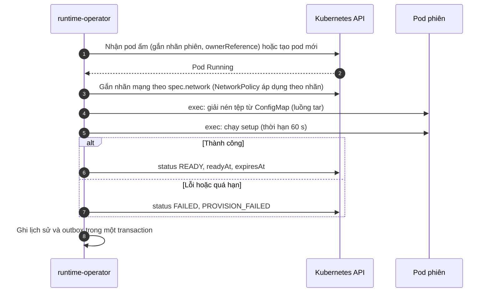
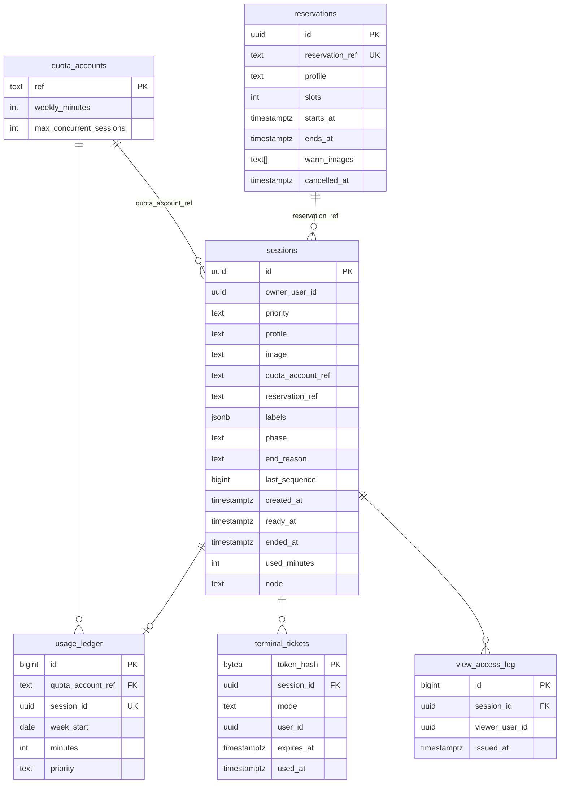

# Thiết kế module M1 — Phiên thực hành và tài nguyên

| Thuộc tính | Giá trị |
|---|---|
| Mã tài liệu | CR-MOD-M1 |
| Phiên bản | 0.1 |
| Ngày ban hành | 17/10/2026 |
| Người phụ trách | Trưởng nhóm (`NhatMinh0311`) |
| Tài liệu liên quan | CR-DOC-01 mục 5.1, 7.1; CR-DOC-02; CR-DOC-03; CR-DOC-04; CR-DOC-05; ADR-0002, ADR-0003, ADR-0006, ADR-0007, ADR-0011 |

Phiên bản 0.1 là thiết kế trước thử nghiệm S1–S3. Các mục phụ thuộc kết quả thử nghiệm được đánh dấu (S1), (S2), (S3).

## 1. Phạm vi và trách nhiệm

MVP gồm R01–R13. R14 (môi trường nhiều máy) và R15 (bài lab Docker) để sau.

## 2. Thành phần triển khai

Một Go module `services/runtime` với ba chương trình:

| Thành phần | Thư viện chính | Trách nhiệm | Số bản sao |
|---|---|---|---|
| `runtime-api` | `net/http`, oapi-codegen (sinh từ `contracts/runtime-api.yaml`), pgx, golang-migrate | API tại `contracts/runtime-api.yaml`; kiểm tra hạn mức; ghi `LabSession`; cấp vé; chạy lệnh kiểm tra; chuyển tiếp outbox; nhận sự kiện | 2 |
| `runtime-operator` | controller-runtime | Đối soát `LabSession`, `WarmPool`, `CapacityReservation`; xếp hàng và cấp chỗ; theo dõi node; dọn tài nguyên mồ côi; ghi lịch sử và outbox | 2, bầu chọn leader |
| `runtime-gateway` | `coder/websocket`, client-go `remotecommand` (WebSocket executor), MinIO SDK | Terminal WebSocket; ghi asciicast; tái dựng dòng lệnh; cập nhật thời điểm hoạt động | 2 |

Chế độ `RUNTIME_DRIVER=docker` của `runtime-api` thay operator và gateway bằng một trình điều khiển trong tiến trình dùng
Docker Engine API, phục vụ môi trường phát triển của M2, M3 (CR-DOC-03 mục 2.3). Chế độ này không có nhóm ấm, đặt trước
và gVisor; API và sự kiện giữ nguyên.

## 3. Tài nguyên Kubernetes

### 3.1. `LabSession` (`crucible.dev/v1alpha1`)

| Trường | Ý nghĩa |
|---|---|
| `spec.ownerUserId`, `spec.priority`, `spec.profile`, `spec.image` | Từ yêu cầu tạo phiên |
| `spec.network` | `none` hoặc `mirror` |
| `spec.ttlMinutes`, `spec.idleMinutes`, `spec.maxExtensionMinutes`, `spec.extensionMinutes` | Thời hạn; `extensionMinutes` tăng khi gia hạn |
| `spec.setupRef` | Tên ConfigMap chứa tệp và script setup đã kết xuất (tối đa 256 KiB), thuộc sở hữu của `LabSession` |
| `spec.reservationRef`, `spec.recordInput` | Từ yêu cầu tạo phiên |
| `spec.terminate` | `{reason}` khi có yêu cầu kết thúc |
| `status.phase`, `status.endReason`, `status.detail` | Pha hiện tại (CR-DOC-02 mục 7.1) |
| `status.node`, `status.podName`, `status.source` | Nơi chạy; `source` là `warm` hoặc `cold` |
| `status.admittedAt`, `status.readyAt`, `status.expiresAt`, `status.endedAt`, `status.lostAt` | Mốc thời gian |
| `status.idleWarningAt` | Thời điểm đã gửi cảnh báo không hoạt động |

Thời điểm hoạt động cuối được `runtime-gateway` ghi vào annotation `crucible.dev/last-activity`, tối đa mỗi 30 giây một lần.

### 3.2. `WarmPool`

| Trường | Ý nghĩa |
|---|---|
| `spec.image`, `spec.profile` | Cấu hình môi trường của nhóm |
| `spec.minReady`, `spec.maxReady` | Giới hạn số pod ấm |
| `status.ready`, `status.target` | Số pod ấm hiện có, số mục tiêu đã tính |

Số mục tiêu = `minReady` + phần nâng từ các `CapacityReservation` sắp bắt đầu hoặc đang diễn ra có `warmImages` chứa
image của nhóm, giới hạn bởi `maxReady` và sức chứa trống. Nhóm cho image xuất hiện trong đặt trước nhưng chưa có `WarmPool`
được tạo tự động với `minReady: 0`.

### 3.3. `CapacityReservation`

Bản sao của đặt trước trong CSDL (`reservationRef`, `profile`, `slots`, `startsAt`, `endsAt`, `warmImages`), được
`runtime-api` tạo; `status.inUse` do operator cập nhật.

## 4. Quy tắc nghiệp vụ

| Mã | Quy tắc | Liên quan |
|---|---|---|
| BR-M1.1 | Mỗi học viên có tối đa một phiên `PRACTICE` và một phiên `EXAM` ở pha chưa kết thúc. Bảo đảm bằng chỉ mục duy nhất có điều kiện trên `sessions(owner_user_id, priority)` | AC-R1.3 |
| BR-M1.2 | Phiên `PRACTICE` bị từ chối khi tài khoản hạn mức đã dùng hết `weeklyMinutes` của tuần hoặc đạt `maxConcurrentSessions`. Phiên `EXAM` không bị kiểm tra giờ máy. Phiên `LAB_CI` tính vào tài khoản `system:lab-ci` | AC-R2.4 |
| BR-M1.3 | Giờ máy của một phiên = số phút làm tròn lên từ `readyAt` tới `endedAt` (hoặc `lostAt`), bằng 0 nếu phiên chưa từng sẵn sàng; ghi một lần vào sổ khi phiên kết thúc. Tuần bắt đầu lúc 00:00 thứ Hai giờ Việt Nam | AC-R2.5 |
| BR-M1.4 | Phiên chờ được cấp theo thứ tự ưu tiên `EXAM` > `PRACTICE` > `LAB_CI`, cùng ưu tiên thì theo thời điểm tạo | AC-R2.1 |
| BR-M1.5 | Không dừng phiên đang chạy để lấy chỗ. Được xóa pod ấm không khớp image để lấy chỗ cho phiên đang chờ | AC-R2.1 |
| BR-M1.6 | Chỗ đặt trước được giữ từ `startsAt − 15 phút` tới `endsAt`; trong khoảng này, phần chỗ đặt trước chưa dùng chỉ cấp cho phiên `EXAM` có cùng `reservationRef` | AC-R2.2 |
| BR-M1.7 | Tổng chỗ đặt trước của các đặt trước chồng lấn thời gian không vượt 80% sức chứa của mức tài nguyên; 20% còn lại dành cho luyện tập | AC-L2.1 |
| BR-M1.8 | Phiên ở `PENDING` quá 10 phút chuyển `FAILED` với lý do `QUEUE_TIMEOUT` | AC-R2.3 |
| BR-M1.9 | Phiên `PRACTICE` không có dữ liệu nhập trong `idleMinutes` bị kết thúc với lý do `IDLE`; cảnh báo gửi qua terminal trước 2 phút. Không áp dụng cho `EXAM` | AC-R1.4 |
| BR-M1.10 | Chỉ phiên `PRACTICE` ở pha `READY`, `EXPIRING` được gia hạn; tổng gia hạn không vượt `maxExtensionMinutes` | AC-R1.5 |
| BR-M1.11 | Khi node có điều kiện `Ready` là `False` hoặc `Unknown`, mọi phiên chưa kết thúc trên node chuyển `LOST`; pod được xóa cưỡng bức | AC-R4.1 |
| BR-M1.12 | Pod, ConfigMap trong `crucible-sessions` không thuộc `LabSession` chưa kết thúc bị xóa trong vòng 2 phút; phiên chưa kết thúc trong CSDL mà không còn `LabSession` được chuyển `TERMINATED` với lý do `ADMIN` và phát sự kiện | AC-R4.2 |
| BR-M1.13 | Vé terminal chỉ cấp cho chủ phiên ở pha `READY`, `EXPIRING`; hết hạn sau 30 giây; dùng một lần; chỉ lưu mã băm SHA-256 | AC-R3.1 |
| BR-M1.14 | Mỗi phiên có tối đa một kết nối tương tác; kết nối mới đóng kết nối cũ với mã 4009 | CR-DOC-03 mục 6 |
| BR-M1.15 | Phiên `EXAM` không được xếp lên node `crucible.dev/node-class=volatile` | CR-DOC-04 mục 4 |
| BR-M1.16 | Mỗi phiên chạy tối đa một lệnh exec (`CHECK` hoặc `RESTORE`) tại một thời điểm (`EXEC_BUSY`); chỉ ở pha `READY`, `EXPIRING`. `RESTORE` chạy bằng shell và `PATH` của môi trường, `CHECK` chạy bằng bộ công cụ chỉ đọc | CR-DOC-03 mục 7 |

## 5. Cấp phát

### 5.1. Mô hình sức chứa

- Chi phí một phiên = bộ nhớ của mức tài nguyên + chi phí gVisor (CR-DOC-04 mục 10). Bộ nhớ là tài nguyên giới hạn;
  CPU không được dùng để tính chỗ.
- Chỗ trống của một node = (bộ nhớ khả dụng của node − tổng request bộ nhớ của pod trên node) / chi phí phiên. Pod ấm được
  tính là đã chiếm chỗ nhưng có thể được nhận hoặc bị xóa (BR-M1.5).
- Sức chứa của một mức tài nguyên = tổng chỗ của các node phiên `Ready`, không bị `cordon`.
- `GET /v1/capacity` trả sức chứa hiện tại trừ chỗ đặt trước chồng lấn khung giờ hỏi.

### 5.2. Vòng xếp hàng

Bản leader của operator chạy vòng xếp hàng mỗi khi có `LabSession` mới, phiên kết thúc, pod ấm sẵn sàng, node thay đổi,
và định kỳ mỗi 5 giây:

1. Lấy các `LabSession` ở `PENDING`, sắp theo BR-M1.4.
2. Với mỗi phiên: tính chỗ được phép dùng theo BR-M1.6, BR-M1.15.
3. Nếu có pod ấm khớp image và mức tài nguyên trên node được phép: nhận pod ấm (`source = warm`).
4. Nếu không: nếu còn chỗ trống, tạo pod mới; nếu hết chỗ nhưng có pod ấm không khớp, xóa pod ấm đó và tạo pod mới
   (`source = cold`); nếu không, giữ `PENDING` và dừng xét các phiên cùng ưu tiên sau nó.
5. Ghi `status.admittedAt`, chuyển `PROVISIONING`.

Vị trí trong hàng đợi trả về ở `getSession` được tính từ danh sách `PENDING` trong bộ nhớ đệm của `runtime-api`.

### 5.3. Dựng môi trường

Pod phiên: PID 1 là `tini` chạy `sleep infinity`; terminal và lệnh kiểm tra đều đi qua exec. Volume `/opt/crucible/bin`
là image công cụ gắn dạng chỉ đọc (S1 xác nhận cách gắn tương thích gVisor).

### 5.4. Đồng bộ trạng thái với CSDL và sự kiện

Trạng thái trong `LabSession` là nguồn sự thật. Sau mỗi lần đổi pha, operator cập nhật bảng `sessions` và ghi sự kiện
vào `outbox` trong cùng một transaction, với `sequence` tăng dần theo phiên. Nếu operator dừng giữa hai bước, lần đối
soát sau phát hiện pha trong CSDL khác pha trong `LabSession` và ghi bù; `sequence` bảo đảm bên nhận bỏ qua sự kiện trùng.

## 6. Terminal

| Mục | Thiết kế |
|---|---|
| Kết nối | Gateway tiêu thụ vé (`UPDATE ... SET used_at = now() WHERE token_hash = $1 AND used_at IS NULL AND expires_at > now() RETURNING ...`), mở exec `bash -l` với TTY tới pod |
| Phân bổ kết nối | Kết nối của một phiên có thể rơi vào bản gateway bất kỳ. Quy tắc một kết nối tương tác (BR-M1.14) dùng khóa tư vấn PostgreSQL theo mã phiên; bản giữ khóa đóng kết nối cũ khi nhận thông báo `LISTEN/NOTIFY` |
| Xem trực tiếp | Bản gateway giữ kết nối tương tác phát lại đầu ra cho người xem qua exchange nội bộ `runtime.terminal-stream` của RabbitMQ (không bền, routing key là mã phiên; không thuộc hợp đồng). Bản gateway nhận kết nối xem gửi tín hiệu đăng ký; bản giữ kết nối tương tác chỉ phát khi có đăng ký còn hiệu lực (gia hạn mỗi 30 giây). Khi mới kết nối, người xem nhận 64 KB đầu ra gần nhất. Không dùng `tmux` trong môi trường vì học viên có thể thoát hoặc dừng tiến trình đó (S3 đo thông lượng) |
| Ghi phiên | Đầu ra (và đầu vào với phiên `recordInput`) ghi theo asciicast v2; đệm 64 KB hoặc 10 giây rồi tải lên MinIO thành phần `recordings/<sessionId>/<số thứ tự>.part`; khi phiên kết thúc, operator ghép thành `recordings/<sessionId>.cast` và phát `runtime.recording.available` |
| Tái dựng dòng lệnh | Bộ đệm theo kết nối: ký tự in được thêm vào, `0x7f`/`0x08` xóa ký tự cuối, `Ctrl-U` xóa dòng, `\r` phát dòng; chuỗi escape bị bỏ qua. Khung nhập dài hơn 200 byte đánh dấu `pasted`. Tối đa 5 sự kiện mỗi giây mỗi phiên |
| Hoạt động | Mỗi khung nhập cập nhật thời điểm hoạt động trong bộ nhớ; ghi annotation tối đa mỗi 30 giây |
| Dừng có kiểm soát | Nhận SIGTERM: ngừng nhận kết nối mới, gửi `closing` mã 4010 cho mọi kết nối, đẩy phần bản ghi còn đệm, thoát sau tối đa 20 giây |

## 7. Mô hình dữ liệu (CSDL `runtime`)

Bảng hạ tầng: `idempotency_keys`, `outbox`, `inbox` (CR-DOC-03 mục 3.3, 5.2).

## 8. Sự kiện

| Sự kiện | Phát / nhận | Xử lý |
|---|---|---|
| `runtime.session.*`, `runtime.terminal.*`, `runtime.recording.available` | Phát | Theo mục 5.4 và mục 6 |
| `content.lab.published` | Nhận | Thêm image vào danh sách kéo sẵn của DaemonSet trên node phiên |
| `learning.exam.closed` | Nhận | Kết thúc sớm đặt trước có `reservationRef` tương ứng; hạ nhóm ấm |

## 9. Giao diện

| Màn hình, thành phần | Vai trò | Nội dung |
|---|---|---|
| Thành phần `<Terminal sessionId mode>` | Học viên, giảng viên | xterm.js; lấy vé, kết nối, tự kết nối lại theo mã đóng; được M2 nhúng vào trang làm bài, M3 nhúng vào trang giám sát |
| Thanh trạng thái phiên | Học viên | Pha, thời gian còn lại, vị trí hàng đợi, gia hạn, cảnh báo không hoạt động |
| Quản trị cụm | `ADMIN` | Sức chứa theo node và mức tài nguyên, nhóm ấm, hàng đợi, phiên đang chạy (lọc, kết thúc), đặt trước theo lịch, tài khoản hạn mức |

## 10. Tác vụ định kỳ

| Tác vụ | Chu kỳ | Thành phần | Nội dung |
|---|---|---|---|
| Vòng xếp hàng | 5 giây và theo sự kiện | Operator (leader) | Mục 5.2 |
| Hết hạn và không hoạt động | 15 giây | Operator | Chuyển `EXPIRING`, `TERMINATED`; cảnh báo không hoạt động |
| Dọn tài nguyên mồ côi | 60 giây | Operator | BR-M1.12; cập nhật `crucible_orphan_resources` |
| Chuyển tiếp outbox | 1 giây | `runtime-api` (một bản qua khóa tư vấn) | CR-DOC-03 mục 5.2 |
| Dọn vé, khóa lặp lại an toàn, outbox, inbox | 1 giờ | `runtime-api` | Xóa bản ghi quá hạn |

## 11. Kiểm thử

| Mức | Công cụ | Phạm vi |
|---|---|---|
| Đơn vị | `go test` | Tính chỗ, thứ tự xếp hàng, quy tắc đặt trước, tính giờ máy, tái dựng dòng lệnh |
| Bộ điều khiển | envtest (API server thật, không có node) | Vòng đời `LabSession`, nhóm ấm, mất node (giả lập điều kiện node), dọn mồ côi |
| Tích hợp | Testcontainers (PostgreSQL, RabbitMQ, MinIO) | Outbox, vé, hạn mức đồng thời, chỉ mục duy nhất |
| Hợp đồng | Schemathesis với `runtime-api` chế độ `docker` | Khớp `contracts/runtime-api.yaml` |
| Cụm | k3d trong CI (runc) | Luồng tạo phiên, exec, terminal, kết thúc |
| Cụm chuẩn | Bộ kiểm thử cách ly, k6, chaos | Q1–Q6, Q9 |

| Tiêu chí, quy tắc | Kiểm thử |
|---|---|
| AC-R1.1, AC-R1.2 | k6 `practice-steady`, `cold-start` |
| AC-R1.3, BR-M1.1 | Tích hợp: 10 yêu cầu đồng thời của một học viên, đúng một thành công |
| AC-R2.1, BR-M1.4, BR-M1.5 | Đơn vị và envtest: thứ tự cấp, không dừng phiên đang chạy |
| AC-R2.2, BR-M1.6, BR-M1.7 | Đơn vị và envtest: đặt trước |
| AC-R2.4, AC-R2.5, BR-M1.2, BR-M1.3 | Tích hợp: sổ hạn mức |
| AC-R3.1, BR-M1.13 | Tích hợp: dùng lại vé, vé hết hạn, vé của người khác |
| AC-R4.1, BR-M1.11 | envtest và chaos CH1 |
| AC-R4.2, BR-M1.12 | envtest và chaos CH2, CH3 |

## 12. Cấu hình

| Biến | Ý nghĩa | Mặc định |
|---|---|---|
| `RUNTIME_DRIVER` | `kubernetes` hoặc `docker` | `kubernetes` |
| `DB_URL` | Kết nối CSDL `runtime` | |
| `AMQP_URL` | Kết nối RabbitMQ | |
| `OIDC_ISSUER`, `OIDC_AUDIENCE` | Xác thực token | |
| `S3_ENDPOINT`, `S3_BUCKET` | Lưu bản ghi | `recordings` |
| `SESSION_NAMESPACE` | Namespace của phiên | `crucible-sessions` |
| `QUEUE_TIMEOUT` | BR-M1.8 | `10m` |
| `RESERVATION_MAX_RATIO` | BR-M1.7 | `0.8` |
| `RESERVATION_LEAD_TIME` | BR-M1.6 | `15m` |
| `SETUP_TIMEOUT` | Thời hạn setup | `60s` |

## Lịch sử thay đổi

| Phiên bản | Ngày | Nội dung |
|---|---|---|
| 0.1 | 17/10/2026 | Bản thiết kế trước thử nghiệm S1–S3 |
