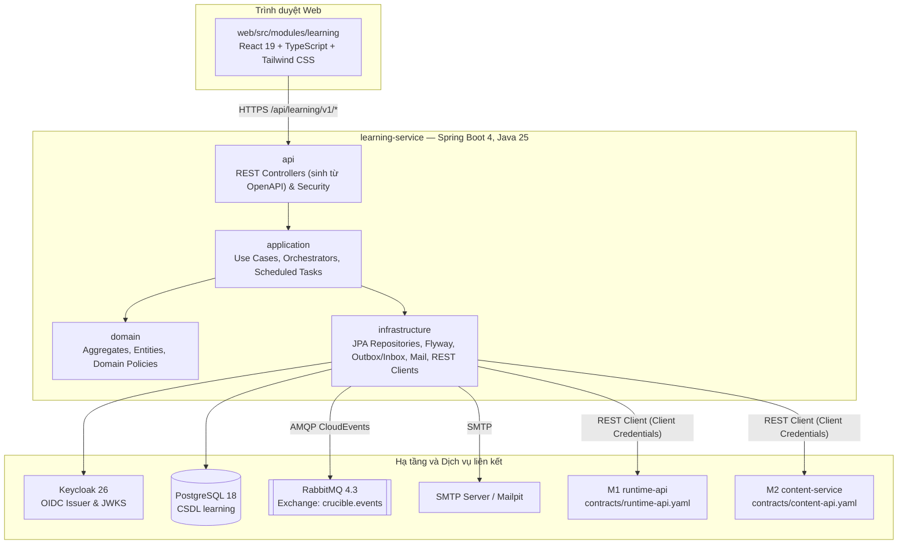
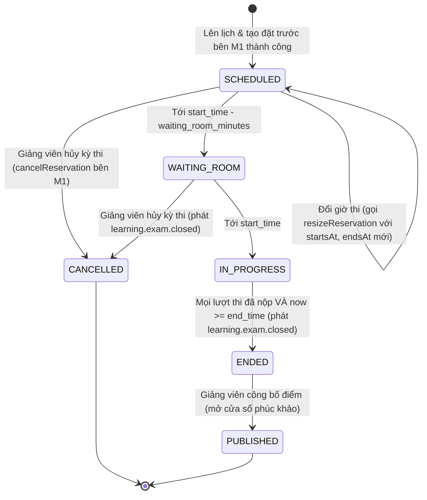
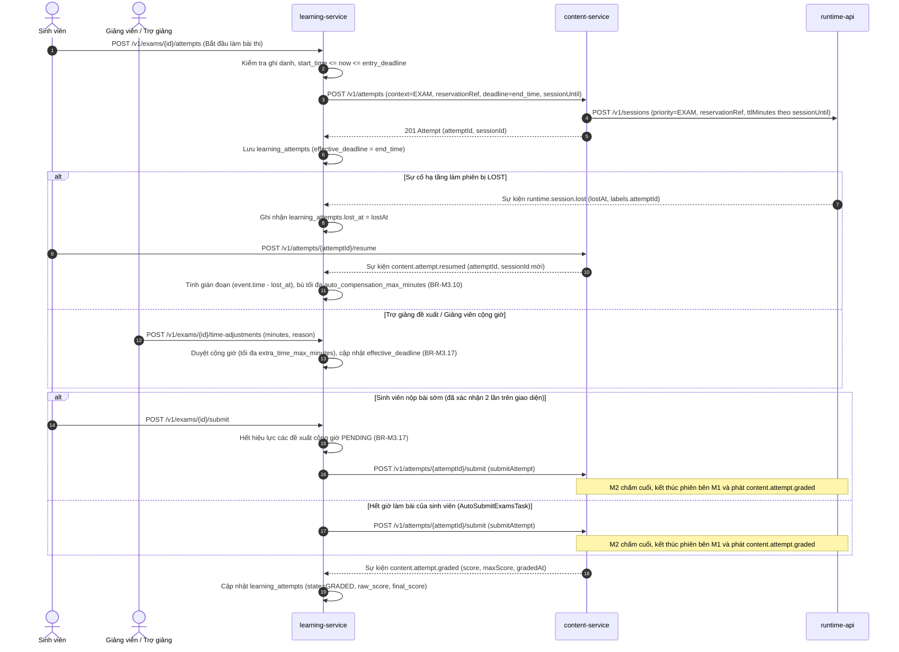
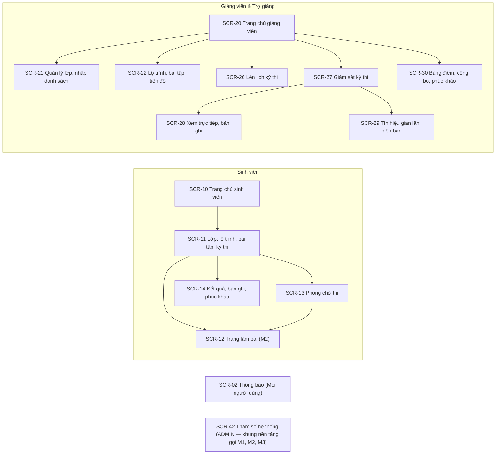

# Thiết kế module M3 — Học tập và kỳ thi

| Thuộc tính | Giá trị |
|---|---|
| Mã tài liệu | CR-MOD-M3 |
| Phiên bản | 1.1 |
| Ngày ban hành | 04/11/2026 |
| Người phụ trách | `quanpva62` |
| Tài liệu liên quan | CR-DOC-01 mục 5.3, 5.6, 7.3, 7.4; CR-DOC-02; CR-DOC-03; CR-DOC-04; CR-DOC-10; CR-DOC-11; ADR-0001, ADR-0004, ADR-0005, ADR-0010, ADR-0012, ADR-0013 |

---

## 1. Phạm vi và trách nhiệm

Module M3 (`learning-service` và `web/src/modules/learning`) chịu trách nhiệm tổ chức lớp học, lộ trình luyện tập, bài tập
có thời hạn, điều phối kỳ thi đồng loạt, giám sát kỳ thi, phát hiện tín hiệu gian lận, xử lý phúc khảo, tổng hợp bảng điểm
và gửi thông báo cho người dùng. Hợp đồng giao tiếp với M1 và M2 được quy định tại CR-DOC-03 và `contracts/`.

### 1.1. Chức năng thuộc phạm vi MVP

Module hiện thực toàn bộ các chức năng từ L01 đến L16 và phần trách nhiệm của M3 trong P04, P05 theo CR-DOC-01 mục 5.3, 5.5:

* **L01 — Lớp học:** Tạo lớp; nhập danh sách sinh viên từ tệp CSV (mã số sinh viên, họ tên, email trường); tự động gắn sinh
  viên vào lớp khi đăng nhập lần đầu bằng email trùng khớp; quản lý giảng viên phụ trách và trợ giảng.
* **L02 — Lộ trình luyện tập:** Chuỗi bài lab có điều kiện tiên quyết (bài sau mở khi bài trước đạt ngưỡng điểm); không giới
  hạn số lượt làm bài; không tính vào điểm học phần; giảng viên theo dõi tiến độ hoàn thành của lớp.
* **L03 — Bài tập:** Giao bài lab cho lớp có thời hạn nộp và số lượt làm tối đa; điểm bài tập là điểm cao nhất trong các
  lượt đã chấm sau khi trừ điểm nộp muộn; chính sách quá hạn (không nhận hoặc nhận muộn trong hạn muộn tối đa với tỉ lệ trừ
  điểm mỗi ngày); gia hạn riêng cho từng sinh viên kèm lý do; ước tính tải cao điểm trong 3 giờ trước hạn nộp và cảnh báo
  nếu vượt sức chứa hoặc vượt số phiên đồng thời của lớp.
* **L04 — Kỳ thi:** Một bài lab (cố định phiên bản khi lên lịch), giờ bắt đầu, giờ kết thúc chung (thời lượng không vượt
  `exam.maxDurationMinutes`), hạn chót vào thi, chế độ phản hồi khi kiểm tra (`FULL`, `RECORDED_ONLY`, `DISABLED`), bật hoặc
  tắt gợi ý, bắt đầu đồng loạt, tự động nộp bài khi hết giờ.
* **L05 — Đặt trước tài nguyên:** Tự động tạo đặt trước tài nguyên bên M1 khi lên lịch kỳ thi; tự động đồng bộ số chỗ đặt
  trước theo sĩ số lớp cho tới giờ kết thúc kỳ thi.
* **L06 — Bù giờ và cộng giờ thi:** Bù giờ tự động khi phiên thi bị `LOST` do sự cố hạ tầng; giảng viên phụ trách cộng giờ
  cho từng sinh viên chưa nộp trong lúc thi, trợ giảng gửi đề xuất cộng giờ; áp dụng trần riêng cho từng loại và ghi nhật ký.
* **L07 — Giám sát kỳ thi:** Hiển thị trạng thái và tiến độ từng sinh viên theo kết quả chấm ngầm gần nhất; xem trực tiếp
  terminal qua vé xem của M1; hiển thị cảnh báo phiên thi dùng CPU bất thường.
* **L08 — Xem lại bản ghi phiên:** Giảng viên phụ trách và trợ giảng xem mọi bản ghi phiên của lớp; sinh viên xem bản ghi
  phiên thi của chính mình sau khi điểm kỳ thi được công bố.
* **L09 & L13 — Tín hiệu gian lận và xử lý vi phạm:** Phát hiện tín hiệu lộ giá trị biến thể (`VARIANT_LEAK`), chuỗi lệnh
  tương đồng (`COMMAND_SIMILARITY`), kết nối tương tác từ hai địa chỉ IP (`DUAL_IP`), dán khối lệnh lớn (`LARGE_PASTE`);
  trợ giảng đề xuất, giảng viên phụ trách lập biên bản với kết luận `DISMISSED`, `WARNED` hoặc `VOIDED` kèm lý do.
* **L10 — Bảng điểm lớp:** Tổng hợp điểm bài tập và kỳ thi của lớp; xuất tệp CSV.
* **L11 & L14 — Công bố điểm và phúc khảo:** Công bố điểm kỳ thi để sinh viên xem điểm từng bước và bản ghi của mình; tiếp
  nhận yêu cầu phúc khảo trong thời hạn của kỳ thi (mặc định theo `regrade.defaultWindowDays`, giảng viên đổi được); trợ
  giảng góp ý, giảng viên phụ trách quyết định giữ hoặc sửa điểm.
* **L12 — Hạn mức giờ máy theo lớp:** Giảng viên phân bổ hạn mức giờ máy tuần và số phiên đồng thời cho từng lớp từ trần
  hạn mức của giảng viên phụ trách chính qua API hạn mức của M1.
* **L15 — Thông báo và email:** Thông báo trong ứng dụng cho mọi người dùng; gửi email cho các sự kiện quan trọng (CR-DOC-11
  mục 8.2) qua bảng hàng đợi email nội bộ theo ngôn ngữ (`locale`) của người nhận.
* **L16 — Phòng chờ thi:** Mở trước giờ thi theo tham số `exam.waitingRoomMinutes` (mặc định 15 phút): hiển thị quy chế,
  đếm ngược, kiểm tra kết nối terminal bằng môi trường mẫu ngắn.
* **P04 & P05 — Tham số hệ thống và đa ngôn ngữ:** Cung cấp API xem, cập nhật và tra cứu lịch sử 5 tham số hệ thống của M3;
  đảm bảo văn bản giao diện thuộc không gian `learning`, thông báo và email hỗ trợ đầy đủ tiếng Việt và tiếng Anh.

### 1.2. Phạm vi mở rộng (sau MVP)

* Kỳ thi gồm nhiều bài lab phối hợp trong một ca thi (CR-DOC-01 mục 5.3 L04).
* Mô hình dịch vụ nhiều đơn vị đào tạo (multi-tenant theo ADR-0013).

---

## 2. Thành phần triển khai

| Thành phần | Công nghệ | Trách nhiệm | Số bản sao |
|---|---|---|---|
| `learning-service` | Spring Boot 4.1.1, Java 25, Spring Data JPA, Flyway, ShedLock, JavaMailSender | Cung cấp REST API `/v1/*`; thực thi quy tắc nghiệp vụ L01–L16; lắng nghe sự kiện từ M1, M2 và phát sự kiện qua outbox; gửi email thông báo; chạy tác vụ định kỳ | 1 bản |
| Giao diện M3 | React 19, TypeScript strict, TanStack Query, react-i18next, Recharts, Lucide | Hiện thực các màn hình `SCR-02`, `SCR-10`, `SCR-11`, `SCR-13`, `SCR-14`, `SCR-20`–`SCR-22`, `SCR-26`–`SCR-30` trong gói `web/src/modules/learning` | Đóng gói chung trong container `web` |
| CSDL `learning` | PostgreSQL 18 | Lưu trữ 15 bảng nghiệp vụ và cấu hình của M3 cùng các bảng hạ tầng (`outbox`, `inbox`, `email_outbox`, `shedlock`) | 1 bản |
| Thư viện nền tảng | `crucible-platform` (`libs/java/crucible-platform`) | Xác thực JWT Keycloak, truyền `trace_id`, xử lý lỗi RFC 9457, cơ chế transactional outbox/inbox | Nhúng trong `learning-service` |

---

## 3. Mô hình dữ liệu

### 3.1. Sơ đồ thực thể – liên kết (CSDL `learning`)

Mô hình dữ liệu của M3 gồm 15 bảng nghiệp vụ và tham số (cùng 4 bảng hạ tầng `outbox`, `inbox`, `email_outbox`, `shedlock`):

```mermaid
erDiagram
    classes ||--o{ class_members : "class_id"
    classes ||--o{ learning_paths : "class_id"
    classes ||--o{ assignments : "class_id"
    classes ||--o{ exams : "class_id"
    classes ||--o{ learning_attempts : "class_id"
    learning_paths ||--o{ learning_path_items : "path_id"
    learning_path_items ||--o| learning_path_items : "prerequisite_item_id"
    assignments ||--o{ assignment_extensions : "assignment_id"
    exams ||--o{ exam_time_adjustments : "exam_id"
    exams ||--o{ cheating_signals : "exam_id"
    exams ||--o{ incident_reports : "exam_id"
    cheating_signals ||--o| incident_reports : "cheating_signal_id"
    exams ||--o{ regrade_requests : "exam_id"
    settings ||--o{ settings_history : "key"

    classes {
        uuid id PK
        varchar code UK "Mã lớp, ví dụ IT3070-20261"
        varchar name "Tên lớp học"
        varchar semester "Học kỳ, ví dụ 2026.1"
        uuid lead_instructor_id "Giảng viên phụ trách chính"
        varchar quota_account_ref UK "class:<id> bên M1"
        int weekly_minutes "Hạn mức phút máy mỗi tuần của lớp"
        int max_concurrent_sessions "Số phiên đồng thời tối đa của lớp"
        varchar status "ACTIVE, ARCHIVED"
        timestamptz created_at
        timestamptz updated_at
    }

    class_members {
        uuid id PK
        uuid class_id FK
        uuid user_id "Nullable khi SV chưa đăng nhập lần đầu"
        varchar role "INSTRUCTOR, TEACHING_ASSISTANT, STUDENT"
        varchar student_id_number "MSSV (nullable với GV/TG)"
        varchar full_name
        varchar email
        varchar locale "vi, en (cập nhật khi đăng nhập)"
        timestamptz joined_at
        timestamptz created_at
    }

    published_labs {
        uuid version_id PK "Phiên bản bài lab từ content.lab.published"
        uuid lab_id
        int version
        varchar slug
        varchar title
        numeric max_score
        int step_count
        varchar image
        varchar profile "small, medium"
        timestamptz published_at
    }

    learning_paths {
        uuid id PK
        uuid class_id FK
        varchar title
        text description
        timestamptz created_at
        timestamptz updated_at
    }

    learning_path_items {
        uuid id PK
        uuid path_id FK
        uuid lab_id
        int item_order
        numeric min_score "Ngưỡng điểm mở bài kế tiếp"
        uuid prerequisite_item_id FK "Nullable với bài đầu tiên"
        timestamptz created_at
    }

    assignments {
        uuid id PK
        uuid class_id FK
        uuid lab_id
        uuid version_id "Nullable để dùng bản mới nhất"
        varchar title
        text description
        timestamptz due_at "Hạn nộp chung"
        int max_attempts "Số lượt tối đa (>= 1)"
        varchar late_policy "REJECT, ALLOW_LATE"
        numeric late_penalty_per_day "Tỉ lệ trừ mỗi ngày muộn (0..1)"
        int max_late_days "Số ngày muộn tối đa"
        timestamptz created_at
        timestamptz updated_at
    }

    assignment_extensions {
        uuid id PK
        uuid assignment_id FK
        uuid user_id
        timestamptz extended_due_at "Hạn nộp riêng của SV"
        text reason "Lý do bắt buộc"
        uuid granted_by "Giảng viên cấp"
        timestamptz created_at
    }

    exams {
        uuid id PK
        uuid class_id FK
        uuid lab_id
        uuid version_id "Phiên bản cố định khi lên lịch"
        varchar title
        text description
        timestamptz start_time
        timestamptz end_time
        timestamptz entry_deadline "Hạn chót vào thi"
        varchar feedback_mode "FULL, RECORDED_ONLY, DISABLED"
        boolean hints_enabled
        uuid reservation_id "ID đặt trước bên M1"
        varchar reservation_ref "exam:<id>"
        int reserved_slots "Số chỗ đã đặt được bên M1"
        int shortfall_slots "Số chỗ thiếu khi tăng sĩ số (0 nếu đủ)"
        varchar shortfall_reason "CAPACITY_UNAVAILABLE, RESERVATION_BUDGET_EXHAUSTED"
        int max_duration_minutes "Giá trị exam.maxDurationMinutes đã chốt"
        int auto_compensation_max_minutes "Giá trị exam.autoCompensationMaxMinutes đã chốt"
        int extra_time_max_minutes "Giá trị exam.extraTimeMaxMinutes đã chốt"
        int waiting_room_minutes "Giá trị exam.waitingRoomMinutes đã chốt"
        int regrade_window_days "Thời hạn phúc khảo (ngày) của kỳ thi"
        varchar status "SCHEDULED, WAITING_ROOM, IN_PROGRESS, ENDED, PUBLISHED, CANCELLED"
        timestamptz published_at "Thời điểm công bố điểm"
        timestamptz created_at
        timestamptz updated_at
    }

    learning_attempts {
        uuid attempt_id PK "Mã lượt làm bài bên M2"
        uuid session_id "Phiên hiện tại bên M1"
        uuid user_id
        uuid class_id FK
        varchar context_type "PRACTICE, ASSIGNMENT, EXAM"
        varchar context_ref "track:<id>, assignment:<id>, exam:<id>, lobby:<id>"
        uuid context_id "ID của path_item, assignment hoặc exam"
        uuid lab_id
        uuid version_id
        int attempt_number "Thứ tự lượt của SV trong ngữ cảnh"
        varchar state "ACTIVE, LOST, SUBMITTED, GRADED"
        timestamptz started_at
        timestamptz effective_deadline "Hạn nộp của lượt hoặc giờ kết thúc riêng"
        timestamptz submitted_at
        timestamptz graded_at
        numeric raw_score "Điểm từ M2"
        numeric max_score
        int late_days "Số ngày nộp muộn (với ASSIGNMENT)"
        numeric final_score "Điểm sau khi trừ phạt nộp muộn"
        int steps_passed "Số bước đạt ở lần chấm gần nhất"
        int steps_total
        timestamptz last_step_checked_at
        int auto_compensated_seconds "Tổng giây đã bù tự động (EXAM)"
        int extra_time_minutes "Tổng phút giảng viên đã cộng (EXAM)"
        timestamptz lost_at "Thời điểm bắt đầu LOST hiện tại (nullable)"
        timestamptz cpu_alert_at "Thời điểm cảnh báo CPU gần nhất"
        numeric cpu_ratio "Tỉ lệ CPU khi cảnh báo"
        boolean recording_available "Bản ghi đã sẵn sàng trên M1"
        jsonb variant_values "Giá trị tham số biến thể để dò VARIANT_LEAK"
    }

    exam_time_adjustments {
        uuid id PK
        uuid exam_id FK
        uuid user_id "Sinh viên được bù/cộng giờ"
        varchar adjustment_type "AUTO_COMPENSATION, INSTRUCTOR_EXTRA"
        varchar status "PENDING, APPROVED, REJECTED, EXPIRED"
        int minutes "Số phút cộng (hoặc làm tròn từ giây bù)"
        int duration_seconds "Số giây gián đoạn thực tế (với AUTO_COMPENSATION)"
        text reason "Lý do bắt buộc"
        uuid proposed_by "Trợ giảng đề xuất (nullable)"
        uuid approved_by "Giảng viên phụ trách duyệt (nullable khi PENDING)"
        timestamptz created_at
        timestamptz decided_at
    }

    cheating_signals {
        uuid id PK
        uuid exam_id FK
        uuid user_id
        uuid attempt_id FK
        varchar signal_type "VARIANT_LEAK, COMMAND_SIMILARITY, DUAL_IP, LARGE_PASTE"
        jsonb evidence "Bằng chứng (dòng lệnh, IP, sinh viên trùng biến thể)"
        timestamptz detected_at
    }

    incident_reports {
        uuid id PK
        uuid exam_id FK
        uuid user_id
        uuid attempt_id FK
        uuid cheating_signal_id FK "Nullable nếu lập trực tiếp"
        varchar status "PROPOSED, DECIDED"
        varchar proposed_conclusion "Đề xuất của trợ giảng (nullable)"
        text proposed_reason
        uuid proposed_by "Trợ giảng đề xuất (nullable)"
        varchar conclusion "DISMISSED, WARNED, VOIDED (nullable khi PROPOSED)"
        text reason "Lý do kết luận của giảng viên phụ trách"
        numeric previous_score "Điểm trước khi VOIDED"
        uuid decided_by "Giảng viên phụ trách quyết định"
        timestamptz created_at
        timestamptz decided_at
    }

    regrade_requests {
        uuid id PK
        uuid exam_id FK
        uuid attempt_id FK
        uuid user_id
        varchar step_id "Bước khiếu nại (nullable nếu toàn bài)"
        text student_reason "Lý do phúc khảo của sinh viên"
        varchar status "PENDING, TA_COMMENTED, APPROVED, REJECTED"
        text ta_comment "Ý kiến của trợ giảng (nullable)"
        uuid ta_user_id "Trợ giảng góp ý (nullable)"
        numeric old_score "Điểm trước khi xử lý phúc khảo"
        numeric new_score "Điểm sau khi xử lý phúc khảo"
        text decision_reason "Trả lời của giảng viên phụ trách"
        uuid resolved_by "Giảng viên phụ trách quyết định"
        timestamptz created_at
        timestamptz resolved_at
    }

    notifications {
        uuid id PK
        uuid user_id
        varchar type "Loại thông báo theo CR-DOC-11 mục 8.2"
        varchar title_key "Khóa dịch tiêu đề"
        varchar body_key "Khóa dịch nội dung"
        jsonb params "Tham số nội suy bản dịch"
        varchar link_path "Đường dẫn điều hướng trên giao diện"
        boolean is_read
        timestamptz created_at
    }

    settings {
        varchar key PK "Khóa tham số hệ thống của M3"
        numeric value
        timestamptz updated_at
        uuid updated_by
    }

    settings_history {
        bigint id PK
        varchar key FK
        numeric old_value
        numeric new_value
        timestamptz changed_at
        uuid changed_by
    }
```

### 3.2. Ràng buộc, chỉ mục và bảng hạ tầng

1. **`classes` và `class_members`:**
   * `classes.quota_account_ref` có dạng `class:<id>`, duy nhất trên toàn bảng.
   * `UNIQUE (class_id, LOWER(email))` và `UNIQUE (class_id, student_id_number)` trên `class_members`: chống trùng email hoặc
     mã số sinh viên trong cùng một lớp khi nhập CSV (`AC-L1.5`).
   * `INDEX idx_class_members_user (user_id)` và `INDEX idx_class_members_unlinked_email (LOWER(email)) WHERE user_id IS NULL`:
     phục vụ tra cứu lớp của người dùng và tự động gắn `user_id` ngay khi sinh viên đăng nhập lần đầu (`BR-M3.05`).
2. **`learning_attempts`:**
   * `UNIQUE (context_type, context_id, user_id, attempt_number)`: kết hợp với khóa dòng `SELECT ... FOR UPDATE` trên bản ghi
     `class_members` của sinh viên trước khi gọi `createAttempt` sang M2 để bảo đảm số lượt làm bài không bao giờ vượt
     `max_attempts` kể cả khi có nhiều yêu cầu đồng thời (`AC-L1.3`, `BR-M3.03`) và mỗi sinh viên chỉ có một lượt thi chính
     thức cho mỗi kỳ thi.
   * `INDEX idx_attempts_active_deadline (context_type, state, effective_deadline) WHERE state IN ('ACTIVE', 'LOST')`: phục vụ
     `AutoSubmitExamsTask` và `CloseOverdueAssignmentsTask` quét các lượt cần nộp tự động.
   * `INDEX idx_attempts_session (session_id)`: tra cứu lượt làm bài khi nhận sự kiện từ M1 hoặc M2.
3. **`exam_time_adjustments`, `incident_reports`, `regrade_requests` (nhật ký kiểm toán):**
   * `UNIQUE (exam_id, user_id)` trên `regrade_requests`: cưỡng chế quy tắc mỗi sinh viên chỉ gửi tối đa một yêu cầu phúc khảo
     cho mỗi kỳ thi (`AC-L3.5`).
   * Phân định trách nhiệm lưu vết kiểm toán giữa M2 và M3 (`BR-M3.10`, `BR-M3.17`, `BR-M3.21`):
     * **M2 (`content-service`)** là nguồn sự thật của điểm lượt làm bài và lưu lịch sử điều chỉnh điểm thông qua operation
       `adjustScore` (`POST /v1/attempts/{attemptId}/score-adjustments` với người điều chỉnh, lý do, điểm mới).
     * **M3 (`learning-service`)** lưu toàn bộ hồ sơ kiểm toán nghiệp vụ dẫn tới thay đổi thời gian hoặc điểm số: bảng
       `exam_time_adjustments` (người đề xuất, người duyệt, số phút, lý do, trạng thái), `incident_reports` (đề xuất của trợ
       giảng, kết luận của giảng viên, lý do, `previous_score`), `regrade_requests` (góp ý của trợ giảng, quyết định của giảng
       viên, `old_score`, `new_score`, lý do) và `settings_history` (`old_value`, `new_value`, `changed_by`, `changed_at`).
4. **Bảng hạ tầng:**
   * `outbox` (`id UUID PK, event_type VARCHAR, subject VARCHAR, sequence BIGINT, payload JSONB, created_at TIMESTAMPTZ, published_at TIMESTAMPTZ`):
     lưu sự kiện CloudEvents phát lên exchange `crucible.events` trong cùng transaction nghiệp vụ (CR-DOC-03 mục 5.2).
   * `inbox` (`event_id UUID PK, subject VARCHAR, sequence BIGINT, processed_at TIMESTAMPTZ`): loại trùng và kiểm tra thứ tự
     `sequence` theo `subject` cho mọi sự kiện nhận từ M1 và M2.
   * `email_outbox` (`id UUID PK, recipient_email VARCHAR, locale VARCHAR, template_key VARCHAR, variables JSONB, status VARCHAR, retry_count INT, created_at TIMESTAMPTZ, sent_at TIMESTAMPTZ`):
     hàng đợi gửi email bất đồng bộ theo mẫu đa ngôn ngữ (CR-DOC-01 L15, CR-DOC-11 mục 8.2).
   * `shedlock` (`name VARCHAR(64) PK, lock_until TIMESTAMPTZ, locked_at TIMESTAMPTZ, locked_by VARCHAR(255)`): khóa phân tán
     cho các tác vụ định kỳ.

---

## 4. Quy tắc nghiệp vụ và máy trạng thái

### 4.1. Máy trạng thái kỳ thi (`ExamStatus`)

* Khi lên lịch kỳ thi, nếu M1 từ chối đặt trước (`409 CAPACITY_UNAVAILABLE` hoặc `402 RESERVATION_BUDGET_EXHAUSTED`), transaction
  bị hủy, kỳ thi chưa được tạo và M3 trả về thông tin số chỗ thiếu kèm khung giờ gợi ý từ `findCapacityWindows` (`AC-L2.1`).
* Khi đổi giờ kỳ thi (`PATCH /v1/exams/{examId}`), M3 gọi `resizeReservation` (`PATCH /v1/reservations/{reservationId}`) bên M1 truyền thời gian `startsAt`, `endsAt` mới (thao tác này chờ pull request mở rộng `contracts/runtime-api.yaml` của M1 merge). M1 đổi giờ trong một thao tác, kiểm tra sức chứa khả dụng mà không tính chính đặt trước đó và tính lại ngân sách chỗ × giờ. Nếu M1 trả `409 CAPACITY_UNAVAILABLE` hoặc `402 RESERVATION_BUDGET_EXHAUSTED`, kỳ thi giữ nguyên giờ cũ và M3 trả khung giờ gợi ý như khi lên lịch (`BR-M3.07`).
* Khi hủy kỳ thi trước `start_time`, M3 gọi `cancelReservation` (`DELETE /v1/reservations/{reservationId}`) bên M1 để giải phóng
  chỗ và hoàn lại ngân sách chỗ × giờ cho giảng viên (`AC-R2.7`).
* Khi kỳ thi chuyển sang `ENDED` (toàn bộ lượt thi đã được nộp/chấm cuối VÀ thời điểm hiện tại `now >= end_time`), M3 ghi sự kiện
  `learning.exam.closed` vào `outbox` để M1 giải phóng phần đặt trước còn lại.

### 4.2. Luồng vào thi, bù giờ, cộng giờ và nộp bài

> **Lưu ý về phân quyền kết thúc phiên:** Theo CR-DOC-03 mục 3.2, `learning-service` không có scope `runtime.sessions.write`
> và không bao giờ gọi trực tiếp M1 để kết thúc phiên. Khi sinh viên nộp bài sớm hoặc hết giờ làm bài, M3 gọi operation
> `submitAttempt` (`POST /v1/attempts/{attemptId}/submit`) của M2; việc chạy lệnh kiểm tra cuối và gọi
> `POST /v1/sessions/{sessionId}/terminate` sang M1 thuộc trách nhiệm của M2.

### 4.3. Bảng quy tắc nghiệp vụ (`BR-M3.*`)

| Mã | Quy tắc | Tiêu chí chấp nhận liên quan |
|---|---|---|
| **BR-M3.01** | **Điều kiện mở bài lab trong lộ trình:** Sinh viên chỉ tạo được lượt làm bài luyện tập (`context.type = PRACTICE`, `context.ref = track:<itemId>`) khi là thành viên `STUDENT` của lớp và có ít nhất một lượt `GRADED` của bài tiên quyết (`prerequisite_item_id`) đạt `final_score >= min_score`. Vi phạm trả `403 PREREQUISITE_NOT_MET`. | `AC-L1.1` |
| **BR-M3.02** | **Chính sách hạn nộp bài tập:** Hạn nộp cơ sở của sinh viên là `coalesce(extended_due_at, due_at)`. Sau mốc này, nếu `late_policy = REJECT` hoặc đã quá `hạn cơ sở + max_late_days`, yêu cầu tạo lượt mới bị từ chối với `409 ASSIGNMENT_CLOSED`. Mọi lượt đang làm được đặt `deadline` bằng hạn cuối cùng được phép và bị nộp tự động qua `submitAttempt` của M2 khi tới hạn đó. | `AC-L1.2` |
| **BR-M3.03** | **Giới hạn số lượt làm bài tập:** Khi sinh viên bắt đầu bài tập, M3 khóa dòng `class_members` của sinh viên (`SELECT ... FOR UPDATE`), đếm số lượt của `(assignment_id, user_id)` trong `learning_attempts`. Nếu đã đạt `max_attempts`, trả `409 ATTEMPT_LIMIT` (CR-DOC-03 mục 3.4) hoặc từ chối yêu cầu đồng thời nhờ ràng buộc duy nhất `(context_type, context_id, user_id, attempt_number)`. | `AC-L1.3` |
| **BR-M3.04** | **Tính điểm bài tập và phạt nộp muộn:** Khi nhận `content.attempt.graded` cho lượt bài tập, số ngày muộn `late_days` tính bằng `ceil((submitted_at - hạn_cơ_sở) / 24h)` (bằng `0` nếu nộp đúng hạn). Điểm của lượt là `final_score = max(0, round(score * (1 - late_days * late_penalty_per_day), 2))`. Điểm bài tập của sinh viên là `MAX(final_score)` của các lượt đã chấm. | `AC-L1.4` |
| **BR-M3.05** | **Nhập danh sách sinh viên CSV và tự động gắn lớp:** Tệp CSV gồm 3 cột `studentId`, `fullName`, `email`. M3 kiểm tra toàn bộ tệp và trả danh sách lỗi theo từng dòng (thiếu cột, email sai định dạng, trùng mã số sinh viên hoặc email trong tệp/trong lớp). Khi người dùng đăng nhập, bộ lọc xác thực hoặc API hồ sơ đối chiếu claim `email` và `locale` trong JWT để cập nhật `user_id`, `locale`, `joined_at` cho mọi dòng `class_members` có email trùng khớp. | `AC-L1.5` |
| **BR-M3.06** | **Cảnh báo tải khi giao hoặc đổi hạn nộp bài tập:** Khi giảng viên lưu bài tập có hạn nộp `D`, M3 ước tính số phiên đồng thời cao điểm trong khung 3 giờ cố định `[D - 3h, D]` bằng hằng số thiết kế `ceil(0.5 * sĩ_số_lớp)`. M3 gọi `getCapacity` của M1 cho khung `[D - 3h, D]` với `profile` của bài lab. Nếu số phiên ước tính vượt `availableSlots` của M1 hoặc vượt `classes.max_concurrent_sessions`, M3 trả cảnh báo kèm số liệu; bài tập được lưu khi giảng viên gửi cờ xác nhận. | `AC-L1.6` |
| **BR-M3.07** | **Lên lịch kỳ thi và đặt trước tài nguyên:** Thời lượng `end_time - start_time` không vượt `exam.maxDurationMinutes`. M3 chốt 5 tham số `exam.*` và `regrade_window_days` vào dòng `exams`, lấy `profile`, `image`, `capabilities` của phiên bản bài lab từ M2, rồi gọi `createReservation` của M1 (`reservationRef = exam:<id>`, `quotaAccountRef = class:<classId>`, `slots = sĩ_số_SV`, `startsAt = start_time`, `endsAt = end_time`, `warmImages`, `warmCapabilities`). Nếu M1 trả `409 CAPACITY_UNAVAILABLE`, M3 gọi `findCapacityWindows` (`dailyStart = 07:00`, `dailyEnd = 21:00`, `limit = 3`) và trả lỗi `409 CAPACITY_UNAVAILABLE` kèm `requiredSlots`, `availableSlots` và danh sách khung giờ gợi ý. | `AC-L2.1`, `AC-P1.4` |
| **BR-M3.08** | **Bắt đầu làm bài thi đồng loạt:** Khi sinh viên vào thi, M3 gọi `createAttempt` của M2 với `context = {type: EXAM, ref: exam:<id>}`, `versionId` đã cố định, `quotaAccountRef = class:<classId>`, `reservationRef = exam:<id>`, `deadline = end_time`, `sessionUntil = end_time + auto_compensation_max_minutes + extra_time_max_minutes`, `hintsEnabled` và `checkFeedback` (`FULL`, `RECORDED_ONLY`, `DISABLED`). M2 tạo phiên ưu tiên `EXAM` từ chỗ đặt trước trên M1, đảm bảo 30 sinh viên bắt đầu trong cùng 1 phút đạt p95 ≤ 10 giây. Ngay sau khi tạo lượt thi, M3 gọi `getAttempt` (`include=variant`) để lưu `variant_values` phục vụ dò gian lận. | `AC-L2.2` |
| **BR-M3.09** | **Tự động nộp bài khi hết giờ và đóng kỳ thi:** Hạn kết thúc thực tế của mỗi sinh viên là `effective_deadline = end_time + auto_compensated_seconds + extra_time_minutes`. Khi `now >= effective_deadline` mà lượt thi chưa nộp, `AutoSubmitExamsTask` gọi `submitAttempt` của M2 để chấm cuối và kết thúc phiên. Khi mọi lượt thi của kỳ thi đã nộp và qua `end_time`, kỳ thi chuyển `ENDED` và phát sự kiện `learning.exam.closed`. | `AC-L2.3`, `AC-L2.7` |
| **BR-M3.10** | **Bù giờ tự động khi phiên thi bị `LOST`:** Khi nhận `runtime.session.lost` của phiên thi đang diễn ra, M3 ghi `lost_at = data.lostAt` vào `learning_attempts`. Khi nhận `content.attempt.resumed` (hoặc khi xét hết giờ), thời gian gián đoạn được tính bằng chênh lệch giữa thuộc tính thời gian `time` của CloudEvent và `lost_at` (`event.time - lost_at`, không phụ thuộc độ trễ xử lý sự kiện tại M3), giới hạn sao cho tổng `auto_compensated_seconds` của sinh viên trong kỳ thi không vượt `exams.auto_compensation_max_minutes * 60`. Phần được bù cộng vào `effective_deadline` và ghi một bản ghi `exam_time_adjustments` (`adjustment_type = AUTO_COMPENSATION`, `status = APPROVED`, `duration_seconds`, `reason`). | `AC-L2.4` |
| **BR-M3.11** | **Phân quyền xem trực tiếp terminal và bản ghi phiên:** Trong kỳ thi, chỉ giảng viên phụ trách và trợ giảng của lớp mới gọi được API lấy vé xem trực tiếp (`createViewTicket` bên M1) và đường dẫn bản ghi (`getRecording` bên M1). Với sinh viên, trước khi kỳ thi ở trạng thái `PUBLISHED`, mọi truy vấn điểm chi tiết và bản ghi của kỳ thi bị từ chối (`403 FORBIDDEN`); sau khi `PUBLISHED`, sinh viên chỉ xem được điểm từng bước và bản ghi của chính mình (không xem lời giải mẫu). | `AC-L2.5`, `AC-L2.9` |
| **BR-M3.12** | **Chặn vào thi sau hạn chót:** Sinh viên chưa có lượt thi gọi bắt đầu làm bài thi sau `entry_deadline` bị từ chối với `409 EXAM_ENTRY_CLOSED`. Sinh viên đã tạo lượt thi trước `entry_deadline` vẫn được tiếp tục (`resume`) nếu phiên gặp sự cố trong thời gian làm bài còn lại. | `AC-L2.7` |
| **BR-M3.13** | **Nộp bài thi trước giờ kết thúc:** Giao diện bắt buộc sinh viên xác nhận hai lần trước khi gửi yêu cầu nộp bài thi. Khi nhận yêu cầu nộp, M3 đánh dấu các đề xuất cộng giờ `PENDING` của sinh viên thành `EXPIRED`, gọi `submitAttempt` sang M2, chuyển trạng thái lượt thi sang `SUBMITTED` và chặn mọi yêu cầu vào lại hoặc tạo lượt mới. | `AC-L2.8` |
| **BR-M3.14** | **Cập nhật tiến độ giám sát từ chấm ngầm:** Khi nhận `content.attempt.step-checked` (bao gồm `trigger = PERIODIC` mỗi 2 phút từ M2), M3 cập nhật `steps_passed`, `raw_score` và `last_step_checked_at` trong `learning_attempts` để hiển thị trên bảng giám sát `SCR-27`, bất kể `feedback_mode` của kỳ thi là `FULL`, `RECORDED_ONLY` hay `DISABLED`. | `AC-L2.6` |
| **BR-M3.15** | **Cảnh báo phiên thi dùng CPU bất thường:** Khi nhận `runtime.session.resource-alert` (`priority = EXAM`, `action = REPORTED`), M3 cập nhật `cpu_alert_at` và `cpu_ratio` trên `learning_attempts` để màn hình giám sát `SCR-27` hiển thị biểu tượng cảnh báo trong ≤ 30 giây. Cảnh báo này không tạo `cheating_signals` và không ảnh hưởng điểm. | `AC-L2.10` |
| **BR-M3.16** | **Tiếp tục thi khi phiên dừng do `OUT_OF_MEMORY` hoặc `ENVIRONMENT_FAILED`:** Khi nhận `runtime.session.terminated` với `endReason` là `OUT_OF_MEMORY` hoặc `ENVIRONMENT_FAILED` của lượt thi chưa nộp, M3 giữ lượt thi ở trạng thái cho phép khôi phục nhưng không ghi `lost_at` và không bù giờ tự động; sinh viên bấm "Tiếp tục" để M2 tạo phiên mới và khôi phục các bước đã đạt theo lần chấm ngầm gần nhất trong thời gian còn lại. | `AC-L2.11` |
| **BR-M3.17** | **Cộng giờ thi thủ công và đề xuất của trợ giảng:** Chỉ áp dụng cho sinh viên chưa nộp bài trong kỳ thi đang diễn ra, bắt buộc có `reason`. Trợ giảng tạo bản ghi `exam_time_adjustments` ở trạng thái `PENDING`; giảng viên phụ trách duyệt (`APPROVED`), từ chối (`REJECTED`) hoặc cộng trực tiếp (`APPROVED`). Khi duyệt hoặc cộng trực tiếp, nếu tổng số phút `APPROVED` (`INSTRUCTOR_EXTRA`) của sinh viên trong kỳ thi vượt `exams.extra_time_max_minutes` đã chốt thì từ chối với `409 EXTRA_TIME_LIMIT` (CR-DOC-03 mục 3.4). Khi sinh viên nộp bài, mọi đề xuất `PENDING` của sinh viên đó chuyển sang `EXPIRED`. Mỗi lần cộng giờ được ghi nhật ký và gửi thông báo cho sinh viên. | `AC-L2.12` |
| **BR-M3.18** | **Đồng bộ số chỗ đặt trước theo sĩ số lớp:** Khi thêm hoặc xóa sinh viên trong lúc lớp có kỳ thi ở trạng thái `SCHEDULED`, `WAITING_ROOM` hoặc `IN_PROGRESS` chưa qua `end_time`, M3 xử lý: (1) Nếu sĩ số mới bằng 0, không gọi M1 vì trường `slots` có `minimum: 1`; (2) Khi tăng sĩ số: gọi `resizeReservation` (`PATCH /v1/reservations/{reservationId}`) với `slots` mới; nếu M1 từ chối do `409 CAPACITY_UNAVAILABLE` hoặc `402 RESERVATION_BUDGET_EXHAUSTED`, việc thêm sinh viên vẫn thành công, M3 giữ nguyên `reserved_slots`, ghi `shortfall_slots = sĩ_số_mới - reserved_slots` và `shortfall_reason`, gửi thông báo + email cảnh báo cho giảng viên phụ trách kèm nút thử lại trên `SCR-26` (sinh viên vượt số chỗ vẫn vào thi được từ sức chứa chung với ưu tiên `EXAM`); (3) Khi giảm sĩ số: gọi `resizeReservation` với `slots` mới; nếu M1 từ chối do `409 RESERVATION_SLOTS_IN_USE` (số chỗ giảm xuống dưới số phiên đang hoạt động) hoặc `409 RESERVATION_CLOSED` (đặt trước đã hủy hoặc qua `endsAt`), M3 giữ nguyên `reserved_slots` hiện tại, việc xóa sinh viên khỏi lớp vẫn thành công và không phát sinh cảnh báo cho giảng viên. | `AC-L2.13` |
| **BR-M3.19** | **Phát hiện tín hiệu gian lận:** Trong kỳ thi, M3 xử lý bất đồng bộ các sự kiện terminal từ M1: (1) Khi nhận `runtime.terminal.input-line`, đối chiếu `line` với `variant_values` của các thí sinh khác trong cùng kỳ thi; nếu chứa giá trị biến thể riêng của thí sinh khác thì tạo tín hiệu `VARIANT_LEAK` (`AC-L3.1`); nếu `pasted = true` thì tạo tín hiệu `LARGE_PASTE`; đồng thời chuẩn hóa chuỗi lệnh theo cửa sổ trượt để phát hiện `COMMAND_SIMILARITY` giữa hai thí sinh; (2) Khi nhận `runtime.terminal.connected` (`mode = INTERACTIVE`), nếu cùng một lượt thi xuất hiện kết nối từ hai `clientIp` khác nhau trong khoảng thời gian chồng lấn hoặc liên tiếp ngắn thì tạo tín hiệu `DUAL_IP`. | `AC-L3.1` |
| **BR-M3.20** | **Biên bản xử lý gian lận:** Tín hiệu gian lận không tự động trừ điểm. Trợ giảng có thể gửi đề xuất biên bản (`status = PROPOSED`); giảng viên phụ trách quyết định biên bản (`status = DECIDED`) với kết luận `DISMISSED`, `WARNED` hoặc `VOIDED` kèm lý do. Khi kết luận `VOIDED`, M3 lưu `previous_score` vào `incident_reports`, gọi `adjustScore` (`score = 0`) sang M2, gửi thông báo + email kèm lý do cho sinh viên; sinh viên bị `VOIDED` vẫn có quyền gửi yêu cầu phúc khảo. | `AC-L3.2`, `AC-L3.4` |
| **BR-M3.21** | **Lưu vết kiểm toán khi điều chỉnh điểm:** Khi giải quyết phúc khảo có thay đổi điểm hoặc khi lập biên bản `VOIDED`, M3 lưu `old_score`, `new_score`, `resolved_by` (hoặc `decided_by`), thời điểm và lý do vào CSDL `learning`, đồng thời gọi `adjustScore` của M2 để M2 lưu lịch sử điều chỉnh điểm trên lượt làm bài và phát `content.attempt.graded` (`adjusted = true`). | `AC-L3.3` |
| **BR-M3.22** | **Quy tắc gửi và xử lý phúc khảo:** Sinh viên chỉ được gửi yêu cầu phúc khảo khi kỳ thi ở trạng thái `PUBLISHED`, thời điểm gửi `now <= published_at + regrade_window_days`, và sinh viên chưa từng gửi phúc khảo cho kỳ thi đó. Vi phạm bất kỳ điều kiện nào bị từ chối với `409 REGRADE_NOT_ALLOWED`. Trợ giảng ghi nhận ý kiến (`TA_COMMENTED`); giảng viên phụ trách quyết định giữ nguyên điểm (`REJECTED`) hoặc sửa điểm (`APPROVED`). | `AC-L3.5` |
| **BR-M3.23** | **Quản trị tham số hệ thống của M3:** Chỉ vai trò `ADMIN` được gọi `/v1/settings`, `/v1/settings/{key}`, `/v1/settings/{key}/history`; vai trò khác nhận `403 FORBIDDEN`. Giá trị nằm ngoài `[minimum, maximum]` tại mục 11.2 bị từ chối với `422 SETTING_OUT_OF_RANGE`; khóa không thuộc 5 tham số của M3 trả `404`. Mỗi lần cập nhật ghi vào `settings` và `settings_history` trong cùng transaction, làm mới bộ nhớ đệm trong ≤ 60 giây mà không khởi động lại dịch vụ. | `AC-P1.1`–`AC-P1.4` |
| **BR-M3.24** | **Đa ngôn ngữ cho thông báo và email:** Mọi mẫu thông báo trong ứng dụng và mẫu email của M3 đều có bản tiếng Việt (`vi`) và tiếng Anh (`en`). Khi tạo thông báo hoặc đẩy vào `email_outbox`, M3 tra ngôn ngữ `locale` đã lưu của người nhận (mặc định `vi`) để kết xuất đúng ngôn ngữ của người nhận. | `AC-P2.1`, `AC-P2.4` |
| **BR-M3.25** | **Phòng chờ thi và kiểm tra kết nối:** Phòng chờ mở từ `start_time - waiting_room_minutes` tới `start_time`. Khi sinh viên bấm "Kiểm tra kết nối" trên `SCR-13`, M3 gọi `createAttempt` sang M2 với ngữ cảnh `context = {type: PRACTICE, ref: lobby:<examId>}` (tiền tố `lobby` khớp mẫu `Ref` trong `content-api.yaml`), bài lab hệ thống kiểm tra kết nối (`WAITING_ROOM_CHECK_LAB_ID`), `quotaAccountRef = class:<classId>` và `deadline = min(now + 5 phút, start_time)`. Sau khi mở terminal đo xong độ trễ khứ hồi, sinh viên (chủ lượt làm bài) gọi trực tiếp `submitAttempt` (`POST /v1/attempts/{attemptId}/submit`) sang M2 theo quyền hạn của học viên tại `contracts/content-api.yaml` để M2 chấm cuối và thu hồi môi trường trước giờ mở đề; nếu sinh viên không bấm kết thúc, môi trường tự động thu hồi khi chạm `deadline`. | `L16` |
| **BR-M3.26** | **Quản lý tài khoản hạn mức của lớp:** Khi tạo lớp hoặc khi giảng viên cập nhật hạn mức của lớp trên `SCR-21`, M3 gọi `putQuotaAccount` (`PUT /v1/quota-accounts/class:{classId}`) bên M1 với `parentRef = instructor:{leadInstructorId}`, `weeklyMinutes` và `maxConcurrentSessions`. Khi đổi giảng viên phụ trách chính của lớp, M3 gọi lại `putQuotaAccount` với `parentRef` của giảng viên mới. Nếu M1 trả `422 QUOTA_CEILING_EXCEEDED`, M3 chuyển tiếp nguyên mã lỗi RFC 9457 về cho giảng viên. | `L12`, `AC-R2.6`, `AC-R2.8` |

---

## 5. API cho giao diện

Đường dẫn của `learning-service` bắt đầu bằng `/v1/...` (tiền tố `/api/learning` do reverse proxy thêm theo CR-DOC-04 mục 3.3).
Đặc tả đầy đủ đặt tại `services/learning/api/openapi.yaml`. Mọi phản hồi lỗi tuân theo RFC 9457 (`Problem`) và bảng mã lỗi tại
CR-DOC-03 mục 3.4.

| Phương thức | Đường dẫn | Quyền truy cập | Mô tả |
|---|---|---|---|
| `GET` | `/v1/dashboard` | `STUDENT`, `INSTRUCTOR` | Dữ liệu trang chủ sinh viên (`SCR-10`) hoặc giảng viên/trợ giảng (`SCR-20`) |
| `GET` | `/v1/classes` | Đã đăng nhập | Danh sách lớp học mà người dùng hiện tại là thành viên |
| `POST` | `/v1/classes` | `INSTRUCTOR`, `ADMIN` | Tạo lớp học mới và khởi tạo tài khoản hạn mức `class:<id>` bên M1 (`BR-M3.26`) |
| `GET` | `/v1/classes/{classId}` | Thành viên lớp | Chi tiết lớp học, thông tin hạn mức lớp và phần trần giảng viên đã chia |
| `PATCH` | `/v1/classes/{classId}` | Giảng viên phụ trách | Cập nhật thông tin lớp, đổi giảng viên phụ trách chính hoặc cập nhật hạn mức lớp (`BR-M3.26`) |
| `GET` | `/v1/classes/{classId}/members` | Thành viên lớp | Danh sách giảng viên, trợ giảng và sinh viên của lớp |
| `POST` | `/v1/classes/{classId}/members/csv-preview` | Giảng viên phụ trách | Kiểm tra tệp CSV danh sách sinh viên, trả kết quả hợp lệ và lỗi theo dòng (`BR-M3.05`) |
| `POST` | `/v1/classes/{classId}/members/csv-import` | Giảng viên phụ trách | Xác nhận nhập danh sách sinh viên từ CSV và đồng bộ đặt trước kỳ thi (`BR-M3.05`, `BR-M3.18`) |
| `POST` | `/v1/classes/{classId}/staff` | Giảng viên phụ trách | Thêm giảng viên phụ trách hoặc trợ giảng vào lớp (`L01`) |
| `DELETE` | `/v1/classes/{classId}/members/{memberId}` | Giảng viên phụ trách | Xóa thành viên khỏi lớp và đồng bộ đặt trước kỳ thi nếu có |
| `GET` | `/v1/classes/{classId}/learning-paths` | Thành viên lớp | Lấy lộ trình luyện tập kèm trạng thái mở khóa/điểm của sinh viên hoặc tiến độ cả lớp |
| `PUT` | `/v1/classes/{classId}/learning-paths` | Giảng viên phụ trách | Tạo hoặc cập nhật lộ trình luyện tập và điều kiện tiên quyết (`L02`) |
| `POST` | `/v1/learning-path-items/{itemId}/attempts` | Sinh viên của lớp | Kiểm tra điều kiện tiên quyết (`BR-M3.01`) và tạo lượt làm bài luyện tập qua M2 |
| `GET` | `/v1/classes/{classId}/assignments` | Thành viên lớp | Danh sách bài tập, hạn nộp, số lượt và điểm cao nhất |
| `POST` | `/v1/classes/{classId}/assignments` | Giảng viên phụ trách | Giao bài tập mới (kiểm tra cảnh báo tải 3 giờ trước hạn nộp theo `BR-M3.06`) |
| `PATCH` | `/v1/assignments/{assignmentId}` | Giảng viên phụ trách | Sửa bài tập / đổi hạn nộp (kèm kiểm tra cảnh báo tải `BR-M3.06`) |
| `POST` | `/v1/assignments/{assignmentId}/extensions` | Giảng viên phụ trách | Cấp gia hạn riêng cho sinh viên kèm lý do (`L03`) |
| `POST` | `/v1/assignments/{assignmentId}/attempts` | Sinh viên của lớp | Kiểm tra hạn nộp, số lượt (`BR-M3.02`, `BR-M3.03`) và tạo lượt làm bài tập qua M2 |
| `GET` | `/v1/classes/{classId}/exams` | Thành viên lớp | Danh sách kỳ thi của lớp |
| `POST` | `/v1/classes/{classId}/exams` | Giảng viên phụ trách | Lên lịch kỳ thi mới, chốt tham số `exam.*` và tạo đặt trước bên M1 (`BR-M3.07`) |
| `GET` | `/v1/exams/{examId}` | Thành viên lớp | Chi tiết kỳ thi, trạng thái phòng chờ, lượt thi hiện tại của sinh viên |
| `PATCH` | `/v1/exams/{examId}` | Giảng viên phụ trách | Đổi giờ thi (gọi `resizeReservation` với `startsAt`, `endsAt` mới), đổi cấu hình hoặc đổi `regrade_window_days` |
| `DELETE` | `/v1/exams/{examId}` | Giảng viên phụ trách | Hủy kỳ thi và gọi `cancelReservation` bên M1 |
| `POST` | `/v1/exams/{examId}/reservation-sync` | Giảng viên phụ trách | Thử lại cập nhật số chỗ đặt trước khi sĩ số lớp tăng (`AC-L2.13`, `SCR-26`) |
| `POST` | `/v1/exams/{examId}/connection-check` | Sinh viên của lớp | Tạo môi trường mẫu ngắn 5 phút kiểm tra kết nối tại phòng chờ (`BR-M3.25`, `SCR-13`) |
| `POST` | `/v1/exams/{examId}/attempts` | Sinh viên của lớp | Bắt đầu làm bài thi chính thức (`BR-M3.08`, `BR-M3.12`) |
| `POST` | `/v1/exams/{examId}/submit` | Sinh viên dự thi | Nộp bài thi sớm sau khi xác nhận hai lần (`BR-M3.13`) |
| `GET` | `/v1/exams/{examId}/monitor` | Giảng viên, Trợ giảng | Bảng giám sát kỳ thi: trạng thái, tiến độ chấm ngầm, bù giờ, cảnh báo CPU, tín hiệu (`SCR-27`) |
| `POST` | `/v1/exams/{examId}/participants/{userId}/view-ticket` | Giảng viên, Trợ giảng | Lấy vé xem trực tiếp terminal của sinh viên từ M1 (`BR-M3.11`, `SCR-28`) |
| `GET` | `/v1/attempts/{attemptId}/recording` | Thành viên được phép | Lấy URL bản ghi phiên từ M1 theo quy tắc phân quyền `BR-M3.11` (`SCR-14`, `SCR-28`) |
| `POST` | `/v1/exams/{examId}/time-adjustments` | Giảng viên, Trợ giảng | Cộng giờ trực tiếp (giảng viên) hoặc gửi đề xuất cộng giờ (trợ giảng) (`BR-M3.17`) |
| `PATCH` | `/v1/exam-time-adjustments/{adjustmentId}` | Giảng viên phụ trách | Duyệt hoặc từ chối đề xuất cộng giờ của trợ giảng (`AC-L2.12`) |
| `POST` | `/v1/exams/{examId}/publish` | Giảng viên phụ trách | Công bố điểm kỳ thi và mở thời hạn phúc khảo (`L14`) |
| `GET` | `/v1/exams/{examId}/cheating-signals` | Giảng viên, Trợ giảng | Danh sách tín hiệu nghi vấn gian lận và biên bản của kỳ thi (`SCR-29`) |
| `POST` | `/v1/exams/{examId}/incident-reports` | Giảng viên, Trợ giảng | Trợ giảng đề xuất hoặc giảng viên phụ trách lập biên bản xử lý (`BR-M3.20`) |
| `PATCH` | `/v1/incident-reports/{reportId}` | Giảng viên phụ trách | Ra kết luận `DISMISSED`, `WARNED` hoặc `VOIDED` cho đề xuất biên bản (`BR-M3.20`) |
| `GET` | `/v1/exams/{examId}/regrade-requests` | Thành viên lớp | Danh sách yêu cầu phúc khảo (giảng viên/trợ giảng xem cả lớp, sinh viên xem của mình) |
| `POST` | `/v1/exams/{examId}/regrade-requests` | Sinh viên dự thi | Gửi yêu cầu phúc khảo trong thời hạn quy định (`BR-M3.22`, `SCR-14`) |
| `PATCH` | `/v1/regrade-requests/{requestId}` | Giảng viên, Trợ giảng | Trợ giảng ghi ý kiến hoặc giảng viên phụ trách quyết định phúc khảo (`BR-M3.21`, `BR-M3.22`) |
| `GET` | `/v1/classes/{classId}/gradebook` | Giảng viên, Trợ giảng | Xem bảng điểm tổng hợp của lớp (`SCR-30`) |
| `GET` | `/v1/classes/{classId}/gradebook/csv` | Giảng viên, Trợ giảng | Xuất bảng điểm của lớp ra tệp CSV (`L10`, `SCR-30`) |
| `GET` | `/v1/notifications` | Đã đăng nhập | Danh sách thông báo trong ứng dụng của người dùng (`SCR-02`) |
| `PATCH` | `/v1/notifications/{notificationId}/read` | Đã đăng nhập | Đánh dấu thông báo đã đọc |
| `GET` | `/v1/settings` | `ADMIN` | Danh sách 5 tham số hệ thống của M3 (`listSettings`, CR-DOC-03 mục 3.6, `SCR-42`) |
| `PUT` | `/v1/settings/{key}` | `ADMIN` | Cập nhật giá trị tham số hệ thống của M3 (`updateSetting`, `BR-M3.23`) |
| `GET` | `/v1/settings/{key}/history` | `ADMIN` | Lịch sử chỉnh sửa của một tham số hệ thống (`listSettingChanges`, `AC-P1.3`) |

---

## 6. Sự kiện

Toàn bộ sự kiện trao đổi qua exchange `crucible.events` tuân theo đặc tả đã merge tại `contracts/events.asyncapi.yaml` và
cơ chế outbox/inbox tại CR-DOC-03 mục 5. Liên kết từ sự kiện của M1 sang lượt làm bài của sinh viên thực hiện qua trường
`data.labels.attemptId` và `data.labels.contextRef`.

| Sự kiện | Phát / nhận | Xử lý |
|---|---|---|
| `learning.exam.closed` | Phát (bên nhận: M1) | Phát với `subject = examId`, `data = {examId, reservationRef, closedAt}` khi kỳ thi kết thúc (`ENDED`) hoặc bị hủy sau khi đã vào khung giữ chỗ để M1 giải phóng đặt trước sớm |
| `runtime.session.lost` | Nhận (từ M1) | Với lượt thi (`context_type = EXAM`) chưa nộp: ghi `learning_attempts.lost_at = data.lostAt` để bắt đầu tính thời gian gián đoạn hạ tầng (`BR-M3.10`, `AC-L2.4`) |
| `runtime.session.terminated` | Nhận (từ M1) | Với lượt thi chưa nộp kết thúc do `endReason` là `OUT_OF_MEMORY` hoặc `ENVIRONMENT_FAILED`: cập nhật trạng thái phiên trên bảng giám sát, giữ quyền tiếp tục bằng phiên mới trong thời gian còn lại và không bù giờ tự động (`BR-M3.16`, `AC-L2.11`) |
| `runtime.session.resource-alert` | Nhận (từ M1) | Với phiên thi (`priority = EXAM`, `action = REPORTED`): ghi `cpu_alert_at = data.detectedAt` và `cpu_ratio = data.cpuRatio` vào `learning_attempts` để hiển thị cảnh báo trên `SCR-27` trong ≤ 30 giây (`BR-M3.15`, `AC-L2.10`) |
| `runtime.terminal.connected` | Nhận (từ M1) | Với phiên thi (`mode = INTERACTIVE`): lưu lịch sử `clientIp` theo `attemptId`; tạo tín hiệu `DUAL_IP` nếu phát hiện kết nối tương tác từ hai địa chỉ IP khác nhau (`BR-M3.19`, `L09`) |
| `runtime.terminal.input-line` | Nhận (từ M1) | Với phiên thi: (1) dò chuỗi `line` với `variant_values` của các thí sinh khác trong cùng kỳ thi để phát hiện `VARIANT_LEAK` (`AC-L3.1`); (2) tạo tín hiệu `LARGE_PASTE` nếu `pasted = true`; (3) cập nhật tập dấu vân tay chuỗi lệnh để phát hiện `COMMAND_SIMILARITY` (`BR-M3.19`, `L09`) |
| `runtime.recording.available` | Nhận (từ M1) | Đánh dấu `learning_attempts.recording_available = true` theo `labels.attemptId` để mở chức năng xem lại bản ghi trên `SCR-14` và `SCR-28` (`L08`) |
| `content.lab.published` | Nhận (từ M2) | Lưu hoặc cập nhật siêu dữ liệu phiên bản bài lab (`labId`, `versionId`, `version`, `title`, `maxScore`, `stepCount`, `image`, `profile`) vào bảng `published_labs` phục vụ cấu hình lộ trình, giao bài tập và đặt trước tài nguyên kỳ thi |
| `content.attempt.step-checked` | Nhận (từ M2) | Cập nhật `steps_passed`, `raw_score`, `last_step_checked_at` của lượt làm bài; khi `trigger = PERIODIC`, cung cấp dữ liệu tiến độ chấm ngầm định kỳ cho màn hình giám sát kỳ thi `SCR-27` (`BR-M3.14`, `AC-L2.6`) |
| `content.attempt.resumed` | Nhận (từ M2) | Cập nhật `session_id = data.sessionId` trên `learning_attempts`; nếu lượt thi đang có `lost_at IS NOT NULL`, chốt thời gian gián đoạn từ `lost_at` tới thời điểm khôi phục theo thuộc tính `time` của CloudEvent (`event.time - lost_at`) để cộng bù giờ tự động theo trần `auto_compensation_max_minutes` và xóa `lost_at` (`BR-M3.10`, `AC-L2.4`) |
| `content.attempt.graded` | Nhận (từ M2) | Cập nhật kết quả chấm cuối (`raw_score`, `max_score`, `gradedAt`, `state = GRADED`); với bài tập, tính phạt nộp muộn và cập nhật điểm cao nhất (`BR-M3.04`, `AC-L1.4`); với kỳ thi, ghi nhận điểm thi hoặc điểm sau điều chỉnh phúc khảo/biên bản (`adjusted = true`) (`AC-L2.3`, `AC-L3.3`, `AC-L3.4`) |

---

## 7. Giao diện

Các màn hình thuộc M3 được hiện thực trong `web/src/modules/learning/` theo đúng mã màn hình tại CR-DOC-11 mục 5, 6 và định
hướng thẩm mỹ "Bản vẽ kỹ thuật" tại [DESIGN.md](../../DESIGN.md):

| Mã | Màn hình | Vai trò | Nội dung chính |
|---|---|---|---|
| `SCR-02` | Thông báo | Mọi người dùng | Danh sách thông báo trong ứng dụng theo ngôn ngữ người dùng, lọc chưa đọc, đánh dấu đã đọc, điều hướng tới đối tượng liên quan |
| `SCR-10` | Trang chủ sinh viên | Sinh viên | Kỳ thi sắp tới, bài tập sắp hết hạn, lượt làm bài đang dở để tiếp tục nhanh (UC02) |
| `SCR-11` | Lớp: lộ trình, bài tập, kỳ thi | Sinh viên | Ba phân mục của lớp: lộ trình luyện tập (bài đã mở, bài bị khóa kèm ngưỡng điểm tiên quyết), bài tập (hạn nộp, gia hạn riêng, số lượt đã dùng/tối đa, điểm cao nhất), danh sách kỳ thi (UC02) |
| `SCR-13` | Phòng chờ thi | Sinh viên | Mở trước giờ thi `waiting_room_minutes`: đồng hồ đếm ngược tới giờ mở đề, quy chế thi (chế độ phản hồi, gợi ý, ghi hình), nút kiểm tra kết nối terminal bằng môi trường mẫu 5 phút, nút "Vào thi" kích hoạt đúng giờ bắt đầu (UC05, CR-DOC-11 mục 7.2) |
| `SCR-14` | Kết quả từng bước, bản ghi, phúc khảo | Sinh viên | Xem điểm từng bước sau khi công bố, phát lại bản ghi phiên thi của chính mình (nhúng trình phát asciicast), gửi yêu cầu phúc khảo trong thời hạn kèm chọn bước và lý do (UC06) |
| `SCR-20` | Trang chủ giảng viên | Giảng viên, Trợ giảng | Danh sách lớp phụ trách, kỳ thi sắp diễn ra, số tín hiệu gian lận, đề xuất cộng giờ và yêu cầu phúc khảo đang chờ xử lý |
| `SCR-21` | Quản lý lớp, nhập danh sách | Giảng viên | Danh sách sinh viên, nhập tệp CSV có bảng xem trước lỗi theo từng dòng, quản lý giảng viên và trợ giảng, cấu hình hạn mức giờ máy tuần và phiên đồng thời của lớp kèm hiển thị trần của giảng viên và phần đã chia (UC11) |
| `SCR-22` | Lộ trình, bài tập, tiến độ | Giảng viên | Soạn chuỗi bài lab trong lộ trình và ngưỡng điểm tiên quyết; giao bài tập, chọn chính sách quá hạn, cấp gia hạn riêng cho sinh viên; hiển thị hộp cảnh báo tải cao điểm 3 giờ trước hạn nộp; bảng tiến độ hoàn thành của lớp (UC12, UC13) |
| `SCR-26` | Lên lịch kỳ thi | Giảng viên | Chọn bài lab (cố định phiên bản), giờ bắt đầu/kết thúc, hạn vào thi, chế độ phản hồi (`FULL`, `RECORDED_ONLY`, `DISABLED`), gợi ý, thời hạn phúc khảo; hiển thị sức chứa khả dụng và ngân sách chỗ × giờ còn lại; khi thiếu chỗ hiển thị số chỗ thiếu và tối đa 3 khung giờ gợi ý; hiển thị cảnh báo thiếu chỗ khi sĩ số lớp tăng kèm nút "Thử lại" (UC14, CR-DOC-11 mục 7.5) |
| `SCR-27` | Giám sát kỳ thi | Giảng viên, Trợ giảng | Bảng thời gian thực: MSSV, họ tên, trạng thái, tiến độ theo lần chấm ngầm gần nhất, bù giờ tự động và giờ cộng thêm, biểu tượng ⚡ cảnh báo CPU bất thường, số tín hiệu gian lận; hộp thoại cộng giờ (giảng viên) hoặc đề xuất cộng giờ (trợ giảng) và thanh duyệt đề xuất chờ xử lý (UC15, CR-DOC-11 mục 7.3) |
| `SCR-28` | Xem trực tiếp terminal, bản ghi | Giảng viên, Trợ giảng | Nhúng thành phần `<Terminal mode="VIEW">` của M1 để quan sát trực tiếp thao tác của thí sinh hoặc phát lại bản ghi phiên của lớp (UC15) |
| `SCR-29` | Tín hiệu gian lận, biên bản | Giảng viên, Trợ giảng | Danh sách tín hiệu (`VARIANT_LEAK`, `COMMAND_SIMILARITY`, `DUAL_IP`, `LARGE_PASTE`) kèm bằng chứng chi tiết; trợ giảng gửi đề xuất, giảng viên phụ trách lập biên bản `DISMISSED`, `WARNED` hoặc `VOIDED` có xác nhận (UC16) |
| `SCR-30` | Bảng điểm, công bố, phúc khảo | Giảng viên, Trợ giảng | Bảng điểm tổng hợp bài tập và kỳ thi của lớp, xuất CSV; nút công bố điểm kỳ thi có xác nhận; danh sách yêu cầu phúc khảo, ý kiến trợ giảng và quyết định giữ/sửa điểm của giảng viên phụ trách (UC17, UC18) |

> `SCR-12` (Trang làm bài) thuộc M2; khi sinh viên bắt đầu hoặc tiếp tục bài luyện tập, bài tập hoặc kỳ thi từ `SCR-11`, `SCR-13`,
> giao diện M3 gọi API tạo lượt làm bài rồi chuyển hướng sang `SCR-12` kèm `attemptId` và thông tin đồng hồ/chế độ nộp bài.
> `SCR-42` (Tham số hệ thống) thuộc khung giao diện nền tảng, gọi `GET /v1/settings`, `PUT /v1/settings/{key}` và
> `GET /v1/settings/{key}/history` của cả ba module M1, M2, M3.

---

## 8. Tác vụ định kỳ

Mọi tác vụ định kỳ trong `learning-service` sử dụng khóa phân tán ShedLock trên bảng `shedlock`:

| Tác vụ | Chu kỳ | Nội dung | Khóa phân tán |
|---|---|---|---|
| `ExamLifecycleTask` | 15 giây | Chuyển trạng thái kỳ thi từ `SCHEDULED` sang `WAITING_ROOM` khi tới `start_time - waiting_room_minutes`, và từ `WAITING_ROOM` sang `IN_PROGRESS` khi tới `start_time` | `learning_exam_lifecycle` |
| `AutoSubmitExamsTask` | 15 giây | Quét các lượt thi trong `learning_attempts` (`context_type = EXAM`, `state IN ('ACTIVE', 'LOST')`) có `now >= effective_deadline`; hết hiệu lực các đề xuất cộng giờ `PENDING` và gọi `submitAttempt` sang M2. Khi mọi lượt thi của kỳ thi đã nộp và `now >= end_time`, chuyển kỳ thi sang `ENDED` và ghi sự kiện `learning.exam.closed` vào `outbox` | `learning_auto_submit_exams` |
| `AutoSubmitAssignmentsTask` | 1 phút | Quét các lượt làm bài tập (`context_type = ASSIGNMENT`, `state IN ('ACTIVE', 'LOST')`) đã chạm hạn nộp cuối cùng cho phép (`effective_deadline`) và gọi `submitAttempt` sang M2 (`AC-L1.2`) | `learning_auto_submit_assignments` |
| `DeadlineReminderTask` | 15 phút | Quét bài tập và kỳ thi sắp đến hạn/bắt đầu trong 24 giờ tới để tạo bản ghi `notifications` và `email_outbox` cho sinh viên của lớp (CR-DOC-11 mục 8.2) | `learning_deadline_reminders` |
| `OutboxRelayTask` | 1 giây | Đọc các dòng chưa gửi trong `outbox` và phát lên RabbitMQ exchange `crucible.events`; cập nhật chỉ số `crucible_outbox_lag_seconds` | `learning_outbox_relay` |
| `EmailOutboxSenderTask` | 5 giây | Đọc các email chờ gửi trong `email_outbox`, kết xuất mẫu theo `locale` của người nhận và gửi qua SMTP | `learning_email_outbox_sender` |
| `HousekeepingTask` | 1 giờ | Xóa các bản ghi `outbox` đã gửi và `inbox` quá 7 ngày theo CR-DOC-03 mục 5.2 | `learning_housekeeping` |

---

## 9. Kiểm thử

### 9.1. Các mức kiểm thử

| Mức | Công cụ | Phạm vi |
|---|---|---|
| Đơn vị | JUnit 5, AssertJ, Mockito | Quy tắc tiên quyết lộ trình, tính điểm phạt nộp muộn, tính thời gian gián đoạn và trần bù giờ/cộng giờ, dò `VARIANT_LEAK` và `COMMAND_SIMILARITY`, kiểm tra khoảng hợp lệ tham số hệ thống, kết xuất mẫu thông báo/email hai ngôn ngữ |
| Tích hợp | Spring Boot Test, Testcontainers (PostgreSQL 18, RabbitMQ 4.3), WireMock | Luồng REST API `/v1/*`, khóa đồng thời khi tạo lượt làm bài tập, giao dịch outbox/inbox, xử lý toàn bộ 10 sự kiện nhận từ M1/M2 và phát `learning.exam.closed`, đồng bộ hạn mức lớp và đặt trước với WireMock M1/M2 |
| Hợp đồng | OpenAPI Generator, Schemathesis | Kiểm tra `services/learning/api/openapi.yaml` và tính tương thích của client gọi `contracts/runtime-api.yaml`, `contracts/content-api.yaml`, `contracts/events.asyncapi.yaml` |
| Giao diện | Vitest, React Testing Library | Kiểm thử các màn hình `SCR-02`, `SCR-10`, `SCR-11`, `SCR-13`, `SCR-14`, `SCR-20`–`SCR-22`, `SCR-26`–`SCR-30`, kiểm tra khóa dịch `vi`/`en`, định dạng múi giờ `Asia/Ho_Chi_Minh`, hộp xác nhận hai lần khi nộp bài thi |

### 9.2. Bảng truy vết tiêu chí chấp nhận và quy tắc nghiệp vụ

| Tiêu chí, quy tắc | Kiểm thử |
|---|---|
| `AC-L1.1`, `BR-M3.01` | Tích hợp (`LearningPathIntegrationTest`): sinh viên không thuộc lớp hoặc chưa đạt `min_score` của bài tiên quyết bị từ chối `403 PREREQUISITE_NOT_MET`; đạt ngưỡng thì gọi `createAttempt` thành công |
| `AC-L1.2`, `BR-M3.02` | Đơn vị và tích hợp (`AssignmentDeadlineTest`): bài tập quá hạn (đã tính gia hạn riêng) trả `409 ASSIGNMENT_CLOSED` khi `late_policy = REJECT` hoặc quá `max_late_days`; lượt đang làm được `AutoSubmitAssignmentsTask` gọi `submitAttempt` khi chạm hạn cuối |
| `AC-L1.3`, `BR-M3.03` | Tích hợp đồng thời (`AssignmentConcurrencyTest`): 10 luồng đồng thời của cùng một sinh viên gọi tạo lượt làm bài khi `max_attempts = 2`, đúng 2 lượt được tạo và 8 luồng nhận `409` |
| `AC-L1.4`, `BR-M3.04` | Đơn vị (`AssignmentScoringTest`): tính điểm nhiều lượt làm bài có các mức nộp muộn khác nhau, kết quả bằng điểm cao nhất sau khi trừ tỉ lệ nộp muộn từng lượt |
| `AC-L1.5`, `BR-M3.05` | Đơn vị và tích hợp (`ClassCsvImportTest`): tệp CSV có dòng thiếu cột, email sai định dạng, trùng MSSV trả đúng số dòng lỗi; sinh viên có email trong danh sách đăng nhập lần đầu được tự động gắn `user_id` vào lớp |
| `AC-L1.6`, `BR-M3.06` | Tích hợp (`AssignmentCapacityWarningTest`): giao bài tập hoặc đổi hạn nộp khi `0,5 × sĩ số` vượt `availableSlots` của M1 trong 3 giờ trước hạn nộp hoặc vượt `max_concurrent_sessions` của lớp thì trả cảnh báo kèm số liệu; có cờ xác nhận thì lưu thành công |
| `AC-L2.1`, `BR-M3.07` | Tích hợp với WireMock M1 (`ExamSchedulingTest`): lên lịch kỳ thi tạo đặt trước theo sĩ số lớp; khi M1 trả `409 CAPACITY_UNAVAILABLE`, M3 trả số chỗ cần, số chỗ còn và tối đa 3 khung giờ gợi ý trong khoảng `07:00–21:00` |
| `AC-L2.2`, `BR-M3.08` | Tích hợp và kịch bản đo tải `exam-burst` (`tests/load/`): 30 sinh viên bắt đầu kỳ thi trong 60 giây đều nhận được lượt thi và phiên với p95 ≤ 10 giây; lời gọi `createAttempt` truyền đúng `sessionUntil` và `reservationRef` |
| `AC-L2.3`, `BR-M3.09` | Tích hợp (`AutoSubmitExamsTaskTest`): khi hết giờ, mọi lượt thi chưa nộp được gọi `submitAttempt` sang M2, kỳ thi chuyển `ENDED` và phát sự kiện `learning.exam.closed` |
| `AC-L2.4`, `BR-M3.10` | Tích hợp sự kiện (`ExamAutoCompensationTest`): nhận `runtime.session.lost` (`lostAt`) rồi nhận `content.attempt.resumed`, hệ thống bù đúng thời gian gián đoạn vào `effective_deadline`, không vượt trần `auto_compensation_max_minutes` (15 phút) và ghi `exam_time_adjustments` |
| `AC-L2.5`, `BR-M3.11` | Tích hợp bảo mật (`ExamObservationSecurityTest`): chỉ giảng viên phụ trách và trợ giảng của lớp lấy được vé xem terminal và bản ghi; giảng viên lớp khác và sinh viên bị từ chối `403 FORBIDDEN` |
| `AC-L2.6`, `BR-M3.14` | Tích hợp sự kiện (`ExamMonitorProgressTest`): nhận `content.attempt.step-checked` với `trigger = PERIODIC` cho kỳ thi có `feedback_mode = DISABLED` hoặc `RECORDED_ONLY`, API `/v1/exams/{id}/monitor` phản ánh đúng số bước đạt và điểm tạm thời |
| `AC-L2.7`, `BR-M3.12` | Tích hợp (`ExamEntryDeadlineTest`): sinh viên bắt đầu sau `entry_deadline` nhận `409 EXAM_ENTRY_CLOSED`; mỗi sinh viên được nộp tự động tại `end_time` cộng thời gian bù/cộng của riêng mình |
| `AC-L2.8`, `BR-M3.13` | Kiểm thử giao diện và tích hợp (`ExamEarlySubmitTest`): trên `SCR-12`/`SCR-13` nộp sớm cần xác nhận 2 lần; sau khi gọi `/v1/exams/{id}/submit`, M3 gọi `submitAttempt` của M2 và từ chối mọi yêu cầu vào lại |
| `AC-L2.9`, `BR-M3.11` | Tích hợp bảo mật (`ExamPublishAccessTest`): trước khi công bố điểm, sinh viên gọi xem điểm từng bước và bản ghi nhận `403`; sau khi công bố (`PUBLISHED`), sinh viên xem được điểm từng bước và bản ghi của chính mình |
| `AC-L2.10`, `BR-M3.15` | Tích hợp sự kiện (`ExamResourceAlertTest`): nhận `runtime.session.resource-alert` của phiên thi, trạng thái cảnh báo CPU hiển thị trên dữ liệu giám sát trong ≤ 30 giây, không tạo tín hiệu gian lận và không trừ điểm |
| `AC-L2.11`, `BR-M3.16` | Tích hợp sự kiện (`ExamAbnormalTerminationTest`): nhận `runtime.session.terminated` với `endReason = OUT_OF_MEMORY` và `ENVIRONMENT_FAILED` khi chưa nộp, sinh viên tiếp tục được bằng phiên mới với các bước đã đạt theo lần chấm ngầm gần nhất, không được bù giờ tự động |
| `AC-L2.12`, `BR-M3.17` | Tích hợp (`ExamExtraTimeTest`): giảng viên cộng giờ có lý do bắt buộc, vượt 30 phút nhận `409 EXTRA_TIME_LIMIT`; trợ giảng tạo đề xuất `PENDING`, giảng viên duyệt hoặc từ chối; đề xuất `PENDING` tự chuyển `EXPIRED` khi sinh viên nộp bài; ghi nhật ký và tạo thông báo |
| `AC-L2.13`, `BR-M3.18` | Tích hợp với WireMock M1 (`ExamReservationSyncTest`): tăng sĩ số gọi `resizeReservation`; khi M1 trả `409 CAPACITY_UNAVAILABLE` hoặc `402 RESERVATION_BUDGET_EXHAUSTED`, sinh viên vẫn vào lớp, giữ nguyên số chỗ, ghi `shortfall_slots`, cảnh báo giảng viên và cho phép thử lại. Giảm sĩ số khi có 0 sinh viên không gọi M1; giảm nhận `409 RESERVATION_SLOTS_IN_USE` hoặc `409 RESERVATION_CLOSED` thì giữ nguyên số chỗ và không cảnh báo |
| `AC-L3.1`, `BR-M3.19` | Đơn vị và tích hợp sự kiện (`CheatingDetectionTest`): nhận `runtime.terminal.input-line` chứa giá trị biến thể của thí sinh khác trong cùng kỳ thi tạo tín hiệu `VARIANT_LEAK`; kiểm thử thêm `LARGE_PASTE`, `COMMAND_SIMILARITY` và `DUAL_IP` từ `runtime.terminal.connected` |
| `AC-L3.2`, `AC-L3.4`, `BR-M3.20` | Tích hợp (`IncidentReportTest`): tín hiệu gian lận không tự đổi điểm; trợ giảng đề xuất, giảng viên lập biên bản; kết luận `VOIDED` gọi `adjustScore` của M2 đặt điểm về 0 (lưu điểm cũ), thông báo cho sinh viên và cho phép sinh viên gửi phúc khảo |
| `AC-L3.3`, `BR-M3.21` | Tích hợp (`RegradeAuditTest`): duyệt phúc khảo sửa điểm lưu đầy đủ `old_score`, `new_score`, `resolved_by`, `decision_reason` tại M3 và gọi `adjustScore` sang M2 |
| `AC-L3.5`, `BR-M3.22` | Tích hợp (`RegradeValidationTest`): gửi phúc khảo sau `published_at + regrade_window_days` hoặc gửi lần thứ hai cho cùng kỳ thi bị từ chối `409 REGRADE_NOT_ALLOWED` |
| `AC-P1.1`–`AC-P1.4`, `BR-M3.23` | Tích hợp (`SystemSettingsTest`): vai trò khác `ADMIN` nhận `403 FORBIDDEN`; giá trị ngoài khoảng nhận `422 SETTING_OUT_OF_RANGE`, khóa lạ nhận `404`; lịch sử sửa trả đủ người sửa, giá trị cũ, giá trị mới, thời điểm; sửa `exam.*` áp dụng ngay cho kỳ thi lên lịch mới nhưng kỳ thi đã lên lịch giữ nguyên giá trị đã chốt |
| `AC-P2.1`–`AC-P2.4`, `BR-M3.24` | Đơn vị và giao diện (`LocalizationAndNotificationTest`): kiểm tra đối xứng khóa dịch `vi`/`en` của không gian `learning` và mẫu thông báo/email; thông báo và email trong `email_outbox` kết xuất đúng theo `locale` (`vi` hoặc `en`) của người nhận |
| `BR-M3.25` | Tích hợp (`WaitingRoomConnectionCheckTest`): gọi `/v1/exams/{id}/connection-check` trong khung phòng chờ tạo lượt `PRACTICE` với `context.ref = lobby:<id>` và bài lab kiểm tra kết nối trên tài khoản hạn mức của lớp; sinh viên gọi trực tiếp `submitAttempt` của M2 để đóng phiên |
| `BR-M3.26` | Tích hợp với WireMock M1 (`ClassQuotaAccountTest`): tạo lớp, sửa hạn mức lớp và đổi giảng viên phụ trách chính gọi `putQuotaAccount` (`class:<id>`, `parentRef = instructor:<id>`); khi M1 trả `422 QUOTA_CEILING_EXCEEDED` thì chuyển tiếp đúng lỗi cho giao diện |

---

## 10. Quan sát

### 10.1. Metric Prometheus

`learning-service` xuất metric tại `/actuator/prometheus`, bao gồm các chỉ số chuẩn bắt buộc tại CR-DOC-04 mục 7.2 và các
chỉ số nghiệp vụ của M3:

| Chỉ số | Loại | Nhãn | Mục đích |
|---|---|---|---|
| `crucible_outbox_lag_seconds` | Gauge | `service="learning-service"` | Độ trễ sự kiện chưa gửi lâu nhất trong bảng `outbox` (CR-DOC-04 mục 7.2, Q8, cảnh báo khi > 60 giây) |
| `crucible_events_dead_lettered_total` | Counter | `queue` | Số sự kiện vào hàng đợi dead-letter của M3 (CR-DOC-04 mục 7.2, Q8) |
| `crucible_learning_active_exams` | Gauge | `status` (`WAITING_ROOM`, `IN_PROGRESS`) | Theo dõi số kỳ thi đang hoạt động trên dashboard Kỳ thi |
| `crucible_learning_exam_participants` | Gauge | `exam_id`, `state` | Số thí sinh đã bắt đầu, đang làm, gián đoạn (`LOST`), đã nộp trong kỳ thi (CR-DOC-04 mục 7.4) |
| `crucible_learning_exam_time_adjustments_total` | Counter | `type` (`AUTO_COMPENSATION`, `INSTRUCTOR_EXTRA`) | Số lần bù giờ tự động và cộng giờ thủ công trong kỳ thi |
| `crucible_learning_cheating_signals_total` | Counter | `signal_type` | Số tín hiệu gian lận phát hiện theo loại |
| `crucible_learning_email_outbox_pending` | Gauge | — | Số email đang chờ gửi trong `email_outbox` |

### 10.2. Nhật ký và Dashboard

* **Nhật ký (Log):** Định dạng JSON một dòng, luôn đính kèm `trace_id`, `span_id`, `user_id`, `class_id`, `exam_id`, `attempt_id`
  để truy vết xuyên suốt M3 → M2 → M1 (Q10). Tuân thủ quy ước tại `AGENTS.md` mục 4: tuyệt đối không ghi token, vé xem terminal
  hoặc nội dung lời giải mẫu vào log.
* **Dashboard:** Cung cấp dữ liệu cho dashboard **Kỳ thi** và **Dịch vụ** trên Grafana (CR-DOC-04 mục 7.4): số sinh viên đã vào
  thi, số lượt bị gián đoạn, tổng phút bù giờ, tốc độ yêu cầu API của `learning-service`, độ trễ `crucible_outbox_lag_seconds`
  và hàng đợi RabbitMQ.

---

## 11. Cấu hình

### 11.1. Biến môi trường

Các biến môi trường khớp với cấu hình tại `services/learning/src/main/resources/application.yaml`:

| Biến | Ý nghĩa | Mặc định |
|---|---|---|
| `PORT` | Cổng HTTP của `learning-service` | `8083` |
| `DB_URL` | Chuỗi kết nối JDBC tới CSDL PostgreSQL của M3 | `jdbc:postgresql://localhost:5432/learning` |
| `DB_USER` | Tên người dùng CSDL | `learning` |
| `DB_PASSWORD` | Mật khẩu CSDL | `learning-dev` |
| `AMQP_HOST` | Máy chủ RabbitMQ | `localhost` |
| `AMQP_PORT` | Cổng AMQP của RabbitMQ | `5672` |
| `AMQP_USER` | Tài khoản RabbitMQ | `crucible` |
| `AMQP_PASSWORD` | Mật khẩu RabbitMQ | `rabbitmq-dev` |
| `OIDC_ISSUER` | Địa chỉ Realm OIDC của Keycloak | `http://localhost:8180/realms/crucible` |
| `OIDC_CLIENT_SECRET` | Client secret của `learning-service` dùng để lấy token gọi M1, M2 | `learning-service-dev-secret` |
| `RUNTIME_API_URL` | Địa chỉ gốc của M1 `runtime-api` | `http://localhost:8081` |
| `CONTENT_SERVICE_URL` | Địa chỉ gốc của M2 `content-service` | `http://localhost:8082` |
| `SMTP_HOST`, `SMTP_PORT` | Máy chủ SMTP gửi email thông báo (Mailpit khi phát triển) | `localhost`, `1025` |
| `WAITING_ROOM_CHECK_LAB_ID` | UUID của bài lab hệ thống dùng để kiểm tra kết nối ở phòng chờ thi (`BR-M3.25`) | Cấu hình theo bản cài đặt |

### 11.2. Tham số hệ thống do M3 quản lý (`CR-DOC-01 mục 5.6`)

Năm tham số nghiệp vụ dưới đây được lưu trong bảng `settings` của M3 và chỉnh qua `/v1/settings` trên màn hình `SCR-42`:

| Khóa | Ý nghĩa | Mặc định | Khoảng hợp lệ | Đơn vị | Phạm vi hiệu lực |
|---|---|---|---|---|---|
| `exam.maxDurationMinutes` | Thời lượng tối đa của kỳ thi (phút) | `180` | `30`–`300` | `MINUTES` | Chốt vào kỳ thi khi lên lịch; kỳ thi đã lên lịch giữ giá trị đã chốt |
| `exam.autoCompensationMaxMinutes` | Trần bù giờ tự động mỗi sinh viên mỗi kỳ thi (phút) | `15` | `0`–`60` | `MINUTES` | Chốt vào kỳ thi khi lên lịch |
| `exam.extraTimeMaxMinutes` | Trần cộng giờ của giảng viên mỗi sinh viên mỗi kỳ thi (phút) | `30` | `0`–`120` | `MINUTES` | Chốt vào kỳ thi khi lên lịch |
| `exam.waitingRoomMinutes` | Thời gian mở phòng chờ trước giờ thi (phút) | `15` | `5`–`60` | `MINUTES` | Chốt vào kỳ thi khi lên lịch |
| `regrade.defaultWindowDays` | Thời hạn phúc khảo mặc định sau khi công bố (ngày) | `7` | `1`–`30` | `DAYS` | Điền làm giá trị mặc định khi lên lịch kỳ thi; giảng viên đổi được cho từng kỳ thi |

---

## Lịch sử thay đổi

| Phiên bản | Ngày | Nội dung |
|---|---|---|
| 1.0 | 04/11/2026 | Ban hành bản thiết kế chi tiết đầu tiên của module M3 (Issue #39) |
| 1.1 | 11/11/2026 | Đồng bộ hợp đồng sự kiện AsyncAPI, operation của M1/M2, biến môi trường `application.yaml`, bổ sung bảng `learning_attempts`, cột chốt tham số kỳ thi, trạng thái đề xuất cộng giờ, tài khoản hạn mức lớp, mã màn hình theo CR-DOC-11 và bảng truy vết kiểm thử |
