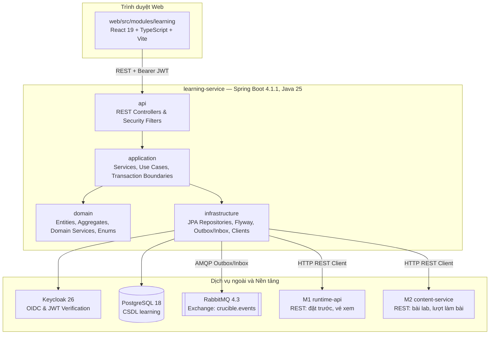
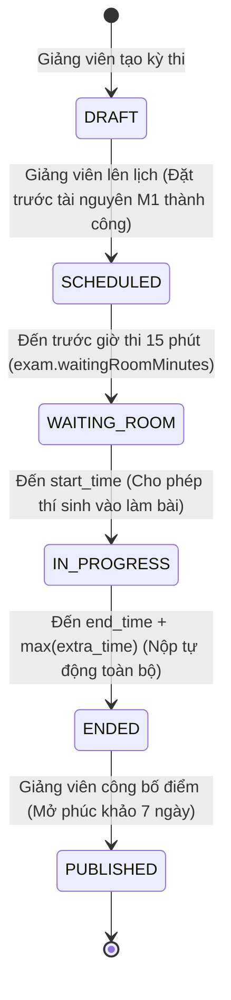
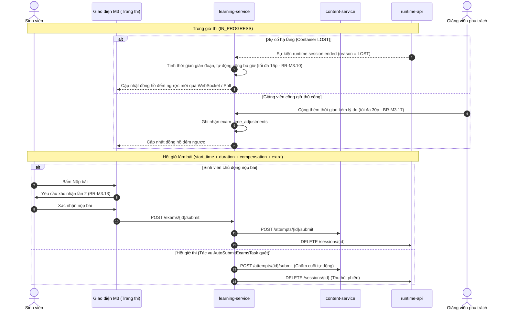
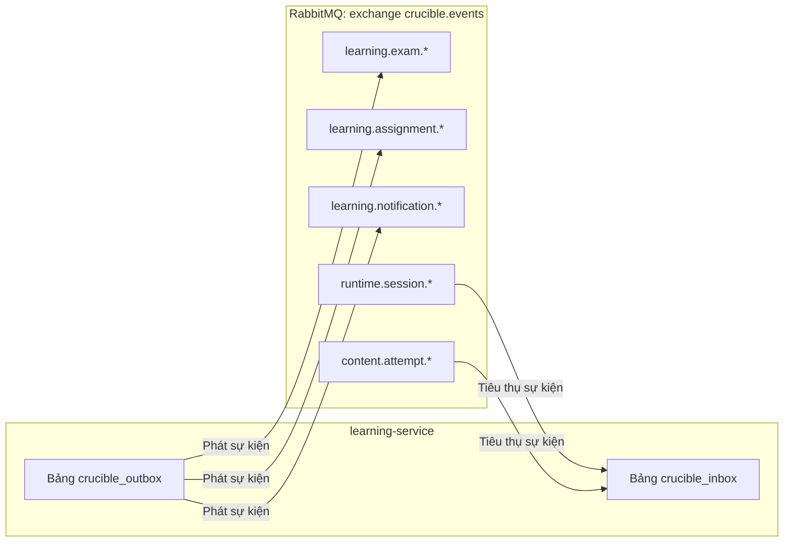
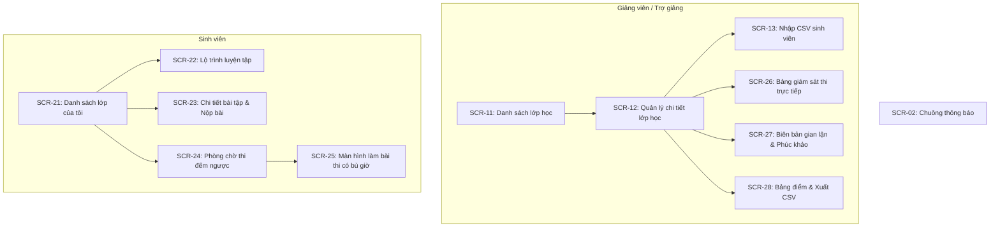

# Thiết kế module M3 — Học tập và kỳ thi

| Thuộc tính | Giá trị |
|---|---|
| Mã tài liệu | CR-MOD-M3 |
| Phiên bản | 1.0 |
| Ngày ban hành | 04/11/2026 |
| Người phụ trách | `quanpva62` |
| Tài liệu liên quan | CR-DOC-01 mục 5.3, 7.3; CR-DOC-02; CR-DOC-03; CR-DOC-04; CR-DOC-10; CR-DOC-11; ADR-0001, ADR-0004, ADR-0005, ADR-0010, ADR-0012, ADR-0013 |

---

## 1. Phạm vi và trách nhiệm

Module M3 (`learning-service`) chịu trách nhiệm tổ chức không gian học tập, lộ trình rèn luyện kỹ năng, quản lý bài tập
và điều phối các kỳ thi thực hành trực tuyến có kiểm soát đồng loạt cho các học phần quản trị hệ thống Linux và mạng.

### 1.1. Chức năng thuộc phạm vi MVP
Module hiện thực đầy đủ các chức năng từ L01 đến L16 theo CR-DOC-01 mục 5.3:

* **L01 — Quản lý lớp học và thành viên:** Tạo lớp học; nhập danh sách sinh viên qua CSV (mã sinh viên, họ tên, email);
  tự động liên kết tài khoản sinh viên đăng nhập lần đầu qua email trường; phân quyền giảng viên phụ trách và trợ giảng.
* **L02 — Lộ trình luyện tập:** Tạo chuỗi bài lab có quan hệ tiên quyết (bài sau mở khi bài trước đạt ngưỡng điểm quy định);
  không giới hạn số lượt làm bài; không tính vào điểm tổng kết học phần; giảng viên theo dõi tiến độ hoàn thành của lớp.
* **L03 — Bài tập thực hành:** Giao bài lab cho lớp có thời hạn nộp (`dueAt`), giới hạn số lượt làm bài; ghi nhận điểm cao
  nhất của các lượt làm bài hợp lệ; chính sách nộp muộn (từ chối hoặc cho phép nộp muộn có trừ điểm theo ngày); cấp gia hạn
  riêng cho từng sinh viên kèm lý do; cảnh báo quá tải sức chứa khi giao hoặc sửa hạn nộp bài.
* **L04 — Kỳ thi thực hành:** Cố định phiên bản bài lab; khung thời gian bắt đầu và kết thúc chung; hạn chót được vào thi
  (`entryDeadline`); chế độ phản hồi khi kiểm tra bước (đầy đủ, chỉ điểm, hoặc ẩn hoàn toàn); bật/tắt gợi ý; bắt đầu đồng
  loạt và tự động nộp bài khi hết giờ.
* **L05 — Đặt trước tài nguyên:** Tự động tạo yêu cầu đặt trước tài nguyên sang M1 (`runtime-api`) khi lên lịch kỳ thi;
  tự động đồng bộ số chỗ theo sĩ số lớp tới khi kỳ thi kết thúc.
* **L06 — Bù giờ và cộng giờ thi:** Bù giờ tự động khi phiên thi của sinh viên bị gián đoạn do sự cố hạ tầng (`LOST`);
  giảng viên phụ trách cộng giờ thi trực tiếp cho sinh viên trong khi thi; trợ giảng gửi đề xuất cộng giờ để giảng viên duyệt;
  áp dụng trần giới hạn bù giờ và ghi nhật ký kiểm toán.
* **L07 — Giám sát kỳ thi trực tiếp:** Bảng theo dõi thời gian thực tiến độ từng thí sinh theo lần chấm ngầm gần nhất;
  xem trực tiếp màn hình terminal của sinh viên qua vé xem của M1; cảnh báo phiên thi vượt ngưỡng tải CPU.
* **L08 — Xem lại bản ghi phiên:** Giảng viên phụ trách và trợ giảng xem toàn bộ bản ghi phiên thi của lớp; sinh viên chỉ
  được xem lại bản ghi phiên của chính mình sau khi điểm thi được công bố chính thức.
* **L09 & L13 — Tín hiệu gian lận và xử lý vi phạm:** Thu thập và phát hiện các dấu hiệu bất thường (nhập giá trị biến thể
  của sinh viên khác `VARIANT_LEAK`, chuỗi lệnh tương đồng, kết nối từ hai IP cùng lúc, dán khối lượng lệnh lớn); giảng viên
  lập biên bản xử lý với kết luận `DISMISSED` (bác bỏ), `WARNED` (nhắc nhở), hoặc `VOIDED` (hủy bài, 0 điểm).
* **L10 — Bảng điểm lớp:** Tổng hợp điểm bài tập và điểm thi của toàn bộ sinh viên trong lớp; hỗ trợ xuất bảng điểm ra tệp CSV.
* **L11 & L14 — Công bố điểm và phúc khảo:** Giảng viên công bố điểm kỳ thi; sinh viên xem điểm từng bước; sinh viên gửi yêu
  cầu phúc khảo trong thời hạn quy định (mặc định 7 ngày); trợ giảng góp ý, giảng viên phụ trách giải quyết và điều chỉnh điểm.
* **L15 — Thông báo và gửi email:** Gửi thông báo trong ứng dụng cho người dùng; phát sự kiện outbox yêu cầu gửi email cho
  các sự kiện quan trọng (mở bài tập, nhắc hạn nộp, lịch thi, công bố điểm).
* **L16 — Phòng chờ thi:** Mở phòng chờ trước giờ thi 15 phút: phổ biến quy chế, đếm ngược đồng bộ, cho phép chạy thử môi
  trường kiểm tra kết nối mạng và hiển thị terminal.
* **L12 — Quản lý hạn mức giờ máy của lớp:** Giảng viên phân bổ hạn mức giờ máy cho từng lớp từ trần hạn mức được cấp.

### 1.2. Phạm vi mở rộng (sau MVP)
* Kỳ thi gồm nhiều bài lab phối hợp.
* Nền tảng dịch vụ đa đơn vị đào tạo (multi-tenant theo ADR-0013) dùng chung hạ tầng.

---

## 2. Thành phần triển khai

Module M3 được triển khai dưới dạng dịch vụ backend `learning-service` và gói giao diện trong `web/src/modules/learning`:



### 2.1. Chi tiết các thành phần

| Thành phần | Công nghệ | Trách nhiệm | Số bản sao |
|---|---|---|---|
| `learning-service` | Spring Boot 4.1.1, Java 25 (tương thích JDK 21 qua `-PjavaVersion=21`) | Quản lý nghiệp vụ lớp học, bài tập, kỳ thi, gian lận, phúc khảo, bảng điểm, thông báo; điều phối lịch trình qua ShedLock | 1 bản (MVP); sẵn sàng mở rộng nhiều bản nhờ ShedLock |
| Giao diện M3 | React 19, TypeScript strict, TanStack Query, Tailwind CSS, Lucide | Các màn hình quản lý lớp học, lộ trình, phòng chờ, làm bài thi, giám sát thi trực tiếp, bảng điểm | Đóng gói chung trong container `web` |
| CSDL `learning` | PostgreSQL 18 | Lưu trữ toàn bộ thực thể nghiệp vụ, bảng lịch trình ShedLock, bảng outbox và inbox | 1 bản |
| Thư viện nền tảng | `crucible-platform` (`libs/java/crucible-platform`) | Cung cấp hạ tầng transactional outbox/inbox, xử lý CloudEvents qua RabbitMQ, cấu hình Resource Server xác thực Keycloak JWT | Tích hợp dưới dạng thư viện nhúng |

---

## 3. Mô hình dữ liệu

### 3.1. Sơ đồ thực thể liên kết (ERD)

```mermaid
erDiagram
    classes ||--o{ class_members : has
    classes ||--o{ learning_paths : defines
    classes ||--o{ assignments : contains
    classes ||--o{ exams : organizes
    learning_paths ||--o{ learning_path_items : contains
    learning_path_items ||--o| learning_path_items : prerequisite
    assignments ||--o{ assignment_extensions : grants
    exams ||--o{ exam_time_adjustments : logs
    exams ||--o{ cheating_signals : records
    cheating_signals ||--o| incident_reports : resolved_by
    exams ||--o{ regrade_requests : receives
    classes ||--o{ notifications : triggers

    classes {
        uuid id PK
        varchar code UK "Mã lớp, ví dụ IT4060-2026-1"
        varchar name "Tên lớp học"
        varchar semester "Học kỳ, ví dụ 2026.1"
        varchar instructor_quota_account_ref "Mã tham chiếu hạn mức giảng viên"
        int session_limit_per_student "Giới hạn phiên đồng thời mỗi SV"
        varchar status "ACTIVE, ARCHIVED"
        timestamptz created_at
        timestamptz updated_at
    }

    class_members {
        uuid id PK
        uuid class_id FK
        uuid user_id "Keycloak sub ID"
        varchar role "INSTRUCTOR, TEACHING_ASSISTANT, STUDENT"
        varchar student_id_number "Mã số sinh viên (nullable với GV)"
        varchar full_name "Họ và tên"
        varchar email "Email trường"
        timestamptz created_at
    }

    learning_paths {
        uuid id PK
        uuid class_id FK
        varchar title "Tiêu đề lộ trình"
        text description
        timestamptz created_at
        timestamptz updated_at
    }

    learning_path_items {
        uuid id PK
        uuid path_id FK
        varchar lab_id "Mã bài lab bên M2"
        varchar lab_version "Phiên bản bài lab"
        int item_order "Thứ tự sắp xếp"
        int min_score "Ngưỡng điểm đạt (0-100)"
        uuid prerequisite_item_id FK "Bài lab điều kiện tiên quyết"
        timestamptz created_at
    }

    assignments {
        uuid id PK
        uuid class_id FK
        varchar lab_id
        varchar lab_version
        varchar title
        text description
        timestamptz due_at "Hạn nộp bài chính thức"
        int max_attempts "Số lượt làm bài tối đa"
        varchar late_policy "REJECT, ALLOW_LATE"
        numeric late_penalty_per_day "Tỉ lệ trừ điểm mỗi ngày muộn (0.0 - 1.0)"
        int max_late_days "Số ngày nộp muộn tối đa cho phép"
        varchar status "DRAFT, PUBLISHED, CLOSED"
        timestamptz created_at
        timestamptz updated_at
    }

    assignment_extensions {
        uuid id PK
        uuid assignment_id FK
        uuid user_id "Sinh viên được gia hạn"
        timestamptz extended_due_at "Hạn nộp mới"
        text reason "Lý do gia hạn"
        uuid granted_by "Giảng viên cấp gia hạn"
        timestamptz created_at
    }

    exams {
        uuid id PK
        uuid class_id FK
        varchar lab_id
        varchar lab_version
        varchar title
        text description
        timestamptz start_time "Giờ bắt đầu thi"
        timestamptz end_time "Giờ kết thúc thi chung"
        timestamptz entry_deadline "Hạn chót cho phép vào thi"
        varchar feedback_mode "FULL, SCORE_ONLY, HIDDEN"
        boolean hints_enabled "Cho phép mở gợi ý hay không"
        varchar reservation_id "Mã đặt trước tài nguyên bên M1"
        varchar status "DRAFT, SCHEDULED, WAITING_ROOM, IN_PROGRESS, ENDED, PUBLISHED"
        timestamptz created_at
        timestamptz updated_at
    }

    exam_time_adjustments {
        uuid id PK
        uuid exam_id FK
        uuid user_id "Sinh viên được điều chỉnh"
        varchar adjustment_type "AUTO_COMPENSATION, INSTRUCTOR_EXTRA"
        int minutes "Số phút bù/cộng"
        text reason "Lý do bù hoặc cộng giờ"
        uuid approved_by "Giảng viên phê duyệt"
        uuid proposed_by "Trợ giảng đề xuất (nullable)"
        timestamptz created_at
    }

    cheating_signals {
        uuid id PK
        uuid exam_id FK
        uuid user_id FK
        varchar signal_type "VARIANT_LEAK, COMMAND_SIMILARITY, DUAL_IP, LARGE_PASTE"
        jsonb details "Chi tiết tín hiệu gian lận"
        timestamptz created_at
    }

    incident_reports {
        uuid id PK
        uuid cheating_signal_id FK "nullable nếu GV tự lập"
        uuid exam_id FK
        uuid user_id FK
        varchar conclusion "DISMISSED, WARNED, VOIDED"
        text reason "Lý do kết luận"
        uuid created_by "Giảng viên lập biên bản"
        timestamptz created_at
    }

    regrade_requests {
        uuid id PK
        uuid exam_id FK
        uuid user_id FK
        int step_index "Bước cần phúc khảo (-1 nếu toàn bài)"
        text reason "Lý do sinh viên khiếu nại"
        varchar status "PENDING, REVIEWED, RESOLVED"
        int original_score "Điểm cũ"
        int new_score "Điểm mới (nullable)"
        text reviewer_comment "Ý kiến trợ giảng / phản hồi GV"
        uuid resolved_by "Giảng viên xử lý"
        timestamptz created_at
        timestamptz updated_at
    }

    notifications {
        uuid id PK
        uuid user_id "Người nhận"
        varchar title
        text message
        varchar type "ASSIGNMENT_DUE, EXAM_REMINDER, REGRADE_RESULT, CHEATING_INCIDENT"
        boolean is_read
        jsonb metadata
        timestamptz created_at
    }
```



### 3.2. Ràng buộc và Chỉ mục quan trọng
1. `class_members`:
   * `UNIQUE (class_id, email)`: Một email chỉ thuộc một vai trò trong một lớp.
   * `UNIQUE (class_id, student_id_number)`: Mã số sinh viên không được trùng trong cùng một lớp.
   * `INDEX idx_class_members_user (user_id)`: Tra cứu nhanh các lớp học của người dùng khi đăng nhập.
2. `assignments` & `assignment_extensions`:
   * `UNIQUE (assignment_id, user_id)` trên `assignment_extensions`: Mỗi sinh viên chỉ có tối đa một bản gia hạn riêng cho mỗi bài tập.
   * `INDEX idx_assignments_due (due_at, status)`: Phục vụ tác vụ định kỳ quét bài tập hết hạn.
3. `exams`:
   * `INDEX idx_exams_lifecycle (start_time, end_time, status)`: Phục vụ tác vụ định kỳ chuyển trạng thái phòng chờ, bắt đầu, kết thúc và nộp bài tự động.
4. `exam_time_adjustments`:
   * `INDEX idx_exam_adjustments_user (exam_id, user_id)`: Tính toán tổng thời gian bù tự động và cộng giờ thủ công của từng sinh viên trong phòng thi.
5. `regrade_requests`:
   * `UNIQUE (exam_id, user_id)`: Mỗi sinh viên chỉ được gửi duy nhất 1 yêu cầu phúc khảo cho một kỳ thi (AC-L3.5).
6. Bảng hỗ trợ nền tảng:
   * `shedlock`: Quản lý khóa phân tán (`name VARCHAR(64) PRIMARY KEY, lock_until TIMESTAMPTZ, locked_at TIMESTAMPTZ, locked_by VARCHAR(255)`).
   * `crucible_outbox` và `crucible_inbox`: Lưu sự kiện đảm bảo nguyên tắc Exactly-Once / At-Least-Once qua Transactional Outbox.

---

## 4. Quy tắc nghiệp vụ và máy trạng thái

### 4.1. Máy trạng thái Kỳ thi (`ExamStatus`)



### 4.2. Luồng nộp bài và bù giờ thi



### 4.3. Bảng quy tắc nghiệp vụ (`BR-M3.*`)

| Mã | Quy tắc | Tiêu chí chấp nhận liên quan |
|---|---|---|
| **BR-M3.01** | **Điều kiện mở bài lab trong lộ trình:** Sinh viên chỉ bắt đầu được bài lab khi thuộc danh sách lớp và đã đạt ngưỡng điểm `min_score` của bài lab tiên quyết (`prerequisite_item_id`). Nếu chưa đạt, trả về lỗi 403 `PREREQUISITE_NOT_MET`. | `AC-L1.1` |
| **BR-M3.02** | **Chính sách hạn nộp bài tập:** Bài tập quá hạn (tính theo `dueAt` cộng thời gian gia hạn riêng nếu có) không cho phép tạo lượt làm bài mới (409 `ASSIGNMENT_CLOSED`), trừ trường hợp `late_policy = ALLOW_LATE` và còn trong số ngày `max_late_days`. Lượt làm bài đang diễn ra tại thời điểm hết hạn cuối cùng sẽ bị tự động nộp. | `AC-L1.2` |
| **BR-M3.03** | **Giới hạn số lượt làm bài tập:** Tổng số lượt làm bài của sinh viên không vượt quá `max_attempts`. Trường hợp có nhiều yêu cầu bắt đầu đồng thời, sử dụng khóa lạc quan / ràng buộc CSDL để từ chối các yêu cầu vượt hạn mức. | `AC-L1.3` |
| **BR-M3.04** | **Tính điểm bài tập:** Điểm bài tập là điểm cao nhất trong các lượt làm bài đã chấm cuối, sau khi đã trừ tỷ lệ điểm nộp muộn: `Điểm = Điểm gốc * (1 - số ngày muộn * late_penalty_per_day)`. | `AC-L1.4` |
| **BR-M3.05** | **Xử lý tệp danh sách lớp CSV:** Khi tải lên CSV, hệ thống kiểm tra và báo lỗi chi tiết theo từng dòng (thiếu cột, email sai định dạng RFC 5322, trùng mã sinh viên trong tệp hoặc trong lớp). Sinh viên có email trong danh sách khi đăng nhập qua Keycloak lần đầu tiên sẽ tự động được gán vào lớp tương ứng. | `AC-L1.5` |
| **BR-M3.06** | **Cảnh báo sức chứa khi giao bài tập:** Khi tạo hoặc đổi hạn nộp bài tập, hệ thống ước tính số phiên đồng thời cao điểm trong 3 giờ trước hạn nộp (`ước tính = 0.5 * sĩ số lớp`). Nếu vượt quá số chỗ trống của hệ thống trong khung giờ đó hoặc vượt hạn mức phiên đồng thời của lớp, hệ thống hiển thị cảnh báo kèm số liệu; bài tập vẫn được lưu nếu giảng viên xác nhận tiếp tục. | `AC-L1.6` |
| **BR-M3.07** | **Đặt trước tài nguyên khi lên lịch kỳ thi:** Khi lên lịch kỳ thi, M3 gọi M1 (`POST /reservations`) để đặt trước số container bằng sĩ số lớp trong khung giờ thi. Nếu không đủ sức chứa, M1 trả về 409 `CAPACITY_UNAVAILABLE`. M3 hiển thị số chỗ cần, số chỗ còn và gợi ý tối đa 3 khung giờ gần nhất có đủ chỗ trong khoảng 07:00–21:00. | `AC-L2.1` |
| **BR-M3.08** | **Cấp phiên đồng loạt khi vào thi:** Kỳ thi bắt đầu đồng loạt, các yêu cầu tạo phiên thi được gán ưu tiên `EXAM` và sử dụng hạn mức đặt trước của kỳ thi, đảm bảo 30 sinh viên bắt đầu cùng một phút đều được cấp phiên với p95 ≤ 10 giây. | `AC-L2.2` |
| **BR-M3.09** | **Tự động nộp bài và thu hồi phiên khi hết giờ thi:** Khi sinh viên hết thời gian làm bài (đã cộng bù giờ và cộng giờ riêng), M3 tự động gọi M2 chấm cuối lượt làm bài và gọi M1 thu hồi phiên thực hành. | `AC-L2.3` |
| **BR-M3.10** | **Bù giờ tự động khi có sự cố hạ tầng:** Nếu phiên thi của sinh viên kết thúc với lý do `LOST` (mất máy phiên, lỗi hạ tầng gVisor), hệ thống tự động ghi nhận thời gian gián đoạn và bù thêm vào thời gian làm bài của sinh viên đó, tối đa không quá 15 phút (`exam.autoCompensationMaxMinutes`). Mỗi lần bù đều ghi log kiểm toán. | `AC-L2.4` |
| **BR-M3.11** | **Bảo mật quan sát kỳ thi và xem lại bản ghi:** Trong thời gian thi, chỉ giảng viên phụ trách và trợ giảng của lớp mới có quyền lấy vé xem trực tiếp terminal và xem bản ghi. Sinh viên chỉ được xem lại bản ghi phiên của chính mình sau khi kỳ thi đã được công bố điểm chính thức. | `AC-L2.5`, `AC-L2.9` |
| **BR-M3.12** | **Khóa vào thi sau hạn chót:** Sinh viên cố gắng bắt đầu làm bài thi sau thời điểm `entry_deadline` sẽ bị từ chối với mã 409 `EXAM_ENTRY_CLOSED`. | `AC-L2.7` |
| **BR-M3.13** | **Xác nhận 2 lần khi nộp bài thi sớm:** Sinh viên nộp bài thi trước giờ kết thúc bắt buộc phải bấm xác nhận qua hộp thoại cảnh báo 2 lần. Sau khi nộp, lượt bài lập tức được chấm cuối, phiên bị thu hồi và sinh viên không thể quay lại làm bài. | `AC-L2.8` |
| **BR-M3.14** | **Bảng giám sát thi thời gian thực:** Màn hình giám sát của giảng viên hiển thị trạng thái làm bài và điểm từng bước của sinh viên dựa trên kết quả chấm ngầm định kỳ của M2, ngay cả khi kỳ thi đặt chế độ ẩn phản hồi (`HIDDEN`) đối với thí sinh. | `AC-L2.6` |
| **BR-M3.15** | **Hiển thị cảnh báo tài nguyên phiên thi:** Khi nhận sự kiện `runtime.session.resource-alert` từ M1 (container vượt ngưỡng CPU/bộ nhớ), hệ thống hiển thị huy hiệu cảnh báo trên dòng của sinh viên đó tại màn hình giám sát trong vòng 30 giây. Cảnh báo này chỉ mang tính kỹ thuật, không coi là gian lận và không ảnh hưởng điểm số. | `AC-L2.10` |
| **BR-M3.16** | **Khôi phục khi phiên thi bị dừng bất thường:** Nếu phiên thi bị dừng với lý do `OUT_OF_MEMORY` hoặc `ENVIRONMENT_FAILED` khi sinh viên chưa nộp bài, sinh viên được phép tạo phiên mới để tiếp tục thi trong quỹ thời gian còn lại. Môi trường mới được khôi phục tới các bước đã đạt theo lần chấm ngầm gần nhất; đồng hồ thi không tạm dừng và không được bù giờ tự động. | `AC-L2.11` |
| **BR-M3.17** | **Giảng viên cộng giờ thi thủ công:** Trong khi thi, giảng viên phụ trách có quyền cộng thêm thời gian cho sinh viên chưa nộp bài kèm lý do bắt buộc; tổng thời gian cộng tối đa không quá 30 phút (`exam.extraTimeMaxMinutes`). Trợ giảng có quyền tạo đề xuất cộng giờ để giảng viên duyệt hoặc từ chối. Mọi thao tác đều được ghi nhật ký kiểm toán. | `AC-L2.12` |
| **BR-M3.18** | **Đồng bộ số chỗ đặt trước khi sĩ số lớp thay đổi:** Khi danh sách sinh viên lớp thay đổi trước khi kỳ thi kết thúc, M3 tự động cập nhật số container đặt trước sang M1. Nếu M1 không đủ chỗ, sinh viên vẫn được thêm vào lớp, số chỗ giữ nguyên và giảng viên nhận cảnh báo kèm nút thử lại. Thí sinh vượt hạn mức đặt trước sẽ được cấp phiên từ tài nguyên chung với ưu tiên `EXAM`. | `AC-L2.13` |
| **BR-M3.19** | **Phát hiện tín hiệu gian lận:** Hệ thống ghi nhận tín hiệu `VARIANT_LEAK` khi sinh viên nhập giá trị biến thể thuộc đề của sinh viên khác trong cùng kỳ thi; ghi nhận tín hiệu khi phát hiện 2 kết nối terminal từ 2 IP khác nhau hoặc hành vi dán khối lượng lệnh bất thường. | `AC-L3.1` |
| **BR-M3.20** | **Xử lý vi phạm và lập biên bản:** Tín hiệu gian lận không tự động thay đổi điểm số. Giảng viên phụ trách xem xét bằng chứng và lập biên bản với một trong ba kết luận: `DISMISSED` (bác bỏ), `WARNED` (nhắc nhở giữ nguyên điểm), hoặc `VOIDED` (hủy bài, điểm 0). Khi chọn `VOIDED`, M3 gọi M2 điều chỉnh điểm về 0 và thông báo cho sinh viên. | `AC-L3.2`, `AC-L3.4` |
| **BR-M3.21** | **Điều chỉnh điểm và lưu vết kiểm toán:** Mọi thay đổi điểm số do lập biên bản hoặc xử lý phúc khảo đều phải ghi nhận đầy đủ điểm cũ, điểm mới, người điều chỉnh, thời điểm và lý do. | `AC-L3.3` |
| **BR-M3.22** | **Tiếp nhận và giải quyết phúc khảo:** Sinh viên chỉ được gửi duy nhất 1 đơn phúc khảo cho mỗi bài thi trong thời hạn quy định (mặc định 7 ngày sau khi công bố điểm). Yêu cầu gửi quá hạn hoặc gửi lần thứ hai sẽ bị từ chối với mã 409 `REGRADE_NOT_ALLOWED`. Trợ giảng ghi nhận ý kiến, giảng viên phụ trách ra quyết định phê duyệt hoặc từ chối. | `AC-L3.5` |
| **BR-M3.23** | **Quản trị tham số hệ thống M3:** Chỉ người dùng có vai trò `ADMIN` mới có quyền xem và điều chỉnh các tham số hệ thống (`exam.maxDurationMinutes`, `exam.autoCompensationMaxMinutes`, `exam.extraTimeMaxMinutes`, `exam.waitingRoomMinutes`, `regrade.defaultWindowDays`). Các kỳ thi đã lên lịch sẽ giữ nguyên giá trị cấu hình tại thời điểm lên lịch. | `AC-P1.1` – `AC-P1.4` |
| **BR-M3.24** | **Hỗ trợ đa ngôn ngữ:** Toàn bộ nội dung email thông báo và thông báo giao diện phải có đầy đủ bản dịch tiếng Việt và tiếng Anh, gửi đi dựa trên thuộc tính ngôn ngữ `locale` lưu trong tài khoản người nhận. | `AC-P2.1`, `AC-P2.2` |
| **BR-M3.25** | **Phòng chờ kỳ thi:** Phòng chờ mở tự động trước giờ thi 15 phút. Thí sinh trong phòng chờ được xem quy chế thi, đồng hồ đếm ngược đồng bộ theo giờ máy chủ, và được cấp 1 phiên thử nghiệm ngắn để kiểm tra kết nối Web Terminal trước giờ làm bài. | `L16` |
| **BR-M3.26** | **Hạn mức giờ máy của lớp:** Giảng viên phân bổ hạn mức giờ máy cho từng lớp học nằm trong trần hạn mức cá nhân do quản trị viên cấp. Dịch vụ M3 chỉ được phép ghi hạn mức của lớp mình quản lý. | `L12`, `AC-R2.8` |

---

## 5. API cho giao diện

Các API nội bộ phục vụ giao diện người dùng (định dạng JSON theo chuẩn RFC 9457 khi báo lỗi):

| Phương thức | Đường dẫn | Quyền truy cập | Mô tả |
|---|---|---|---|
| `GET` | `/api/v1/classes` | `STUDENT`, `INSTRUCTOR` | Lấy danh sách lớp học của người dùng hiện tại |
| `POST` | `/api/v1/classes` | `INSTRUCTOR`, `ADMIN` | Tạo lớp học mới và thiết lập hạn mức giờ máy |
| `GET` | `/api/v1/classes/{classId}` | Thành viên lớp | Lấy thông tin chi tiết lớp học |
| `GET` | `/api/v1/classes/{classId}/members` | Thành viên lớp | Lấy danh sách thành viên trong lớp |
| `POST` | `/api/v1/classes/{classId}/members/import-csv` | `INSTRUCTOR` | Tải lên tệp CSV nhập danh sách sinh viên |
| `POST` | `/api/v1/classes/{classId}/instructors` | `INSTRUCTOR` | Thêm giảng viên hoặc trợ giảng vào lớp |
| `GET` | `/api/v1/classes/{classId}/learning-paths` | Thành viên lớp | Lấy danh sách lộ trình luyện tập của lớp |
| `POST` | `/api/v1/classes/{classId}/learning-paths` | `INSTRUCTOR` | Tạo lộ trình luyện tập mới |
| `POST` | `/api/v1/learning-paths/{pathId}/items` | `INSTRUCTOR` | Thêm bài lab và điều kiện tiên quyết vào lộ trình |
| `GET` | `/api/v1/classes/{classId}/assignments` | Thành viên lớp | Lấy danh sách bài tập của lớp |
| `POST` | `/api/v1/classes/{classId}/assignments` | `INSTRUCTOR` | Giao bài tập mới (có kiểm tra cảnh báo sức chứa) |
| `POST` | `/api/v1/assignments/{id}/extensions` | `INSTRUCTOR` | Cấp gia hạn nộp bài riêng cho sinh viên |
| `POST` | `/api/v1/assignments/{id}/start` | `STUDENT` | Bắt đầu làm bài tập (tạo lượt làm bài qua M2) |
| `GET` | `/api/v1/classes/{classId}/exams` | Thành viên lớp | Lấy danh sách kỳ thi của lớp |
| `POST` | `/api/v1/classes/{classId}/exams` | `INSTRUCTOR` | Lên lịch kỳ thi mới (đặt trước tài nguyên với M1) |
| `GET` | `/api/v1/exams/{id}` | Thành viên lớp | Lấy chi tiết kỳ thi |
| `GET` | `/api/v1/exams/{id}/waiting-room` | Sinh viên dự thi | Truy cập phòng chờ thi trước 15 phút |
| `POST` | `/api/v1/exams/{id}/start` | Sinh viên dự thi | Bắt đầu làm bài thi |
| `POST` | `/api/v1/exams/{id}/submit` | Sinh viên dự thi | Nộp bài thi (yêu cầu xác nhận hai lần) |
| `GET` | `/api/v1/exams/{id}/monitor` | `INSTRUCTOR`, Trợ giảng | Lấy dữ liệu bảng giám sát thi thời gian thực |
| `GET` | `/api/v1/exams/{id}/watch-ticket` | `INSTRUCTOR`, Trợ giảng | Lấy vé xem trực tiếp terminal của thí sinh từ M1 |
| `POST` | `/api/v1/exams/{id}/time-adjustments` | `INSTRUCTOR`, Trợ giảng | Cộng giờ thi thủ công hoặc gửi đề xuất cộng giờ |
| `POST` | `/api/v1/exams/{id}/publish` | `INSTRUCTOR` | Công bố điểm kỳ thi chính thức cho cả lớp |
| `GET` | `/api/v1/exams/{id}/cheating-signals` | `INSTRUCTOR`, Trợ giảng | Xem danh sách tín hiệu nghi vấn gian lận |
| `POST` | `/api/v1/exams/{id}/incident-reports` | `INSTRUCTOR` | Lập biên bản xử lý vi phạm gian lận |
| `POST` | `/api/v1/exams/{id}/regrade-requests` | `STUDENT` | Gửi đơn khiếu nại phúc khảo bài thi |
| `PUT` | `/api/v1/regrade-requests/{id}` | `INSTRUCTOR`, Trợ giảng | Trợ giảng góp ý / Giảng viên duyệt đơn phúc khảo |
| `GET` | `/api/v1/classes/{classId}/gradebook` | `INSTRUCTOR`, Trợ giảng | Xem bảng điểm tổng hợp của cả lớp |
| `GET` | `/api/v1/classes/{classId}/gradebook/export-csv`| `INSTRUCTOR`, Trợ giảng | Xuất bảng điểm lớp ra tệp CSV |
| `GET` | `/api/v1/notifications` | Mọi người dùng | Lấy danh sách thông báo của người dùng hiện tại |
| `PUT` | `/api/v1/notifications/{id}/read` | Mọi người dùng | Đánh dấu thông báo đã đọc |
| `GET` | `/api/v1/settings/learning` | `ADMIN` | Xem danh sách tham số hệ thống của M3 |
| `PUT` | `/api/v1/settings/learning` | `ADMIN` | Cập nhật tham số hệ thống của M3 |

---

## 6. Sự kiện giữa các module (AsyncAPI)

Giao tiếp bất đồng bộ qua RabbitMQ tuân thủ chuẩn CloudEvents 1.0 và cơ chế Transactional Outbox/Inbox của `crucible-platform`:



### 6.1. Sự kiện M3 phát ra

| Sự kiện | Routing Key | Mô tả nghiệp vụ |
|---|---|---|
| `learning.exam.scheduled` | `learning.exam.scheduled` | Phát ra khi kỳ thi được lên lịch thành công kèm mã đặt trước tài nguyên |
| `learning.exam.started` | `learning.exam.started` | Phát ra khi kỳ thi chính thức bắt đầu chuyển sang `IN_PROGRESS` |
| `learning.exam.ended` | `learning.exam.ended` | Phát ra khi kỳ thi kết thúc, kích hoạt nộp bài tự động diện rộng |
| `learning.exam.published` | `learning.exam.published` | Phát ra khi giảng viên công bố điểm thi, mở cổng phúc khảo |
| `learning.assignment.created`| `learning.assignment.created` | Phát ra khi bài tập mới được giao cho lớp |
| `learning.notification.email-requested` | `learning.notification.email-requested` | Yêu cầu gửi email thông báo quan trọng đến sinh viên |

### 6.2. Sự kiện M3 lắng nghe và xử lý

| Sự kiện nhận | Nguồn phát | Hành động xử lý của M3 |
|---|---|---|
| `runtime.session.ended` | M1 `runtime-api` | Nếu phiên thi kết thúc với lý do `LOST` và kỳ thi đang diễn ra: tính thời gian gián đoạn và tự động bù giờ cho thí sinh (`BR-M3.10`). Nếu kết thúc vì `OUT_OF_MEMORY`, cho phép tạo phiên mới tiếp tục (`BR-M3.16`). |
| `runtime.session.resource-alert` | M1 `runtime-api` | Ghi nhận cảnh báo tài nguyên và gửi WebSocket cập nhật lên màn hình giám sát thi của giảng viên trong vòng ≤ 30 giây (`BR-M3.15`). |
| `content.attempt.submitted` | M2 `content-service` | Ghi nhận bài làm đã nộp; cập nhật điểm số vào bảng điểm bài tập hoặc kỳ thi. |
| `content.attempt.scored` | M2 `content-service` | Lắng nghe kết quả chấm ngầm định kỳ trong lúc thi để cập nhật tiến độ làm bài lên bảng giám sát thi (`BR-M3.14`). |

---

## 7. Giao diện người dùng

Các màn hình được hiện thực tại `web/src/modules/learning/` theo ngôn ngữ thiết kế "Bản vẽ kỹ thuật" ([DESIGN.md](file:///d:/!important/pj3/Crucible/DESIGN.md)):



### 7.1. Danh mục màn hình chi tiết

1. **SCR-11 — Danh sách lớp học (Giảng viên):** Thẻ thông tin các lớp đang phụ trách, sĩ số, số bài tập đang mở, nút Tạo lớp mới.
2. **SCR-12 — Chi tiết lớp học (Giảng viên):** Gồm 5 tab chức năng chính:
   * Tab 1: *Lộ trình:* Danh sách các bài lab tiên quyết, kéo thả sắp xếp, cấu hình `min_score`.
   * Tab 2: *Bài tập:* Danh sách bài tập, thời hạn, chính sách phạt muộn, nút Giao bài tập (có popup cảnh báo tải).
   * Tab 3: *Kỳ thi:* Lịch thi, cấu hình phản hồi, nút Lên lịch thi mới.
   * Tab 4: *Thành viên:* Danh sách giảng viên, trợ giảng, sinh viên; nút Thêm thành viên và nút Nhập CSV.
   * Tab 5: *Bảng điểm:* Bảng tổng hợp điểm các cột kiểm tra.
3. **SCR-13 — Nhập sinh viên từ CSV:** Khu vực kéo thả tệp CSV, bảng xem trước danh sách hợp lệ và danh sách báo lỗi chi tiết theo dòng.
4. **SCR-21 — Danh sách lớp học (Sinh viên):** Các lớp sinh viên đã được ghi danh kèm tiến độ tổng thể.
5. **SCR-22 — Lộ trình luyện tập (Sinh viên):** Dạng sơ đồ cây các bài lab rèn luyện; bài chưa đạt điều kiện tiên quyết hiển thị biểu tượng ổ khóa kèm ngưỡng điểm yêu cầu.
6. **SCR-23 — Chi tiết bài tập & nộp bài (Sinh viên):** Đề bài, hạn nộp, số lượt làm còn lại, lịch sử các lượt nộp trước và điểm cao nhất đạt được.
7. **SCR-24 — Phòng chờ thi (Waiting Room):** Đồng hồ đếm ngược đồng bộ tới mili-giây, bảng quy chế thi, terminal kiểm tra kết nối mạng mẫu.
8. **SCR-25 — Màn hình làm bài thi:** Thanh trạng thái cố định hiển thị thời gian còn lại, thông báo bù giờ / cộng giờ thời gian thực, nút Nộp bài thi có hộp thoại xác nhận hai lần.
9. **SCR-26 — Giám sát kỳ thi thời gian thực:** Bảng danh sách thí sinh với tiến độ từng bước theo lần chấm ngầm gần nhất; cảnh báo CPU; nút Mở xem trực tiếp terminal.
10. **SCR-27 — Xử lý gian lận & Phúc khảo:** Danh sách tín hiệu nghi vấn, công cụ lập biên bản vi phạm; danh sách đơn khiếu nại phúc khảo và luồng duyệt điểm.
11. **SCR-28 — Bảng điểm & Xuất CSV:** Lưới điểm chi tiết theo thang điểm 10/100, nút tải về tệp `.csv` chuẩn định dạng của trường.
12. **SCR-02 — Chuông thông báo:** Danh sách thông báo đẩy trong ứng dụng, đánh dấu đã đọc.

---

## 8. Tác vụ định kỳ (Scheduled Tasks)

Sử dụng ShedLock với PostgreSQL để đảm bảo các tác vụ chỉ chạy trên đúng một bản ghi khi mở rộng nhiều container:

| Tác vụ | Chu kỳ | Trách nhiệm | Khóa phân tán (ShedLock) |
|---|---|---|---|
| `AutoSubmitExamsTask` | Mỗi 30 giây | Quét các kỳ thi đang `IN_PROGRESS`; với mỗi thí sinh đã hết giờ làm bài (tính cả bù giờ và cộng giờ riêng), gọi M2 nộp bài tự động và gọi M1 thu hồi phiên | `learning_auto_submit_exams` |
| `UpdateExamStatusTask` | Mỗi 1 phút | Chuyển trạng thái kỳ thi từ `SCHEDULED` sang `WAITING_ROOM` (trước 15 phút) và sang `IN_PROGRESS` khi đến giờ thi | `learning_update_exam_status` |
| `CloseOverdueAssignmentsTask` | Mỗi 5 phút | Quét và đóng các bài tập đã quá hạn nộp cuối cùng (hết hạn muộn tối đa) | `learning_close_overdue_assignments` |
| `SyncExamReservationTask` | Mỗi 1 giờ | Kiểm tra và đồng bộ lại số lượng container đặt trước với M1 nếu sĩ số lớp có thay đổi trước giờ thi | `learning_sync_exam_reservations` |
| `SendUpcomingExamRemindersTask`| Mỗi 15 phút | Quét các kỳ thi sắp diễn ra trong 24 giờ tới và gửi email/thông báo nhắc nhở thí sinh | `learning_send_exam_reminders` |

---

## 9. Kế hoạch kiểm thử và bảng truy vết

### 9.1. Các mức kiểm thử
1. **Kiểm thử đơn vị (Unit Tests):** Sử dụng JUnit 5, Mockito kiểm thử các quy tắc nghiệp vụ cô lập trong tầng domain và application (tính điểm phạt muộn, logic bù giờ, kiểm tra điều kiện tiên quyết).
2. **Kiểm thử tích hợp (Integration Tests):** Spring Boot Test kết hợp Testcontainers (PostgreSQL 18, RabbitMQ 4.3), kiểm thử tính toàn vẹn dữ liệu, giao dịch outbox/inbox và cơ chế khóa ShedLock.
3. **Kiểm thử hợp đồng & Client API:** Sử dụng WireMock giả lập các phản hồi của `runtime-api` và `content-service` (mã lỗi 409 `CAPACITY_UNAVAILABLE`, tạo phiên, cấp vé xem).
4. **Kiểm thử giao diện (Frontend Tests):** Vitest + Testing Library kiểm thử hiển thị song ngữ, định dạng giờ theo múi giờ `Asia/Ho_Chi_Minh`, xác nhận 2 lần khi nộp bài.

### 9.2. Bảng truy vết tiêu chí chấp nhận và quy tắc nghiệp vụ

| Tiêu chí | Quy tắc nghiệp vụ | Phương pháp kiểm thử | Tên kiểm thử mong đợi |
|---|---|---|---|
| `AC-L1.1` | `BR-M3.01` | Integration Test | `LearningPathServiceTest.startLab_shouldThrowForbidden_whenPrerequisiteNotMet_AC_L1_1` |
| `AC-L1.2` | `BR-M3.02` | Integration Test | `AssignmentServiceTest.createAttempt_shouldReject_whenOverdueWithoutLatePolicy_AC_L1_2` |
| `AC-L1.3` | `BR-M3.03` | Concurrency Test | `AssignmentServiceTest.createAttempt_shouldEnforceMaxAttempts_underConcurrentRequests_AC_L1_3` |
| `AC-L1.4` | `BR-M3.04` | Unit Test | `AssignmentGradingTest.calculateFinalScore_shouldApplyDailyLatePenaltyCorrectly_AC_L1_4` |
| `AC-L1.5` | `BR-M3.05` | Unit / Integration | `CsvImportServiceTest.importStudents_shouldReportErrorsPerLine_andAssignOnLogin_AC_L1_5` |
| `AC-L1.6` | `BR-M3.06` | Unit Test | `AssignmentCapacityTest.estimatePeakLoad_shouldWarn_whenExceedingCapacity_AC_L1_6` |
| `AC-L2.1` | `BR-M3.07` | Integration (WireMock) | `ExamSchedulingTest.scheduleExam_shouldHandleCapacityUnavailable_andSuggestSlots_AC_L2_1` |
| `AC-L2.2` | `BR-M3.08` | Load Test | `ExamExecutionTest.concurrentStart_30Students_shouldSucceedUnder10Seconds_AC_L2_2` |
| `AC-L2.3` | `BR-M3.09` | Integration Test | `AutoSubmitExamsTaskTest.execute_shouldSubmitAttempts_andTerminateSessions_AC_L2_3` |
| `AC-L2.4` | `BR-M3.10` | Event Integration | `SessionLostEventTest.onSessionLost_shouldCompensateDurationUpTo15Minutes_AC_L2_4` |
| `AC-L2.5` | `BR-M3.11` | Security Test | `ExamMonitoringSecurityTest.getWatchTicket_shouldRejectStudent_andAllowInstructor_AC_L2_5` |
| `AC-L2.6` | `BR-M3.14` | Integration Test | `ExamMonitoringTest.getMonitorData_shouldReflectLatestBackgroundScoring_AC_L2_6` |
| `AC-L2.7` | `BR-M3.12` | Integration Test | `ExamServiceTest.enterExam_shouldReject_afterEntryDeadline_AC_L2_7` |
| `AC-L2.8` | `BR-M3.13` | Component / E2E | `ExamSubmitDialogTest.submitExam_shouldRequireDoubleConfirmation_AC_L2_8` |
| `AC-L2.9` | `BR-M3.11` | Security Test | `ExamResultSecurityTest.studentCannotViewDetails_untilPublished_AC_L2_9` |
| `AC-L2.10`| `BR-M3.15` | Event Integration | `ResourceAlertEventTest.onResourceAlert_shouldDisplayWarningBadgeWithin30s_AC_L2_10` |
| `AC-L2.11`| `BR-M3.16` | Integration Test | `ExamRecoveryTest.onContainerOom_shouldAllowNewSessionWithRestoredSteps_AC_L2_11` |
| `AC-L2.12`| `BR-M3.17` | Integration Test | `ExamTimeAdjustmentTest.addExtraTime_shouldEnforce30MinutesCap_andLogAudit_AC_L2_12` |
| `AC-L2.13`| `BR-M3.18` | Integration Test | `ClassMemberSyncTest.onMemberAdded_shouldUpdateReservationOrWarnInstructor_AC_L2_13` |
| `AC-L3.1` | `BR-M3.19` | Integration Test | `CheatingDetectionTest.onVariantLeakDetected_shouldCreateCheatingSignal_AC_L3_1` |
| `AC-L3.2` | `BR-M3.20` | Unit Test | `IncidentReportTest.cheatingSignal_shouldNotAlterScoreAutomatically_AC_L3_2` |
| `AC-L3.4` | `BR-M3.20` | Integration Test | `IncidentReportTest.voidReport_shouldSetScoreToZero_andAllowRegrade_AC_L3_4` |
| `AC-L3.3` | `BR-M3.21` | Integration Test | `RegradeServiceTest.adjustScore_shouldPersistAuditHistoryWithReason_AC_L3_3` |
| `AC-L3.5` | `BR-M3.22` | Integration Test | `RegradeServiceTest.submitRequest_shouldRejectDuplicateOrOverdueRequest_AC_L3_5` |
| `AC-P1.1` | `BR-M3.23` | Security Test | `SettingsSecurityTest.onlyAdminCanUpdateSettings_AC_P1_1` |
| `AC-P1.2` | `BR-M3.23` | Unit Test | `SettingsValidationTest.outOfRangeSettings_shouldReturn422_AC_P1_2` |
| `AC-P2.1` | `BR-M3.24` | Unit Test | `NotificationTemplateTest.allTemplatesMustHaveBothViAndEn_AC_P2_1` |

---

## 10. Khả năng quan sát (Observability)

### 10.1. Chỉ số Prometheus (Metrics)
`learning-service` phát các metric nghiệp vụ qua endpoint Spring Boot Actuator `/actuator/prometheus`:

* `crucible_learning_classes_total`: Tổng số lớp học đang hoạt động (`status="ACTIVE"`).
* `crucible_learning_exams_active`: Số kỳ thi đang trong trạng thái `WAITING_ROOM` hoặc `IN_PROGRESS`.
* `crucible_learning_exam_auto_submissions_total`: Số lượt thi bị nộp bài tự động do hết giờ.
* `crucible_learning_time_compensations_total`: Số lần bù giờ tự động do sự cố container `LOST`.
* `crucible_learning_cheating_signals_total`: Số tín hiệu nghi vấn gian lận phát hiện (gắn nhãn `signal_type`).
* `crucible_learning_regrade_requests_total`: Số yêu cầu phúc khảo đã tiếp nhận và giải quyết.

### 10.2. Cấu trúc Nhật ký (Logging)
Nhật ký phát ra dưới dạng JSON có gắn cờ ngữ cảnh OTel `trace_id` để liên kết luồng gọi với M1 và M2:
```json
{
  "timestamp": "2026-11-04T07:15:30.123Z",
  "level": "INFO",
  "logger": "dev.crucible.learning.application.exam.AutoSubmitService",
  "message": "Auto-submitted exam attempt due to time expiration",
  "trace_id": "4bf92f3577b34da6a3ce929d0e0e4736",
  "exam_id": "a1b2c3d4-e5f6-7890-abcd-ef1234567890",
  "user_id": "b2c3d4e5-f6a7-8901-bcde-f12345678901",
  "extra_minutes_applied": 15
}
```

---

## 11. Cấu hình và Tham số hệ thống

### 11.1. Biến môi trường

| Biến môi trường | Ý nghĩa | Mặc định khi phát triển |
|---|---|---|
| `SERVER_PORT` | Cổng HTTP của dịch vụ | `8083` |
| `SPRING_DATASOURCE_URL` | Địa chỉ kết nối CSDL PostgreSQL | `jdbc:postgresql://localhost:5432/crucible_learning` |
| `SPRING_DATASOURCE_USERNAME` | Tên người dùng CSDL | `learning` |
| `SPRING_DATASOURCE_PASSWORD` | Mật khẩu CSDL | `learning-dev-secret` |
| `SPRING_RABBITMQ_HOST` | Địa chỉ máy chủ RabbitMQ | `localhost` |
| `SPRING_RABBITMQ_PORT` | Cổng AMQP | `5672` |
| `CRUCIBLE_RUNTIME_API_URL` | Địa chỉ gọi M1 runtime-api | `http://localhost:8081` |
| `CRUCIBLE_CONTENT_API_URL` | Địa chỉ gọi M2 content-service | `http://localhost:8082` |
| `SPRING_SECURITY_OAUTH2_RESOURCESERVER_JWT_JWK_SET_URI` | Địa chỉ JWKS của Keycloak để kiểm tra token | `http://localhost:8180/realms/crucible/protocol/openid-connect/certs` |

### 11.2. Tham số hệ thống có thể điều chỉnh (`CR-DOC-01 mục 5.6`)

Các tham số được quản trị viên (`ADMIN`) điều chỉnh động trên giao diện mà không cần khởi động lại dịch vụ:

| Khóa tham số | Mô tả nghiệp vụ | Mặc định | Khoảng hợp lệ |
|---|---|---|---|
| `exam.maxDurationMinutes` | Thời lượng tối đa của một kỳ thi (phút) | `180` | `30` – `300` |
| `exam.autoCompensationMaxMinutes` | Trần bù giờ tự động mỗi sinh viên mỗi kỳ thi (phút) | `15` | `0` – `60` |
| `exam.extraTimeMaxMinutes` | Trần cộng giờ thủ công của giảng viên mỗi sinh viên (phút) | `30` | `0` – `120` |
| `exam.waitingRoomMinutes` | Thời gian mở phòng chờ trước giờ thi (phút) | `15` | `5` – `60` |
| `regrade.defaultWindowDays` | Thời hạn tiếp nhận phúc khảo sau khi công bố điểm (ngày) | `7` | `1` – `30` |
| `assignment.capacityWarningPeakFactor` | Hệ số ước tính tải phiên đồng thời trước hạn nộp | `0.5` | `0.1` – `1.0` |
| `assignment.capacityWarningLookaheadHours`| Khoảng thời gian xét cao điểm trước hạn nộp (giờ) | `3` | `1` – `12` |

---

## Lịch sử thay đổi

| Phiên bản | Ngày | Nội dung |
|---|---|---|
| `1.0` | 04/11/2026 | Bản thiết kế chi tiết hoàn chỉnh đầu tiên của module M3 (Issue #39). |
